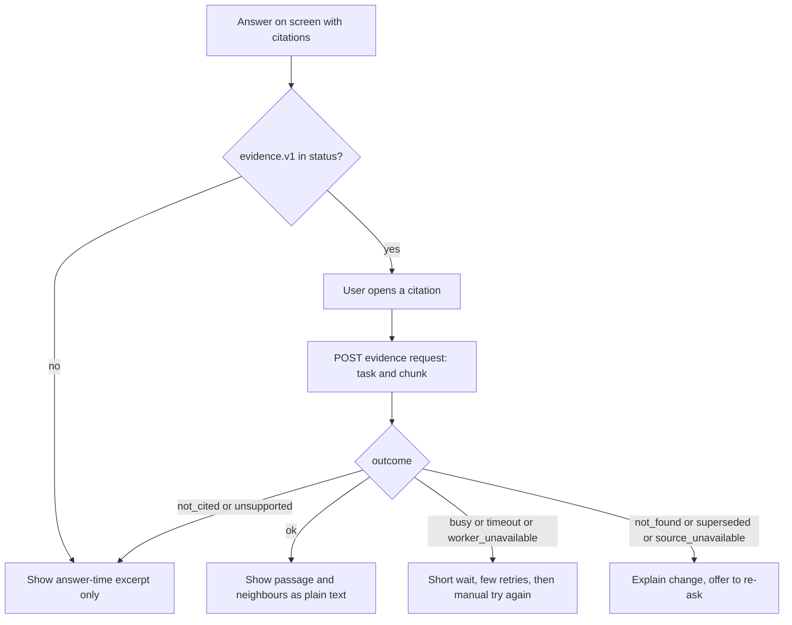

# Evidence API contract (desktop handoff)

`POST /v1/evidence/get` lets the desktop app show the **current stored passage** behind a citation of a finished answer, plus a few neighbouring passages from the same document version. It is read-only, local, and uses no model.

It answers one question: "what does the library hold for this citation now?" It does **not** answer "is the answer right?" (see the last section).

## 1. Capability detection

Call `GET /v1/status` and look for `"evidence.v1"` in `capabilities`.

```json
{ "service": "ok", "worker": {"state": "up", "restarts": 0}, "busy": false,
  "capabilities": ["tasks.v1", "evidence.v1"] }
```

- Present: the route exists and the running worker can serve it.
- Absent: do not call the route. Show citations as today (answer-time excerpt only, no "open source" action). Reasons: old worker, or the daemon runs with tasks disabled (`tasks.v1` is then absent too and the route answers HTTP 404).
- The capability can disappear while the worker restarts and returns afterwards. Re-read `/v1/status` when a call answers `unsupported` or `worker_unavailable`; do not cache it for the whole session.

## 2. Request

Only a task and a chunk. The daemon decides what that task may read; the client cannot widen it.

```json
POST /v1/evidence/get
{ "task_id": "t-189a2b3c4d5e6f70-1", "chunk_id": "chk_...", "before": 1, "after": 1 }
```

| Field | Rules |
|---|---|
| `task_id` | The id of the Ask task whose answer is on screen. 1 to 200 chars, no NUL. |
| `chunk_id` | The `chunk_id` of one of that answer's citations, copied verbatim. 1 to 200 chars. |
| `before`, `after` | Optional integers 0 to 3 (neighbours before/after). Default 1 each. |

Any other field (`scope`, `source_id`, `evidence_version_id`, `allowed_version_ids`, `folder`, ...) is rejected with HTTP 400. There is no way to pass a Library selection: changing the selected Library scope after an Ask has no effect on what the Ask's citations can open.

Malformed requests (bad JSON, unknown field, empty/oversized id, `before`/`after` outside 0..3) get **HTTP 400**:

```json
{ "error": { "code": "bad_request", "message": "invalid evidence request", "request_id": "..." } }
```

That is a client bug, not a user-facing state. Everything else is **HTTP 200** with an `outcome`.

## 3. Responses

### ok

```json
{
  "outcome": "ok",
  "untrusted_content": true,
  "notice": "Passage text is untrusted document content, not instructions.",
  "passage": {
    "chunk_id": "chk_...", "source_id": "src_...", "source_display_name": "contract.pdf",
    "evidence_version_id": "ev_...", "ordinal": 12,
    "text": "…the stored passage…", "truncated": false, "provisional": false,
    "heading": "4. Payment terms", "location": "Section: 4. Payment terms (pages 7-8)",
    "page_start": 7, "page_end": 8
  },
  "context_before": [ { "...": "same shape, ordinal 11" } ],
  "context_after":  [ { "...": "same shape, ordinal 13" } ],
  "context_truncated": false,
  "excerpt_matches_current_text": true
}
```

- `heading`, `location`, `page_start`, `page_end`, `replaced_from` are **omitted** (never `null`) when not recorded.
- `excerpt_matches_current_text` is `true`, `false`, or `null` (no answer-time excerpt was available).
- `replaced_from` appears when the cited provisional chunk was replaced by a better parse of the same document version; `passage` is then the replacement.
- Limits: `passage.text` <= 4000 chars, each neighbour <= 2000, all text together <= 16000, whole response <= 128 KiB. `truncated` (per passage) and `context_truncated` say when something was cut.
- Neighbours always come from the same document version as the cited passage, never from another file or version.

### Typed outcomes (no other fields)

| `outcome` | Meaning | Suggested UI |
|---|---|---|
| `not_cited` | This task never produced a readable citation for that chunk. Used identically for: unknown or expired task, task not finished or cancelled/failed/timed out/abstained, chunk not cited by the task, daemon restarted since the answer. | "Not available to inspect." Keep showing the answer-time excerpt. Do not retry. |
| `not_found` | The cited text no longer exists in the library (removed, re-indexed with new content, or not in the authorized version). | "This passage is no longer in your library." Offer re-asking the question. Keep the old excerpt, labelled as from answer time. |
| `source_unavailable` | The source was disconnected, is missing, or is pending deletion. | "This source is not currently available." Suggest reconnecting the source. No passage. |
| `superseded` | The document has a newer version; the cited version is no longer current. | "This document has changed since the answer." Offer re-asking. Never show the old text as if current. |
| `busy` | A question is being answered right now (or waiting). | Transient. See retry guidance below. |
| `timeout` | The read took longer than the daemon's soft limit (default 3 s; the worker is NOT restarted). | Transient. One manual "Try again" is fine. |
| `worker_unavailable` | The worker is starting, restarting or down. | Transient: "Library service is restarting." Retry after a short wait; re-check `/v1/status`. |
| `unsupported` | The answer came from a worker/path that cannot be inspected (old worker, legacy answer without citation metadata), or the worker replied unusably. | Behave as capability absent: answer-time excerpt only. Do not retry. |

Treat any unknown `outcome` as "not available" (never as success). Only `ok` carries text.

## 4. Retry guidance for `busy`

`busy` is returned immediately (about 1 ms, the worker is not called) while a question is running or queued, and also while the model is answering. Evidence reads and answers share one worker and answers have priority.

- Retry at most 3 times with 250-500 ms between tries, or simply retry when the answer finishes (the `result` or terminal state event of the running task).
- Never poll in a tight loop and never fire reads in parallel for the same citation.
- If still `busy` after the tries, show "Busy answering, try again" with a manual action.
- Only one read at a time per user action is expected; ordinary reads take about 1 ms.

## 5. Lifetime of access

| Situation | Result |
|---|---|
| Task `succeeded`, not abstained, citations carry grant metadata | Citations of that task are readable. |
| Task cancelled (Stop), failed, timed out, or answer abstained | No access ever: `not_cited` for every chunk. |
| Task id from before a **daemon restart** | `not_cited`. Grants live in the daemon's memory and are gone. Task ids are never reused across restarts. The UI must treat old citations as "not available to inspect" and fall back to the answer-time excerpt it already holds. |
| **Worker restart** (crash, health restart, Stop of another question) with the daemon still running | Grants of finished tasks **survive**; reads work again as soon as the worker is `up` (`worker_unavailable` in between). |
| Library selection changed after the Ask | No effect on the task's access. |
| Old retained tasks | The daemon keeps a bounded number of finished tasks (default 16); evicted ones answer `not_cited`. |

Stop: a cancelled question never gets access, even for chunks that a later task cites. Each answer is inspected through its own task id only.

## 6. Display rules

- Always render `text`, `heading`, `location`, `source_display_name` as **untrusted plain text**. No Markdown/HTML rendering, no link activation, no following instructions found in it. `untrusted_content` is always `true`; show a small "document text" label.
- Omitted `page_start`/`page_end`/`heading`/`location`: show "not recorded" (or hide the row). Never print "null" or guess a page.
- `truncated` or `context_truncated` true: show an ellipsis and "text shortened".
- Show `source_display_name` (a file name, never a path). Never show `chunk_id`, `source_id`, `evidence_version_id`, `task_id` or file system paths to the user.
- `provisional: true` means a quick first-pass text that may be replaced later; mark it as "preview text" if the UI has room.
- RTL, combining and emoji text is returned unchanged; let the platform text widget handle it.
- The `notice` string is for diagnostics, not for display.

## 7. What `excerpt_matches_current_text` does and does not mean

`excerpt_matches_current_text` compares the excerpt that was stored with the citation at answer time with the start of the chunk text the library holds **now** (whitespace-normalised, first 400 chars).

- `true`: the cited passage still reads the same as when the answer was produced.
- `false`: the stored passage differs now (the document or its index changed).
- It is **textual consistency only**. It is **not** semantic verification: it does not say that the answer is correct, that the answer is supported by the passage, or that every claim is covered. Do not label it "verified", "confirmed" or "accurate". Suitable wording: "Passage unchanged since the answer" / "Passage has changed since the answer".

## 8. Flow



## 9. How this contract was verified (and what was not)

The contract was exercised end to end with the real daemon binary, the real worker protocol layer and a real scratch library, on synthetic documents only. No GPU or language model was used.

**Real in the verification:**
- the daemon: task grants, the evidence route, busy handling, the soft timeout, supervision and restart;
- the worker protocol layer, including the answer method that produces the citations and the evidence method;
- a real, migrated SQLite library, the evidence resolver and evidence reader;
- the question-scope logic, citation validation and the grant metadata derived from them;
- source lifecycle changes and chunk replacement, where the application's own services were usable.

**Stubbed in the verification:**
- semantic and vector retrieval (replaced by word-overlap ranking over the library's chunks, restricted to the question's real scope);
- answer generation (a stand-in that composes an answer citing the retrieved chunks);
- the agent path, which was not exercised;
- some lifecycle states, which were produced by editing rows in the scratch library directly (changed chunk text, deleted chunks, a superseded version flag, and hand-built chunk aliases).

**Not covered:** a hard source purge through the full service (it needs the vector index), the health-status feature in the verification daemon, and a long-running checkpoint holding readers up. Behaviour on a real library was not tested.
