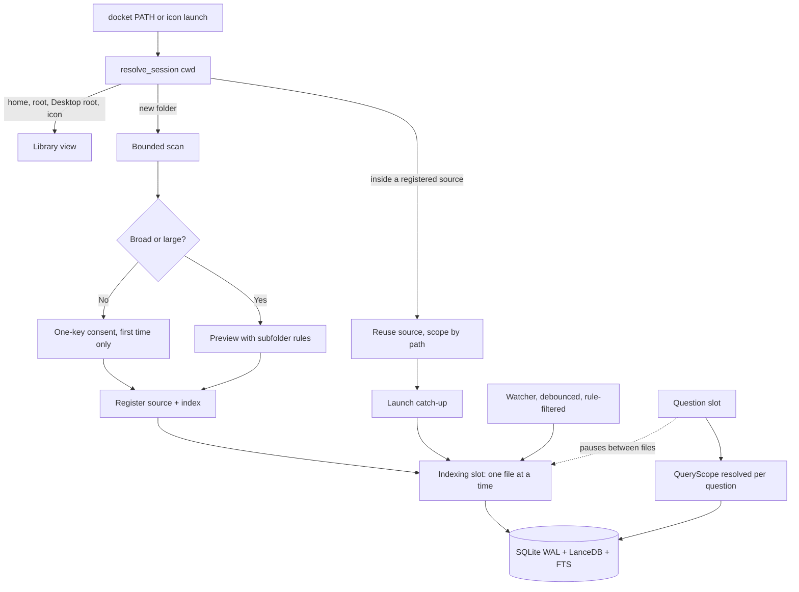

# Library and Ingestion Experience

Status: Design decided with the user on 2026-10-10 and ready to implement; nothing in this document is built yet. The current-implementation section was verified against source. The comparable-tool findings are evidence about other products, not measurements of Docket. The measured facts in section 7 are one user's observation, not a benchmark. Six design choices were reviewed with the user and are marked **Decided**. Everything proposed beyond those is marked **Recommended (pending validation)**. Part 10 owns the interface principles and part 01 the source lifecycle; this document closes the gap between them for everyday folder handling, indexing and freshness. Vocabulary follows `13-terminal-ui-screen-a-design.md` and `16-terminal-ui-wiring.md` (Welcome, Sources, Scope picker, indexing overlay, "Ready / Failed / Disconnected").

## 1. Purpose and scope

On 2026-10-10 the user tried to get Docket to answer questions about a project folder and found the ingestion and folder handling hectic: opaque source ids, a first-run offer that indexed the whole Desktop with no preview, four maintenance commands to run in the right order, typed paths, no automatic refresh, questions blocked while indexing, and failures that never clear. The first plan kept "manage a library" at the centre. The user then chose a different centre: run `docket` inside a folder and it answers about that folder; the library of all folders is a secondary view.

In scope: how a folder becomes searchable (choosing it, previewing it, naming it, narrowing it), how Docket stays current while it is open, what the user can do while indexing runs, how failures are shown and cleared, how upgrades and index-format changes are applied, and the query-scope semantics needed to make "this folder" real. Out of scope, referenced where they constrain this layer: parsing and chunk recipes (parts 02, 04), retrieval ranking (part 05), abstention and citation trust (part 07), the evaluation gate (part 08), distribution and resources (part 09), and a desktop shell (deferred, section 8).

Goal stated as an outcome: `cd project && docket` just works, the user never types an id or a maintenance command, and the index keeps itself current while Docket is open.

## 2. Current implementation (verified against source)

Paths are under `backend/src/docket/`.

| Component | Location | Behavior |
| --- | --- | --- |
| Registering a source | `services/sources/manager.py` (`SourceManager.register_source`) | Checks that the path exists and is a directory, then inserts an `AuthorizedSource` and a `Source` (`source_type="local_folder"`, status ACTIVE). There is no display name, no per-source rules, no overlap check (a parent of an existing source, or a folder inside one, registers happily), and the only handle is the generated id. |
| Discovery | `services/ingestion/pipeline.py` (`_discover_files`, `_discover`) | Delegates to `ignore.discover` with `DISCOVERABLE_EXTENSIONS`; recursive; honours `ingest_ignore_enabled`. No size or count limit and no preview: the whole tree is walked and ingested. |
| Ingest run | `pipeline.py` (`run_ingestion_for_source`) | Creates an `IngestionJob`, loops over every discovered file calling `_ingest_one_file`, emits `ProgressEvent("start"/"done", index, total, path)`, then runs one whole-source `reconcile_source`. A run with zero files is recorded FAILED ("no ingestable files found"). Per-file results are returned but only aggregate counts are stored. Interruption finalizes the job as FAILED "interrupted" and skips reconcile. |
| Ignore rules | `services/ingestion/ignore.py` (`is_ignored_dir_name`, `IgnoreRules.for_root`, `discover`) | Built-in: hidden entries, `node_modules`, `site-packages`, `venv*`, `*.egg-info` and similar. Custom: a `.docketignore` file at the source root. `tests`, `fixtures`, `docs`, `build`, `dist`, `env` are deliberately not ignored. Rules come only from the root's file; nothing is stored per source in the database. |
| Failing files | `pipeline.py` (`_ingest_one_file`, lines near 613-645); `infra/parsing/filecheck.py` (`check_file_signature`) | The signature check runs inside the parser wrappers (`docling_wrapper`, `xlsx_wrapper`, `pptx_wrapper`), after the `EvidenceVersion` row exists. A file whose bytes contradict its extension therefore raises, the version is marked FAILED, and the next run retries it (a FAILED row is reprocessed) and fails again. The reason is shown live and is not stored. |
| Prune | `services/sources/prune.py` (`SourcePruneService.find/count/apply`); CLI `docket sources prune` | Moves READY or FAILED versions that the current ignore rules would skip to SUPERSEDED and deletes their index entries; blobs stay. User files are never touched. It is a separate, manually run command; ingest only prints a hint to run it (`interfaces/cli/quiet.py`). |
| Watching | `services/sources/watcher.py` (`SourceWatcher`); CLI `docket watch <id>` in `interfaces/cli/main.py` | A blocking foreground command. Any `watchfiles` event under the path re-runs the whole-source ingest (cheap for unchanged files thanks to content-hash idempotency). Not used by the classic prompt or `docket ui`. No debounce, no ignore-rule filtering of events, no deleted-file handling beyond the next run. |
| First-run offer | `interfaces/cli/interactive/source_commands.py` (`first_run_offer`), called from `interfaces/cli/interactive/session.py` | When no sources exist and the cwd is neither `/` nor home, asks "Add the current directory? [y/N]" then "Ingest it now? [y/N]". There is no preview and no breadth check beyond those two paths, so Desktop (not home, not `/`) qualifies and is indexed whole. `docket ui` has its own broad-location guard (`tui/real_backend.py` `is_broad_location`) that covers only `.`, `~`, `/` and home. |
| CLI | `interfaces/cli/main.py` (`sources add/list/prune`, `ingest` with `--all --rechunk --dry-run`, `reindex`, `query`, `watch`, `ui`) | Sources are addressed by full id only; `sources list` prints id, status and path. Four maintenance operations (prune, ingest, ingest `--rechunk`, `reindex`) are separate and order-dependent. `docket query` is global. |
| Index format notice | `interfaces/cli/main.py` (rechunk branch), `infra/index/context.py` (`INDEX_TEXT_VERSION = 2`), `infra/index/manifest.py` (`read_manifest`) | After a rechunk, if the manifest's `index_text_version` is below the code's, the CLI prints "run `docket reindex`". The TUI lists rechunk and reindex as "not available in this screen yet, use the command line" (`tui/real_backend.py`, `tui/app.py`). |
| Query scope | `services/query/service.py` (`_ask_fast` around line 374, `_ask_agent` around line 739), `services/agent/tools.py` (`search_knowledge`), `services/agent/run_context.py` (`current_scope_ids`) | The only scope is the version ids that `signals` derive from a file named in the question. The code builds `**({"scope_version_ids": scope_ids} if scope_ids else {})`: an empty list is dropped, so an empty scope searches everything. `hybrid_search` itself returns nothing for `[]`. There is no folder or source scope; `QueryService.ask` takes none. |
| Concurrency | `core/db/engine.py`; `tui/app.py`; `16-terminal-ui-wiring.md` section 2 | SQLite runs in WAL mode. The TUI allows one expensive operation (index or answer) at a time and refuses a send while indexing, keeping the draft. |
| Display names | `interfaces/cli/tui/real_backend.py` (`_names`) | The folder basename, with the parent added in parentheses when two collide. Computed in the TUI only; the CLI and classic prompt show ids. |

### 2.1 Friction table: the 2026-10-10 session

| Symptom the user saw | Code cause |
| --- | --- |
| Whole Desktop indexed on "Yes" with no idea how much it would read | `first_run_offer` guards only `/` and home; `register_source` and `_discover` have no preview, size or count limit |
| Desktop's virtualenvs, repos and test fixtures became searchable "documents" | Ignore rules are name-based and root-file-based; there is no per-source include or exclude, and `tests`/`fixtures`/`docs` are deliberately not ignored |
| Had to copy a 36-character id to do anything | Sources are addressed by id only in the CLI and classic prompt; `_names` exists only in the TUI |
| "Run this command" notices (`sources prune`, `ingest --all --rechunk`, `reindex`) in a specific order | Prune, rechunk and reindex are separate commands; the TUI marks them unavailable and points at the CLI |
| Two fake PDFs "failed" on every refresh and "need attention" never reached zero | Signature check runs inside the parser, after the version row exists; FAILED rows are retried each run; no stored reason; nothing lets the user ignore a file |
| Edited or deleted files were not noticed | No automatic refresh; `docket watch` is a separate blocking command that the UI never starts |
| Could not ask a question while indexing | The TUI controller permits one expensive operation at a time and refuses the send |
| Questions "inside this folder" could not be expressed | No folder or source scope exists on `QueryService.ask` (and an empty scope would silently widen to everything) |
| Typed an absolute path to add a folder | No picker; `check_folder` only validates typed text |

## 3. What comparable tools do

Findings are from product documentation and engineering write-ups, not from running them.

- **GPT4All LocalDocs.** Users create a named collection, attach one or more folders, and the app shows embedding progress and file counts per collection; chats opt into collections via a sidebar toggle. The unit the user manages is a named collection, not an id, and indexing happens in the background while chat stays usable. [GPT4All chat docs](https://git.blob42.xyz/Archives/gpt4all/src/commit/02290fd88153eec009229fe74f20b99c3a2db32d/gpt4all-bindings/python/docs/gpt4all_chat.md)
- **Khoj desktop.** The desktop client lets the user add folders (and files), chooses file types, and syncs on a schedule and on changes while the app runs; a manual "force sync" exists. Again the user names folders, not ids. [Khoj desktop client](https://www.mintlify.com/khoj-ai/khoj/clients/desktop)
- **Cursor codebase indexing.** Indexing starts when the project opens; files are chunked and embedded in the background; a Merkle tree of file hashes finds what changed so catch-up and edits are cheap; ignore files (`.gitignore`, `.cursorignore`) bound what is read; the project is usable while the index builds. [How Cursor indexes codebases fast](https://read.engineerscodex.com/p/how-cursor-indexes-codebases-fast), [secure codebase indexing](https://cursor.com/blog/secure-codebase-indexing)
- **Open WebUI knowledge sync.** A knowledge base can be synced from a folder with change detection (add, update, delete) rather than a re-upload; it is an explicit sync, scriptable, and removals propagate. [Open WebUI knowledge base sync](https://docs.openwebui.com/ecosystem/knowledge-base-sync)
- **AnythingLLM live document sync.** A watched document is re-fetched on a schedule and re-embedded. It is a beta feature with limits that matter here: it works on single files rather than folders, and it stops when the app closes. [AnythingLLM live sync](https://docs.anythingllm.com/beta-preview/active-features/live-document-sync) Docket's refresh model (section 5.6) has the same "only while open" limit and says so.
- **xdg-desktop-portal FileChooser.** On Linux a sandboxed or portable app asks the portal for a native folder dialog rather than rolling its own; it works only with a display session. [Flatpak portals](https://github.com/flatpak/flatpak/wiki/Portals)
- **freedesktop terminal handling.** An xdg-specs merge request proposes a common way for desktop entries to declare and launch terminal applications. It is relevant because an icon-launched `docket` has no shell, so the launcher, not the shell, determines the working directory and terminal (see `launcher.spawn_window`). The details of that proposal were not verified for this document. [xdg-specs merge request 6](https://gitlab.freedesktop.org/xdg/xdg-specs/-/merge_requests/6)

What carries over: the user manages named places, not ids; indexing is background and non-blocking; change detection is hash- or mtime-based and cheap; ignore rules bound what is read before anything is embedded; refresh runs only while the app does. What does not: these are graphical apps with real pickers and drag-and-drop, which a terminal cannot match (section 8).

## 4. Decisions

**Decided (user-reviewed, 2026-10-10):**

1. **Folder-first.** `docket` inside a folder answers about that folder. The library of all folders is a secondary view reached from the app icon, a broad location, or a key.
2. **Ask while indexing.** Questions are accepted while a folder is being indexed; answers use what is indexed so far and state how much that is.
3. **A small additive migration is allowed**, rehearsed on a copy of the backup, so there are no workarounds (no side JSON file, no many-sources trick).
4. **Automatic refresh while Docket is open.** No refresh after Docket closes; the next launch catches up.
5. **Preview only for broad or large folders.** A small, focused folder is registered and indexed after a one-key consent the first time only.
6. **Suggest narrowing the existing whole-Desktop source**, and let the user confirm it from the library view.

One-shot `docket query` stays global unless `--here` is given, so scripts do not change.

## 5. Design

### 5.1 User journeys

**First run in a folder.** The user runs `docket` in `ForgeOPs/docs`. The window title is the folder. A bounded scan finds 4 supported documents; the screen says "Docket will read 4 documents in ForgeOPs/docs. Enter to continue." The first time only, one key confirms. The folder is registered, indexing starts, and the composer is live at once. Answers carry "2 of 4 documents indexed so far" until the job finishes.

**Return visit.** `docket` in the same folder (or any folder inside a registered one) reuses the source. A quick catch-up compares path, size and stored mtime and re-ingests only what changed; the header says "Up to date" when done. No question, no preview.

**Icon launch or broad location.** Launching from the app icon, from home, or from the Desktop/Downloads root opens the library view across all folders. If the library is empty it suggests folders ranked by document count. Add offers Browse (a native dialog where a display exists, section 5.5), or a pasted or dragged path.

**Broad or large folder.** When the bounded scan crosses a breadth or size threshold, a preview appears: counts by type and by subfolder, skipped counts, a time estimate from past jobs, and subfolder checkboxes. Confirming saves include and exclude rules on the source and indexes only those.

**Narrowing an existing broad source.** The library row for the Desktop source shows Narrow. The preview lists subfolders that actually hold documents. Confirming stores include rules and prunes the rest without re-parsing anything kept.

**Upgrade.** A new version changes the chunk recipe or `INDEX_TEXT_VERSION`. One notice offers "Update now". Cheap steps (prune, refresh) run unasked; a rechunk or reindex asks once with a time estimate. No notice tells the user to run a command.

### 5.2 Architecture

### 5.3 Data model additions (migration 0012)

One additive Alembic migration, all columns nullable, so existing rows read as before. It takes the next slot after `0011_fts_version_columns.py` in `core/db/migrations/versions/`; the single-owner rule in `13-codex-handoff.md` section 3 applies and the handoff gets a line when the migration lands.

| Table.column | Type | Purpose |
| --- | --- | --- |
| `sources.display_name` | text, nullable | Stored name; when null the resolver derives the folder basename, disambiguated by parent (the logic now in `tui/real_backend.py` `_names`, moved to a service) |
| `sources.rules_json` | text (JSON), nullable | Include patterns, exclude patterns, user-ignored files; read by `IgnoreRules.for_root` in addition to `.docketignore` |
| `evidence_versions.failure_reason` | text, nullable | Plain reason recorded when a version goes FAILED, cleared on success |
| `evidence_versions.source_mtime` | float or datetime, nullable | The file's mtime when the version was read, so catch-up can compare path, size and mtime before hashing |

New services (all optional-parameter, additive): `services/sources/resolve.py` (`resolve_source(ref)` accepting a name, list number, id prefix or id), `services/sources/session.py` (`resolve_session(cwd)`), `services/sources/scan.py` (bounded scan on `ignore.discover`), `services/query/scope.py` (`QueryScope`), `services/sources/maintenance.py` (`plan()` and `run()`), `services/sources/freshness.py`, and `interfaces/cli/picker.py`.

**Non-overlap rule.** Sources must not overlap. Registering a parent of existing sources stores excludes for the child paths on the parent; registering inside an existing source is refused in favour of a folder scope. Overlap would duplicate evidence and results.

### 5.4 Scope semantics

`QueryScope` is one of: everything, a folder path, or a source. It is resolved per question to the eligible READY version ids under that path, using the same eligibility SQL as `signals.load_eligible_files` (`services/query/signals.py`). It is carried on `RunContext` (`services/agent/run_context.py`) and intersected with the question's own named-file scope. It applies to fast retrieval, agent search, evidence reads and spreadsheet tools.

**The empty-scope fix.** Today `if scope_ids` in `service.py` and `agent/tools.py` drops an empty list and widens to everything. With an enforced scope that is a correctness bug: a folder with nothing indexed yet would answer from other folders. The rule becomes: an explicit scope that resolves to zero eligible versions produces an explicit "nothing indexed in this folder yet" result (during indexing, with the coverage line and a Retry offer), never a search. The distinction is "no scope given" (None, search everything) versus "scope given and empty" (return no evidence). Tests cover the fast and agent paths and the two empty cases.

**Gate.** Any change here must keep the original gold set at recall 33/33 with 0 wrongful abstentions (part 08 section 4; `13-codex-handoff.md` section 1.4).

### 5.5 Concurrency model for asking while indexing

Two slots in the TUI controller (`interfaces/cli/tui/app.py`): an indexing slot and a question slot, replacing the single "one expensive operation" rule of `16-terminal-ui-wiring.md` section 2. A question pauses indexing between files through the existing per-file progress callback; no immediate preemption is claimed, so a question can wait behind the current file and, on one GPU, behind an embedding batch for a few seconds. The query service reopens its LanceDB table handle while a job is active, because the table grows under it. SQLite WAL (already on, `core/db/engine.py`) lets reads proceed during writes, and per-file READY status means a half-indexed file is never eligible.

Answers record coverage ("31 of 47 documents indexed when answered") from the READY and total counts at ask time. An abstention during indexing says the content may not be indexed yet and offers Retry when the job finishes. This feeds the part 07 answer states as a coverage note, not as a new abstention reason.

**As built (CP4).** `TuiApp` has `indexing_active` and `question_active`; `busy` is either. One question at a time is refused with the draft kept. Add, Refresh and Reconnect are refused (not queued) while a question runs, before anything is registered. A `YieldGate` (`tui/yield_gate.py`) is held for the length of a question; the indexing worker waits on it inside the per-file progress callback, so it pauses only between files, and Stop wakes it. Ctrl+C cancels the question first, a second press stops indexing. The query table is opened fresh per question (`LanceIndexWriter.table`) and the service is built per question; a real-LanceDB test covers reads during concurrent writes. Coverage is `{"indexed", "total", "indexing"}` from the job's counts (searchable finished files over discovered files; for a folder inside a larger source it describes the whole source), carried on `AskRequest`, set on `QueryResult.index_coverage` and `RunRecord.index_coverage` by the backend. Worker threads run under the re-entrant `quiet_ingest()`, and `run_ui` wraps the app in `quiet_streams()` (Python-level stdout/stderr and logging handlers only; native writes to fd 1 or 2 are not intercepted; with DOCKET_DEBUG the output goes to `ui-debug.log` in the data directory).

Cross-process locking is not added: two Docket processes indexing the same data directory remain a documented limit (section 8).

### 5.6 Freshness model

Three layers, all only while Docket is open:

1. **Launch catch-up.** Compare path, size and `source_mtime` against stored versions; hash only what differs; re-ingest changed and new files; delete versions for missing files.
2. **Debounced watcher.** One `watchfiles` watcher per active source, events filtered by the source's ignore rules, batched, then `run_ingestion_for_paths(source_id, paths)` (a new public method on the pipeline) on just those paths. A shared deleted-file helper applies the SUPERSEDED plus `IndexManager.delete_version` transition that prune already uses. The existing whole-source `SourceWatcher` is not reused for this because it re-runs everything and is not rule-filtered.
3. **Large-tree fallback.** Above a file-count threshold, a periodic scan replaces the watcher (inotify limits).

Pause and resume use `SourceManager.pause_sync` and `resume_sync`. The footer shows "Updating 3 files". Nothing runs after Docket closes; the next launch's catch-up covers the gap.

**Self-maintenance and clearing failures.** `maintenance.plan()` lists prunable entries, stale recipes, an index manifest behind `INDEX_TEXT_VERSION`, and narrowed rules; `run()` chains prune, refresh, rechunk and reindex using `SourcePruneService`, `run_ingestion_for_source`, `rechunk_source` and `infra/index/reindex.py`. CLI: `docket sync [--dry-run]`. Failed files show the stored plain reason. "Ignore this file" writes to the source's `rules_json`, so "need attention" can reach zero. Files that fail the signature check are skipped at discovery as "not a real document" instead of becoming FAILED rows.

## 6. Checkpoints

One commit each, implemented by subagents in worktrees, reviewed and tested before merge. Gold gate after CP2, CP4 and CP6; unit suite stays green (currently 1501).

| CP | Content | Owner and shared files |
| --- | --- | --- |
| CP0 | This document | docs only |
| CP1 | Migration 0012; `core/db/models.py`; `resolve.py`; `IgnoreRules.for_root` reads stored rules; signature-failed files skipped at discovery; `failure_reason` and `source_mtime` recorded; non-overlap rule | UI owner for models and migrations (single linear chain). Shared: `core/db/models.py`. Note the slot in `13-codex-handoff.md` |
| CP2 | `QueryScope`; `QueryService.ask(scope=None)`; `RunContext`; fast, agent, evidence-read and spreadsheet tools; empty-scope fix | Signature and `RunContext` plumbing are UI-owned; edits inside `_ask_fast` and `_ask_agent` bodies belong to the accuracy owner per the handoff table, so rebase before touching `service.py`. Gold gate required |
| CP3 | `session.py`, `scan.py`; `docket [PATH]` and `--all`; `launcher.spawn_window` passes the folder; `first_run_offer` replaced; header, scope picker and Welcome Consent is kept in `<data_dir>/preferences.json` (`folder_consent_v1`). Unticked preview subfolders are stored as anchored excludes (`/name/`, a leading slash anchors to the source root) via `SourceManager.set_rules`. `ignore.discover` gained optional entry and time budgets for the scan. `docket ui` and `docket chat` also take `--folder` and `--all`; the icon launch passes `--all`. | `interfaces/cli/**`, `services/sources/**` (UI) |
| CP4 | Two slots; pause between files; table-handle reopen; coverage on answers and abstentions | `tui/app.py` (UI); service-side reopen touches query service, coordinate. Gold gate and a concurrency test with fake gateways |
| CP5 | `maintenance.py`, `docket sync`; single Update now notice; failure reasons and Ignore this file; Narrow flow | `services/sources/**`, `interfaces/cli/**` |
| CP6 | `run_ingestion_for_paths`, shared deleted-file helper; `freshness.py`; footer status | `services/ingestion/pipeline.py` (UI owner for progress and cancellation; keep new parameters optional). Gold gate |
| CP7 | `picker.py` (`zenity`, then `kdialog`; skipped over SSH or without a display); Browse; path paste or drag opens Add; folder suggestions by document count | `interfaces/cli/**` |

**As built (CP5).** `services/sources/maintenance.py` holds `LibraryMaintenance`. `plan(source_ids=None)` is read only and returns a `MaintenancePlan` of plain-language steps (kind, count, label, estimated seconds from `scan.recent_seconds_per_file`): prune (`SourcePruneService.find`), refresh (an ACTIVE source with no ingestion job and nothing indexed, counted with a bounded `scan_folder`), rechunk (`pipeline.find_stale_versions`, only asked of sources that have READY versions) and reindex (manifest `index_text_version` below `INDEX_TEXT_VERSION`, or another embed model, with chunks present; global, so left out when a source filter is given). `run(plan, progress, stop)` executes prune, refresh, rechunk, reindex through the existing services with one `MaintenanceProgress(stage, done, total, current)` stream. Stop is cooperative between files; a stop inside a refresh uses the same `BaseException` path as the UI's Stop (the job row is recorded as interrupted, finished files are kept). Reindex is called only when planned, and a failure is recorded as `reindex_error` while the old index keeps serving because `reindex` swaps last. A second `plan()` after a clean run is empty. `rechunk_source` gained optional `only_stale` and `should_stop` (an update never retries failed files); `IngestionPipeline.run_ingestion_for_paths(source_id, paths, progress)` is the new public per-paths entry (one job row, per-file results, a path outside the root or missing is a failed result, whole-source reconcile at the end); CP6 extends it with deleted-file handling. `SourcePruneService.apply_candidates`, `SourceManager.add_ignored_file` and `SourceManager.narrow_source(source_id, keep_subfolders)` (anchored `/name/` excludes for unticked top-level subfolders, other rules kept, re-ticking removes the exclude) are the small helpers underneath.

`docket sync [REF ...] [--dry-run] [--yes]` prints the plan in words, runs prune and refresh unasked, and asks once with the estimate before rechunk and reindex (on a terminal; without one it says they were not run and names `--yes`). `ingest --rechunk`, `reindex` and `sources prune` stay for scripts. No notice names a command any more: the ingest notices (`ignore_notices`, stale recipe, index format) are statements that an update will handle it; the classic prompt offers one `Update now? [y/N]` after an ingest (`ingestion_ui.offer_update`); the TUI shows a Library health line in Sources and Welcome ("Everything is up to date" or "3 updates available (about 2 minutes)"), an `Update now` button and `/update`, and runs the plan as an indexing-slot job (`IndexJob.kind == "update"`), so it pauses between files for a question and honours Stop. Slow steps get one confirm with the estimate. The check runs on a worker after launch and again after every job; it builds the document parser (importing Docling) when the library has indexed files, under a lock shared with indexing so it is built once.

Failed files show the stored `failure_reason` mapped by `failure.plain_failure_reason` (password-protected; old .doc/.xls/.ppt with "save a copy as .docx/.xlsx/.pptx"; damaged or unreadable; empty; anything else keeps its stored wording) in the Sources detail, a new Failed files overlay and the Jobs details. In that overlay `Retry` re-reads the one file as a job and `Ignore this file` appends it to `rules_json["ignored_files"]` and supersedes its FAILED version (via prune), so "need attention" reaches zero and a later run does not list it again; the file on disk is never touched. `Narrow...` in Sources scans the source root (bounded, on a worker), opens the CP3 preview with already left-out subfolders unticked, and only on confirmation saves the rules and prunes on the indexing slot; nothing is re-parsed. A small, narrow folder answers in words that there is nothing to narrow. Limits: Update now needs the parser import on first check; the plan's refresh count is a bounded scan estimate; the global reindex is not offered by `docket sync REF`; the manifest mismatch errors raised on a query still name `docket reindex` (they are errors, not notices, and tests pin them).

**As built (CP6).** `IngestionPipeline.run_ingestion_for_paths(source_id, paths, progress=None, *, missing="error")` is the shared path-level entry for new, changed and deleted paths. Existing files go through `_ingest_one_file` (content-hash idempotency makes an unchanged file one hash); a path the ignore rules (built-ins, `.docketignore`, stored `rules_json`), the extension list or the signature check would not discover is `skipped`; a path that no longer exists supersedes its current version and deletes its index entries through `prune.supersede_and_deindex` (the same `mark_version_status` SUPERSEDED plus `IndexManager.delete_version` transition that `apply_candidates` now calls), reported as `deleted`. With nothing indexed for a missing path `missing="error"` (Retry) is a failed result and `missing="skip"` (freshness) a skipped one. Nothing is ever superseded while the source root is unreachable: the run is a failed job and the source goes MISSING through `mark_unreachable`. One `IngestionJob` row per batch carries `files_processed/failed/deleted/skipped` and `chunks_written`; `source_mtime` is kept current by `EvidenceManager.ingest_file`, also for an unchanged file that was only touched.

`services/sources/freshness.py` holds `catch_up`, `Debouncer` and `FreshnessMonitor`. `catch_up(source_id, session_factory=...)` runs one bounded `ignore.discover` walk (`max_entries` 200,000 and `time_budget_s` 20 by default; `discover` gained `start_after` and `resume_from`, and walks in sorted order so a stopped walk resumes deterministically) and compares each discovered file with the stored READY/FAILED/PENDING version by path, `byte_size` and `source_mtime`. Only candidates (size or mtime differs, no mtime stored, or a PENDING version) are returned for ingestion; a FAILED file whose size and mtime are unchanged is not retried (that is Retry's job). `ChangeSet(new, changed, deleted)` reports a rename as delete plus new. Known files outside an incomplete walk are checked by `stat`, so only brand-new files in the unscanned part wait for the next pass (`incomplete` plus a `resume_from` cursor; a periodic pass resumes there and, while a cursor is pending, passes run every 15 s instead of every 5 minutes). A root that exists but shows no document at all while everything is "gone" holds the deletions back (`held_back`) rather than emptying the index.

`FreshnessMonitor(source_manager, pipeline_provider, ...)` runs one daemon thread per ACTIVE (or temporarily MISSING), not paused source. The watcher is `watchfiles.watch` with a 1 s poll (so stop and root checks are prompt), filtered by `classify_event` (rules, supported extensions; a folder appearing or a suffix-less path vanishing asks for a scan instead). Events go through a `Debouncer`: a batch is released after 5 s of quiet or 60 s after its first event. Batches are passed to the `on_batch` callback only; the TUI decides when to run them. It falls back to a periodic catch-up (every 5 minutes) when the watch cannot start or ends (inotify limit, root gone, watcher error; it tries the watch again once the root is back) or when the tree has more than `LARGE_TREE_ENTRIES` (20,000 entries, ignored folders pruned; a bounded count of at most 10 s, or the launch scan's size as a hint). `pause()` / `resume()` go through `SourceManager.pause_sync` / `resume_sync` (`sync_paused_at`); resume starts with a catch-up. A vanished root marks the source MISSING and a returning one ACTIVE via the existing hooks, and reports nothing as deleted meanwhile. `close()` stops and joins every thread.

TUI: at launch a worker runs `catch_up` for each connected source that has indexed files, posts one quiet notice ("Checked 12 documents - up to date" or "Updating 3 changed documents") and starts the monitor; a source that finishes its first index is watched from then on. Batches are merged per source in a queue and become indexing-slot jobs (`IndexJob.kind == "refresh"`, verb Updating) that pause for questions between files (the YieldGate) and honour Stop. The queue is drained only when no job holds the slot and no question is active (and readiness is not blocked), by the ticker, which runs in reduced motion too. The footer reads "Updating 3 files", "2 changes waiting" while queued and "Updates paused" when a folder is paused or the global switch is off. Sources has `[Pause updates]` / `[Resume updates]` per folder (persisted), and Settings has a Library tab with "Keep my library up to date automatically" (default on), stored atomically in `<data_dir>/preferences.json` as `auto_refresh_v1`. Closing the window runs `backend.stop_watching()`; nothing runs afterwards. `docket watch` and `SourceWatcher` now ingest only the changed paths through the same entry (the whole source is not re-run per event); `docket watch` has no debounce beyond watchfiles' own.

Limits: one inotify watch per folder tree means a very large tree (or a low `fs.inotify.max_user_watches`) falls back to scans every 5 minutes, so a change can take that long to show; catch-up and periodic scans stat every document and read the first bytes of each (signature check), which is real disk and CPU work on a big tree, and the watcher polls once a second per source, so on battery a user with many large folders may prefer to pause updates or turn the switch off; a network or removable folder is watched only as far as the OS reports events (periodic checks cover the rest); a move of a folder that the OS reports as a single event triggers one bounded scan rather than per-file events.

**As built (CP7).** `interfaces/cli/picker.py`: `pick_folder(start=None, timeout=300) -> PickResult(path, cancelled, error, unavailable)` runs `zenity --file-selection --directory`, else `kdialog --getexistingdirectory`, else `yad --file --directory` (argv lists, absolute `shutil.which` path, environment passed through, blocking, for a worker thread). It is unavailable, with a plain reason and no process started, over SSH (`SSH_CONNECTION`/`SSH_CLIENT`/`SSH_TTY`), without `DISPLAY` or `WAYLAND_DISPLAY`, with `TERM=dumb`, or when no tool is installed. Exit code 1 is cancelled, any other non-zero is an error carrying the first stderr line, a timeout is an error. `available()` is the cheap probe. The xdg-desktop-portal `FileChooser` (D-Bus) is the documented alternative and is not implemented. `interfaces/cli/dropped.py` `parse_dropped_path` recognises one line that is an existing folder or file (quotes, backslash-escaped spaces, `file://` with percent-encoding, `~`, an unquoted path with spaces; a relative path only with `./` or `../`); a sentence containing a path or a bare word is never a path. `services/sources/suggest.py` `suggest_folders` measures the children (one level, not hidden, not symlinks) of `~/Documents`, `~/Downloads`, `~/Desktop` plus the current directory's siblings with `scan_folder`, skips registered roots, never scans `/`, and stops at about 3 s and 30,000 entries (0.6 s and 5,000 entries per folder); ranked by document count, with a type summary.

TUI: Add folder shows `[Browse...]` only when the backend has a picker and `available()` is true. It runs on a worker, the overlay shows "Waiting for the folder dialog...", Esc stops waiting without closing the overlay (a still-open dialog is left to the user and its late answer is ignored), and a chosen path goes through the same check, broad-location, consent or preview steps as a typed one; cancel and errors leave the typed path usable. A single line submitted from the composer that is a folder opens Add with that path (a real slash command always wins); a file shows "Docket works with folders - use its folder?" with its parent. The classic prompt asks `Add <folder> and index it? [y/N]` in the same cases. At launch, with an empty library, a worker runs the suggestions once; Welcome (heading "Folders that look like they hold documents", after any launch-folder subfolders) and the empty Sources list show name, count and types, and Enter runs the CP3 flow (`open_folder`). The demo backend has neither picker nor suggestions. Limits: a terminal that does not paste dropped paths gives nothing to parse; the suggestions run once per launch; the dialog cannot be closed by Docket once opened.

Rollout is the user's `pipx install --force`; the live index migrates on first run after a fresh backup. Migration is rehearsed on a copy of the 2026-10-10 backup: upgrade, `sources list`, a query, then compare row counts. Nothing is run against `~/.local/share/docket` (`13-codex-handoff.md` section 1.1).

## 7. Measured facts from the user's real index

Single-user observation from the 2026-10-10 session, not a benchmark and not reproduced here. They explain why the preview and narrowing exist.

- 72 files were indexed from the whole Desktop source: 23 from virtualenv or `site-packages` trees, 30 repository docs and test fixtures, 19 developer-project docs, and 0 personal documents.
- 2 files fail permanently: fake PDFs whose bytes do not start with `%PDF-`, retried and failed on every run.
- `~/Documents` has no supported documents; `~/Downloads` has 6.

The consequence is that "index the Desktop" produced a library that was mostly noise, and the folders with real content were elsewhere. Rules must be per source and visible, and suggestions should be ranked by document count rather than by location.

## 8. Limits and deferred items

- **Terminal ceiling.** A native folder dialog needs a display and `zenity` or `kdialog`; over SSH or headless the path stays typed. Drag-and-drop into a terminal pastes a path, which is parsed, not a real drop target. A desktop app would do better and is out of scope.
- **Refresh only while open.** Nothing watches after Docket closes (the same limit as AnythingLLM's live sync). Catch-up on next launch is the remedy.
- **Cross-process index lock.** Two Docket processes on one data directory are not coordinated; WAL protects SQLite reads, not LanceDB or index writes. Deferred.
- **Single-file sources.** `register_source` accepts folders only; a single file is added by its folder with an include rule.
- **Names.** `display_name` is stored and shown; editing it beyond that, aliases, and per-source colours are deferred.
- **Preemption.** A question waits for the current file; mid-file preemption is not attempted.
- **Large trees.** Above 20,000 entries a source is checked by bounded periodic scans instead of a watcher (section 6, CP6). Behaviour on hundreds of thousands of files is untested (also noted in `16-terminal-ui-wiring.md` section 6).

## 9. Validation list and hand-offs

Validation before any claim of an improved experience:

1. Migration 0012 upgrades a copy of the backup; row counts equal before and after; `sources list` and a query work; downgrade or re-run is a no-op.
2. Gold gate (recall 33/33, 0 wrongful abstentions) after CP2, CP4 and CP6, with unit suite green.
3. Empty-scope tests on fast and agent paths: given-and-empty returns "nothing indexed", not a global answer.
4. Concurrency test with fake gateways: a question during indexing returns, coverage is reported, and the index finishes with the same row set as an unasked run.
5. Overlap tests: registering a parent excludes children; registering inside a source is refused.
6. Fake-PDF fixture: skipped at discovery, no FAILED row, nothing retried.
7. Freshness: edit, add, delete, rename under a watched folder update the index; a rule-ignored change does nothing; pause stops it.
8. `docket sync --dry-run` lists the plan and changes nothing; a narrowed Desktop source prunes without re-parsing kept files.
9. Manual run on scratch data (never the live data directory): `cd` into a small folder and run `docket`, ask while it indexes, edit and delete a file, launch from the icon, narrow a broad source.
10. Time-to-first-answer on a 50-document folder, measured, before it is quoted anywhere.

Hand-offs:

- **Part 06:** the scope and coverage fields ride on `RunContext`; the agent path must honour the scope in every `search_knowledge` and `read_evidence` call.
- **Part 07:** answers produced during indexing carry a coverage note; abstentions during indexing add a "may not be indexed yet" explanation and Retry, using the existing `AbstentionReason` vocabulary rather than a UI-only reason.
- **Part 08:** the gold gate applies to every checkpoint that touches scope; the set still lacks scoped-folder and mid-index cases.
- **Part 10:** folder-first launch, the library view, Update now, and Narrow are interface decisions recorded here and to be folded into part 10 and doc 13's Screen A.
- **Part 11:** migration 0012 and the additive services join the roadmap; the desktop shell stays deferred.

## References

Internal:

- `backend/src/docket/services/sources/manager.py`, `prune.py`, `watcher.py`, `readiness.py`: registration, prune, watcher, readiness
- `backend/src/docket/services/ingestion/pipeline.py`, `ignore.py`: discovery, per-file ingest, ignore rules
- `backend/src/docket/infra/parsing/filecheck.py`, `backend/src/docket/infra/index/context.py`, `manifest.py`, `reindex.py`: signature check, index text version, reindex
- `backend/src/docket/services/query/service.py`, `signals.py`, `backend/src/docket/services/agent/tools.py`, `run_context.py`: scope plumbing and eligibility
- `backend/src/docket/interfaces/cli/main.py`, `launcher.py`, `interactive/source_commands.py`, `tui/real_backend.py`, `tui/app.py`: commands, launch, first-run offer, TUI backend
- `backend/src/docket/core/db/models.py`, `core/db/migrations/versions/0011_fts_version_columns.py`, `core/db/engine.py`: schema, migration chain, WAL
- `Upgrade/13-terminal-ui-screen-a-design.md`, `13-codex-handoff.md`, `16-terminal-ui-wiring.md`: UI vocabulary, ownership, hard rules, wiring
- `Upgrade/01-sources-and-lifecycle.md`, `04-chunking-and-indexing.md`, `05-query-understanding-and-retrieval.md`, `07-citations-trust-and-abstention.md`, `08-evaluation-and-benchmarks.md`

External:

- [GPT4All chat (LocalDocs)](https://git.blob42.xyz/Archives/gpt4all/src/commit/02290fd88153eec009229fe74f20b99c3a2db32d/gpt4all-bindings/python/docs/gpt4all_chat.md): named collections, background embedding
- [Khoj desktop client](https://www.mintlify.com/khoj-ai/khoj/clients/desktop): folder sync while the app runs
- [How Cursor indexes codebases fast](https://read.engineerscodex.com/p/how-cursor-indexes-codebases-fast): background indexing, change detection
- [Cursor: secure codebase indexing](https://cursor.com/blog/secure-codebase-indexing): hash tree, ignore files
- [Open WebUI knowledge base sync](https://docs.openwebui.com/ecosystem/knowledge-base-sync): change-detecting folder sync
- [AnythingLLM live document sync](https://docs.anythingllm.com/beta-preview/active-features/live-document-sync): single files, stops when the app closes
- [Flatpak portals](https://github.com/flatpak/flatpak/wiki/Portals): FileChooser portal
- [xdg-specs merge request 6](https://gitlab.freedesktop.org/xdg/xdg-specs/-/merge_requests/6): terminal handling
