# Current Architecture: Sequence Diagrams

Status: **Current.** Companion to [18-current-architecture.md](18-current-architecture.md). Each diagram follows one real flow through the code on `main` (commit `8a13c3b`), step by step, with the module that performs each step. Nothing here is a proposal.

How to read: columns are participants (grey cards), numbered arrows are calls in time order, green notes mark the decision or the guarantee that matters, and `alt` / `opt` / `loop` boxes show branches and repetition. Paths are relative to `backend/src/docket/`.

| Part | Flow |
| --- | --- |
| A | Launching Docket and choosing the session |
| B | First visit to a folder: consent, register, index |
| C | One file through ingestion |
| D | A question, fast path |
| E | Citation validation and repair |
| F | A question, agent path |
| G | Asking while indexing |
| H | Freshness: launch catch-up and a watcher batch |
| I | Maintenance: `docket sync` / Update now |
| J | Narrowing a broad source and pruning |
| K | Opening the evidence behind a citation |

---

## A. Launching Docket and choosing the session

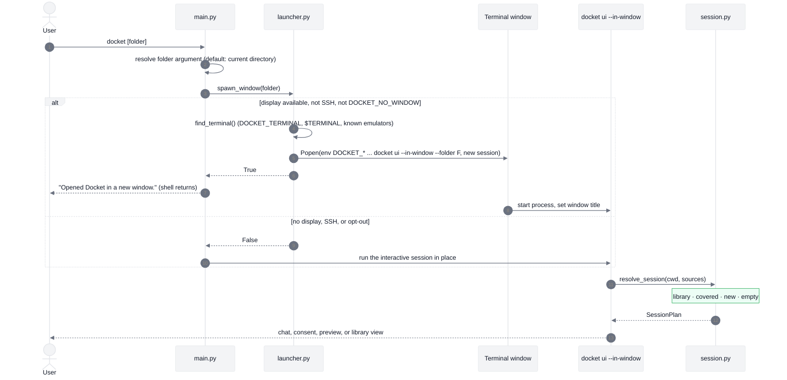

The launcher passes every `DOCKET_*` variable through to the new window, so a scratch data directory set in the calling shell also applies there. If the full-screen UI fails with an unexpected error, the window prints it and waits for Enter instead of closing.

Files: `interfaces/cli/main.py`, `interfaces/cli/launcher.py`, `services/sources/session.py`.

---

## B. First visit to a folder: consent, register, index

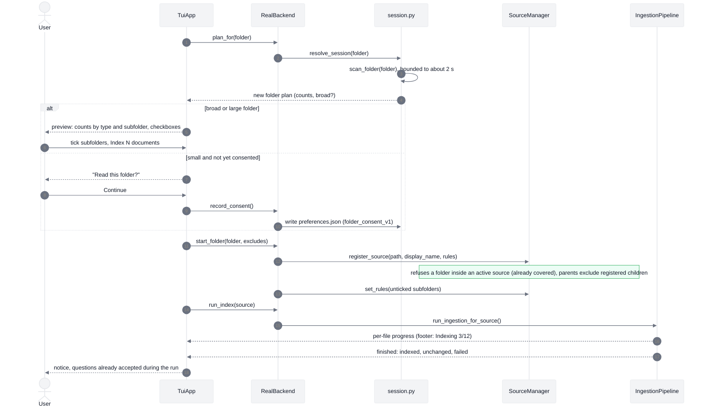

Consent is asked once per data directory. Nothing is registered or read before the user agrees. The scan is read-only and is limited by time and number of entries, so a huge tree is reported as "broad" instead of being walked completely.

Files: `services/sources/scan.py`, `session.py`, `manager.py`; `interfaces/cli/tui/app.py`, `real_backend.py`.

---

## C. One file through ingestion

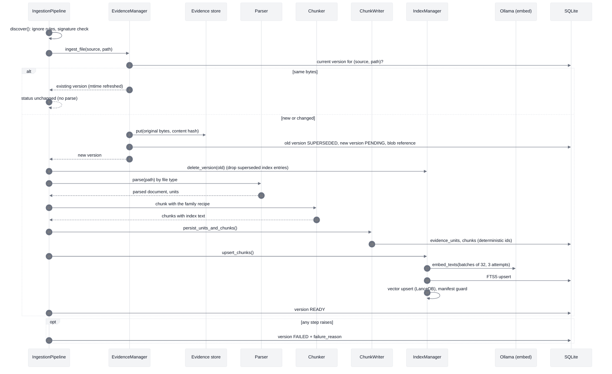

The index text sent to the embedder and the full-text index is the chunk plus its file name, heading breadcrumb and (for spreadsheets) a `Context:` line with fiscal year and units. The stored chunk text stays verbatim, so citations quote the original. A final reconcile after the whole run removes any index row that no longer has a current chunk.

Files: `services/ingestion/pipeline.py`, `chunk_writer.py`; `infra/evidence/manager.py`; `infra/parsing/*`; `infra/index/manager.py`, `context.py`.

---

## D. A question, fast path

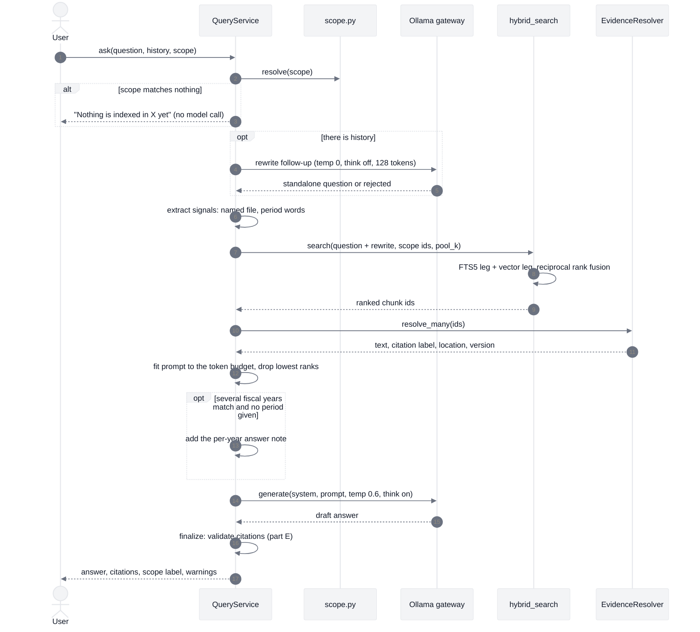

If the search returns nothing, the answer is the fixed abstention sentence and no model call is made. The scope is applied before ranking, so a folder scope cannot be widened by a file named in the question; a named file outside the scope produces an explanation instead of a wider search.

Files: `services/query/service.py`, `scope.py`, `signals.py`; `infra/retrieval/hybrid.py`, `resolver.py`; `infra/inference/gateway.py`.

---

## E. Citation validation and repair

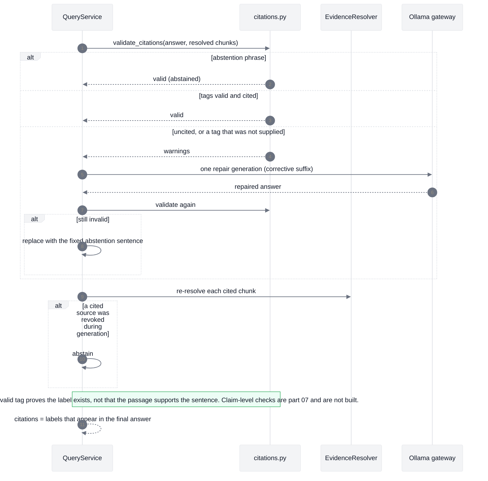

This is the whole trust check today. It protects against invented citations, uncited answers and evidence that disappeared mid-answer. It does not verify that a cited passage supports each claim; the answer view says so ("citations are not verified").

Files: `services/query/citations.py`, `service.py` (`_finalize_answer`).

---

## F. A question, agent path

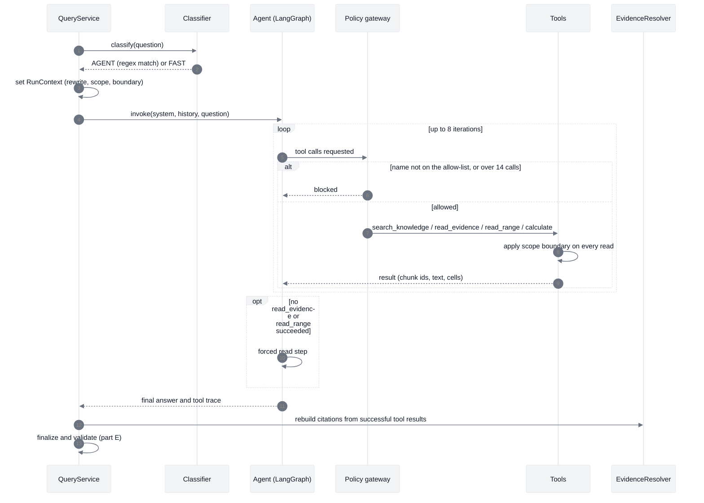

Citations come from what the tools actually returned, not from labels the model wrote. On the measured sets this path scored 47% against 82% for the fast path, because the local model usually searches once and reads the top hit; it is therefore used only for investigative phrasing.

Files: `services/query/classifier.py`, `service.py`; `services/agent/graph.py`, `policy_gateway.py`, `tools.py`, `run_context.py`.

---

## G. Asking while indexing

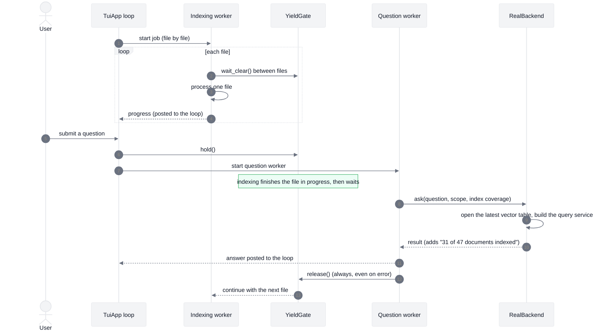

Two slots exist: one indexing job and one question. A second question is refused with a message and the draft is kept; starting Add or Refresh while a question runs is refused too. Stopping an indexing job takes effect between files. A model call that has started cannot be interrupted.

Files: `interfaces/cli/tui/app.py`, `yield_gate.py`, `real_backend.py`.

---

## H. Freshness: launch catch-up and a watcher batch

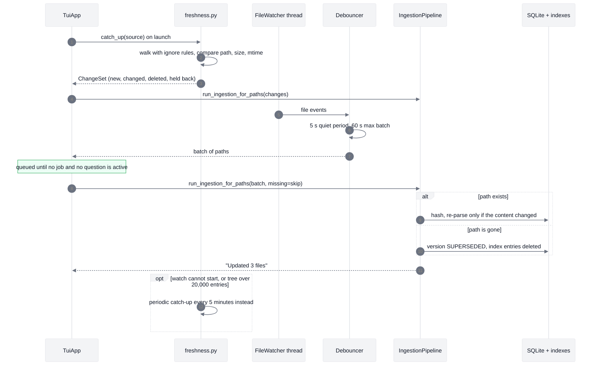

An unreachable root deletes nothing and marks the source MISSING; if everything looks "gone" under a reachable but empty root, deletions are held back rather than wiping the index. The whole mechanism stops when the window closes.

Files: `services/sources/freshness.py`, `watcher.py`; `services/ingestion/pipeline.py`; `interfaces/cli/tui/app.py`.

---

## I. Maintenance: `docket sync` / Update now

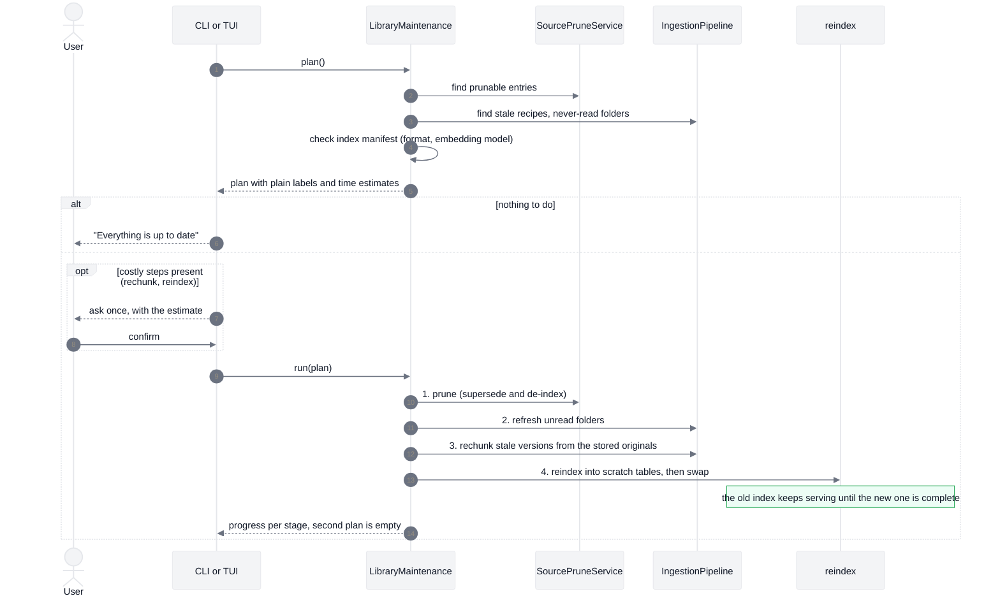

Rechunk always works from the stored original bytes, never from the file on disk, so it cannot pick up a newer edit; refresh does that. Reindex is global and is skipped when the plan is limited to one source.

Files: `services/sources/maintenance.py`, `prune.py`; `services/ingestion/pipeline.py`; `infra/index/reindex.py`.

---

## J. Narrowing a broad source and pruning

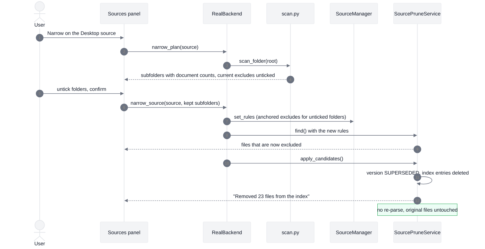

Rules are stored on the source row (`rules_json`: exclude, include, ignored files) and are read by discovery on every run, so excluded folders stay excluded. The same path handles "Ignore this file" for a permanently failing document.

Files: `services/sources/manager.py`, `scan.py`, `prune.py`; `services/ingestion/ignore.py`.

---

## K. Opening the evidence behind a citation

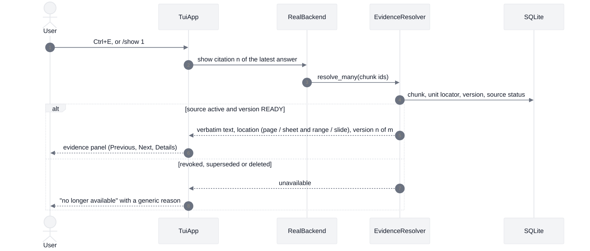

Evidence is resolved again every time it is opened, so a disconnected or deleted source cannot be read through an old answer. A citation always refers to the version it was answered from, never to a newer one. "Open original" is disabled for now.

Files: `infra/retrieval/resolver.py`; `interfaces/cli/tui/overlays.py`, `real_backend.py`.

---

## Related

- [18-current-architecture.md](18-current-architecture.md) for the block-level diagrams, [05](05-query-understanding-and-retrieval.md) for the query design, [07](07-citations-trust-and-abstention.md) for the claim-level trust layer that Part E does not yet implement, [17](17-library-and-ingestion-experience.md) for the folder-first design behind Parts A, B, G, H and I.
