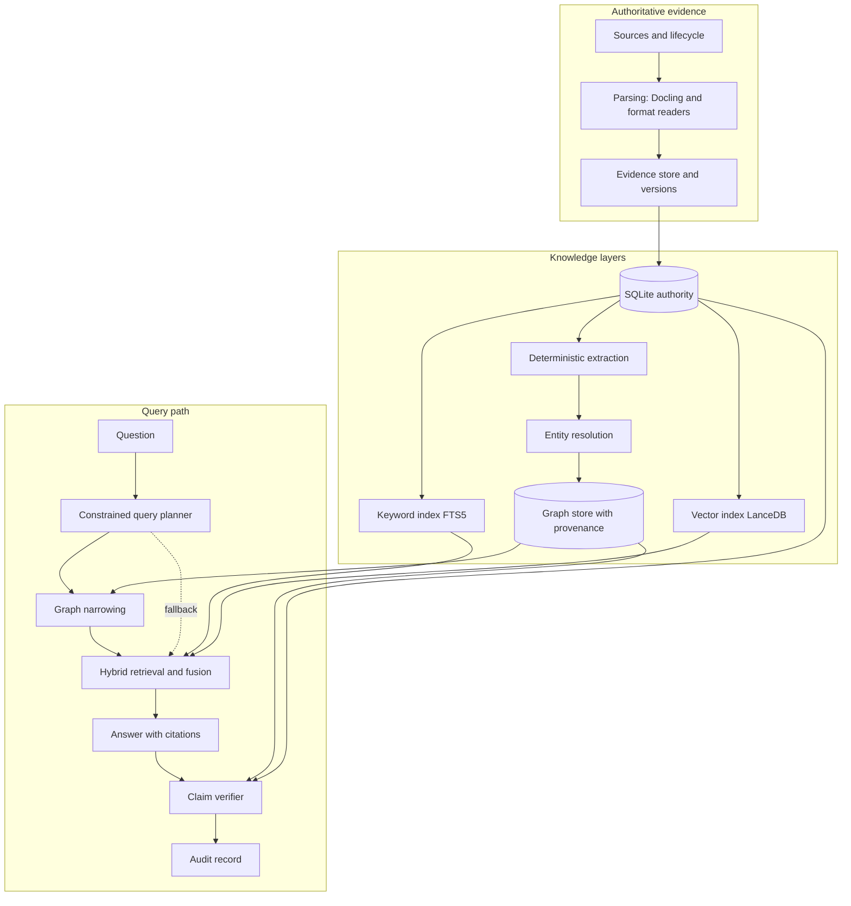
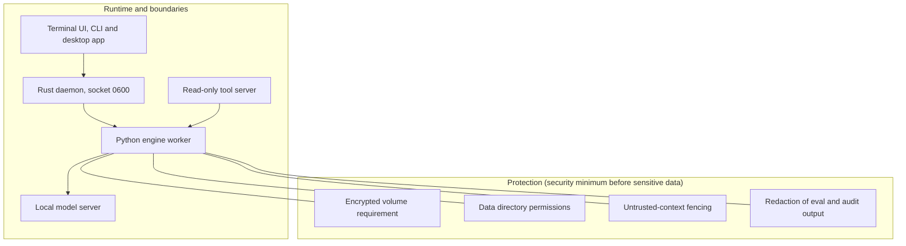
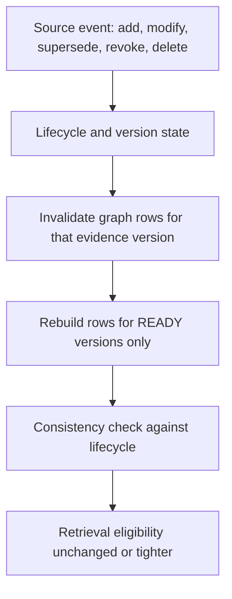

# Docket Next Phase: Architecture Assessment and KAG-First Target

Status: planning only (2026-11-17). Source of truth: the approved plan `/home/pc/.claude/plans/ok-so-hear-me-functional-hamming.md` (sections "Update 2026-11-17" and "REVISION 2026-11-17"). Code verified on branch `rust-app` (worktree `/home/pc/Desktop/Rajdeep_Dev/Local_Agent-rust`, HEAD b53d5d5). Paths below are relative to that worktree unless stated. Nothing here changes application code.

Measured results used throughout (all answer model and judge `qwen3:14b`, so the judge is the answering model; 29-question sets carry about +/-12 point 95% intervals): clean CUAD libraries, flags off 72.4 flat at 12/50/200 contracts; document layer 86.2/86.2/82.8; KAG-lite 89.7/93.1/93.1; cited-absence rescoring 93.1/96.6/93.1; original gold 31/33 with 0 wrongful abstention; G6 27/29 (flag-off control 26/29). No other numbers are claimed. Differences under about 10 points are not established.

## 1. Verdict

The architecture is sound; refine it, do not rewrite it. Stages A-E are implemented and strong. The gaps are in F (investigation, verification) and G (safety, reliability), plus a KAG layer that is real but thin. Docket is KAG-first: KAG-lite is today's foundation, not the final KAG architecture. FTS5, LanceDB and hybrid retrieval are never removed; they become the evidence-search step inside knowledge-aware retrieval rather than the only reasoning strategy.

## 2. Original stages A-G against the code

Frameworks are not progress. The absence of LlamaIndex, OpenJarvis or DeepAgents is not a deficiency; each stage is judged by whether its function exists and is measured.

| Stage | Status | Evidence | Keep unchanged | Next | Depends on |
| --- | --- | --- | --- | --- | --- |
| A Discovery and authorization | Implemented, working | source lifecycle states, tombstones, purge: `services/sources/manager.py:369` (`mark_tombstoned`), `services/sources/purge.py:84` (`purge_source`); freshness watcher | Lifecycle state machine, purge cascade | Graph consistency on lifecycle events (M3); Microsoft 365 blocked on tenant admin (Not established from repository evidence beyond `Upgrade/azure-connector-setup-status.md`) | none |
| B Parsing and extraction | Implemented, improved beyond | Docling wrapper `infra/parsing/docling_wrapper.py`; legacy Office via LibreOffice `infra/parsing/legacy_office.py`; xlsx/pptx/email/text families | Parsing contracts, locators | Real-document validation (M9) | none |
| C Evidence storage and versioning | Implemented, working; encryption missing | `ENCRYPTION_ENABLED = False` at `infra/evidence/store.py:40`; content-hash versions; reference mode `infra/evidence/references.py` | Content-addressed, version-aware evidence store | Storage protection and access boundaries before sensitive libraries (M1) | none |
| D Knowledge base | Implemented, improved beyond; KAG partial | SQLite authoritative, FTS5 `infra/index/fts_index.py`, LanceDB with ANN `infra/index/vector_index.py`, tiered indexing (migration 0017), document layer (0016), KAG-lite (0018, flag off) | SQLite as authority, FTS5, LanceDB, tiered indexing | Provenance and incremental hardening of the graph (M3) | none |
| E Retrieval | Implemented, working; no reranker | RRF fusion `infra/retrieval/hybrid.py:41,105` (`reciprocal_rank_fusion`); scoping; KAG soft scoping `services/query/service.py:589-591`; duplicate collapse | Hybrid RRF as the evidence search step | Logical-form planner over the graph (M5), only if measurements show plain scoping fails | M0, M3 |
| F Investigation | Partial, weak | Fast path good; bounded LangGraph agent `services/agent/graph.py` measured 26/55 vs fast 45/55 (one run each, one 55-question set; cause diagnosed in `docs/research/upgrade/05-query-understanding-and-retrieval.md` line 132 and `docs/research/upgrade/06-reasoning-and-agent-orchestration.md` lines 57-58); no claim verification, contradiction detection or sufficiency check | Fast path as default | Claim verifier (M2), then relations/contradictions (M6) | M0 labels |
| G Runtime and safety | Partial | Rust daemon + 0600 socket, fail-closed policy gateway `services/agent/policy_gateway.py:41`, read-only MCP `interfaces/mcp.py:41-46`; no sandbox, encryption, inference timeouts | Policy gateway, read-only MCP, worker supervision | Security minimum (M1), inference reliability (M7) | none |

## 3. KAG-lite today vs target KAG

KAG here means: entity extraction, entity resolution, typed relationships, document families, clause-to-evidence mapping and graph-assisted retrieval, evolving into a structured knowledge representation with verifiable provenance.

### 3.1 What exists today (KAG-lite, flag `DOCKET_KAG_SCOPING`, default off: `core/config.py:199-202`)

| Aspect | Today | Citation |
| --- | --- | --- |
| Tables | `kag_entities`, `kag_entity_variants`, `kag_document_entities`, `kag_document_clauses` | `core/db/migrations/versions/0018_entity_graph.py:19-44`, models `core/db/models.py:604-650` |
| Entities | parties, preamble corporate names, file-name company; one shared row per normalised name | `services/documents/kag.py:122` (`preamble_entities`), `:226` (`write_graph`) |
| Entity resolution | normalisation only (suffix stripping, plausibility, variants); no merge/split audit, no aliasing across documents beyond equal normalised key | `kag.py:46-100` |
| Relationships | only document->entity (role) and document->clause->chunk | `0018_entity_graph.py:32-44` |
| Clause typing | about 14 clause types tagged per chunk by patterns | `kag.py:152-225` |
| Query planning | exact variant match -> unique / multi / none; soft RRF-fused scoping; conservative "clause absent" note | `kag.py:317-440`, `:476` (`fuse`), `:488` (`absent_note`) |
| Provenance | document->entity edge stores one `chunk_id`, which `write_graph` sets to the document's FIRST chunk (`kag.py:235,250`), not the chunk that names the entity; clause edges store the matching chunk id; no character span, no extractor version, no explicit evidence_version id on graph rows (it is reachable through `documents` -> evidence version, `models.py:557`) | as cited |
| Incremental consistency | `write_graph` deletes and rewrites one document's edges (`kag.py:233-234`); graph rows cascade from `documents` (`ON DELETE CASCADE`); `prune_documents` and purge delete `Document` rows (`services/documents/builder.py:144-157`); shared entity rows are left behind as harmless orphans. Not tested at scale | as cited |
| Verification of graph conclusions | none | `services/query/trust.py` types are unused (section 6) |
| Measured | 89.7/93.1/93.1 at 12/50/200 clean contracts, 29 questions, wide intervals | plan, Update 2026-11-15 |
| Limits | contract-shaped (CUAD names and preambles); the planner is a name-window match, not a logical form | `kag.py:298-317` |

### 3.2 Target KAG layers (none beyond layer 1-2 partial exist today)

| Layer | Content | State |
| --- | --- | --- |
| 1 Authoritative evidence | evidence versions, chunks, locators in SQLite | exists, unchanged |
| 2 Deterministic extraction | entities, dates, amounts, defined terms, clause types, references, amendments; LLM fallback only if a gate justifies it | partial (parties, ~14 clauses; fields in `document_fields`, `models.py:588-603`) |
| 3 Entity resolution | variants, aliases, cross-document merges, merge/split audit | normalisation only |
| 4 Typed relations | party_to, amends, supersedes, version_of/family, defines, references, clause_of, obligation_of | `supersedes_*` and `family_key` exist on `documents` (`models.py:566-572`); others missing |
| 5 Graph store with provenance | SQLite tables; every node, edge and derived fact carries source id, evidence_version_id, chunk id, char span, extractor+version, confidence | partial |
| 6 Constrained logical-form planner | small typed schema `{entities, relation/clause/field, operation, constraints, scope}`; validated; executed deterministically; falls back to hybrid retrieval | missing |
| 7 Hybrid retrieval inside the narrowed evidence | FTS5 + LanceDB + RRF | exists |
| 8 Answer | model answers from the narrowed evidence | exists |
| 9 Claim verifier | verifies text-derived statements AND graph-derived conclusions against authoritative evidence | missing |
| 10 Audit record | metadata of plan, retrieval, verification, citations | missing |

No LLM graph extraction and no free-roaming agent framework until measurements justify them (published LLM graph indexing costs tens to hundreds of millions of tokens; small local models extract unreliably; sources in the plan, tagged mostly preprints). Deterministic reasoning is the baseline.

## 4. Provenance model (target)

Rule: every graph entity, relationship and derived conclusion links to exact source evidence, document version and location, or it is not used.

| Record | Required provenance fields |
| --- | --- |
| Entity mention | source id, evidence_version_id, chunk id, char span within chunk, extractor name+version, confidence |
| Entity (resolved) | set of mention ids; resolution method; merge/split history |
| Relationship | subject, object, type, supporting mention or clause ids, evidence_version_id on both ends, extractor+version, confidence |
| Derived conclusion (for example "document X has no governing-law clause", "amendment Y supersedes Z") | the set of edges/scans it rests on, the evidence versions scanned, a computed-at marker; a negative conclusion records the scan coverage |
| Citation | chunk id plus label, resolved through the existing evidence resolver; the verifier checks it, not just tag existence |

Existing anchors to reuse: `DocumentField.evidence_chunk_id`, `char_span`, `extractor_version`, `confidence` (`core/db/models.py:588-603`) already model this for fields; KAG tables do not yet.

## 5. Incremental update model (target)

| Event | Required behaviour | Existing mechanism |
| --- | --- | --- |
| New or modified source | rebuild graph rows derived from that evidence version only; entity rows are shared and reference-counted or lazily pruned | `build_document` -> `write_graph` replaces per-document rows (`builder.py:97-100`, `kag.py:226`) |
| Supersede | old version's rows invalidated; family relations updated; family-latest retrieval unchanged | `services/documents/family.py:149` (`apply_latest`) |
| Revoke / tombstone | no graph row may make revoked evidence retrievable or citable; eligibility follows existing lifecycle | revoke filtering in the retrieval path; graph rows not checked against lifecycle today (Not established from repository evidence that a stale clause edge cannot surface a revoked chunk; M0 adds a test, M3 fixes if it fails) |
| Delete / purge | graph rows cascade; orphan entities pruned | cascade on `documents` (`0018_entity_graph.py:32-44`) |
| Invariant | after any event: no graph row points to non-READY or revoked evidence; incremental result equals a full rebuild on the same corpus | consistency checker is M3 (`docket doctor --graph`) |

Scale: the 100-500 GB target is preserved by making construction, update and query incremental (per-document rebuild, indexed lookups). No capacity claims without benchmarks (M8).

## 6. Verified gaps list

Each item marked against the code. "Refined" means the plan's statement was right in substance but needed adjustment.

| Gap | Verdict | Evidence and refinement |
| --- | --- | --- |
| Claim-level verification | Verified | citation check is mechanical: `services/query/service.py:1002-1066` (`_finalize_answer`), `services/query/citations.py:74-112` (tag in retrieved set, one regeneration, else abstain). `services/query/trust.py` defines `ClaimDraft`, `ClaimVerification`, `TrustSummary`, `AnswerStatus.CONFLICT`, `AbstentionReason.VERIFIER_UNAVAILABLE` but no module outside `trust.py` imports them. `eval/schema.py:292-294` has unused `answer_status`/`claim_records`. An offline support judge exists (`eval/judge.py:61` `claims_for`, `prompts/judge.py`). |
| Multi-document investigation | Verified | no per-document decomposition on the live path; `services/query/routing.py` header states nothing imports it on the query path |
| `multistep.py` | Refined | exists only on branch `acc-step3` (worktree `/home/pc/Desktop/Rajdeep_Dev/Local_Agent-acc3`, file `backend/src/docket/services/query/multistep.py`); not on `rust-app` or `main` |
| Contradiction detection | Verified | `AnswerStatus.CONFLICT` only in `trust.py`; version awareness exists (`models.py:566-572`, `family.py:149`) but compares nothing |
| Sufficiency checking | Verified | no module; abstention is the only insufficiency signal |
| Authority / sensitivity metadata | Verified | no `authority`, `sensitivity` columns in `core/db/models.py` (document status is lifecycle only) |
| Persisted audit trail | Verified, refined | no persisted query/tool-call/citation log. Opt-in feedback JSONL exists (`services/feedback.py:30-42`, 0600) and eval `RunRecord`s hold full prompts and retrieved text (`eval/schema.py:248-290`) |
| Encryption at rest | Verified | `infra/evidence/store.py:21-40` states it is not implemented |
| Sandboxing | Verified | tool allow-list and policy gateway are real (`policy_gateway.py:41`), but no OS sandbox exists (Not established from repository evidence that any is planned beyond doc notes) |
| Prompt-injection defence | Verified, refined | instruction-only: no fencing of context blocks found in `prompts/query.py`; integration test dir has a prompt-injection test (`backend/tests/integration/`), needs live Ollama |
| Agent underperformance | Verified, cause diagnosed | 26/55 (47.3%) vs 45/55 (81.8%), single runs, `docs/research/upgrade/06-reasoning-and-agent-orchestration.md:57-58`; free ReAct loop searched once, read top hit, 67 searches, 69 reads, 2 `read_range`, 0 `calculate` (`docs/research/upgrade/05-query-understanding-and-retrieval.md:132`). It is a systematic tool-use failure, not evidence the agent idea is wrong; fix by forcing plan/read steps and re-measuring (M5/M6), keep opt-in until it wins |
| Real-document validation | Verified | gold sets are public or synthetic (`backend/eval-public/gold*.yaml`); `reviewed: true` is a flag (`eval/schema.py:119`), not independent review; private kit exists (`backend/eval-private/run_private_eval.py`) but results from users: Not established from repository evidence |
| Rust app status | Refuted (as "paused spike, no tests") | Rust workspace is the mainline on `rust-app`; `app/Cargo.toml` members `docket-proto`, `docketd`, `docket-app`; 36 test attributes (6 in `docket-app/src/model.rs`, 14 in `docketd/tests/api.rs`, others in `docketd/src/socket.rs`, `docket-proto/src`). Open: `Citation` lacks `note` (`app/docket-proto/src/api.rs:64-70`) |
| Inference timeouts | Verified | `infra/inference/gateway.py` has no timeout or cancel; only the daemon's `DOCKET_ASK_TIMEOUT_MS` default 300000 (`app/docketd/src/config.rs:60`, used at `api.rs:195`). Whether the Python worker is cancelled after a daemon 504: Not established from repository evidence |
| Judge independence | Verified | defaults `qwen3:30b` + cross-check `gemma3:12b` (`eval/judge.py:30-31`) but all reported runs used 14b alone; kappa code exists with target 0.7 (`eval/calibration.py:30`) and has never been run on human labels |
| Statistics | Verified | `eval/stats.py` has Wilson, Cohen kappa, exact McNemar, paired flips; no bootstrap, no clustering by question across repeats |
| CI | Verified | no `.github/` directory in the worktree; no CI config found |
| Run configuration capture | Verified (new) | `RunRecord.configuration` (`eval/runner.py:346-`) records models and prompts knobs but not the doc-layer/KAG flags or the code commit; judge identity lives in `JudgedRun.judge_models` (`eval/judge.py:150`) |

## 7. Target architecture

## 8. Component responsibilities and boundaries

| Component | Responsibility | Boundary rule |
| --- | --- | --- |
| Evidence store (`infra/evidence/`) | authoritative bytes, versions, locators | the only source of truth; graph and indexes are derived and rebuildable |
| Indexes (`infra/index/`) | FTS5 and LanceDB over stored chunks | never removed; resumable reindex from SQLite (`infra/index/reindex.py`) |
| Documents/KAG (`services/documents/`) | deterministic extraction, entity resolution, relations, graph store | additive, flag-gated, every row traceable to evidence |
| Query planner (new, M5) | validate a typed plan, run it deterministically | cannot execute free text, cannot call tools; falls back to hybrid retrieval |
| Query service (`services/query/service.py`) | retrieval, prompt, answer, citation check | fast path stays default |
| Claim verifier (new, M2) | check text and graph claims against evidence | flag off/shadow/enforce; fail-closed only when configured |
| Agent (`services/agent/`) | bounded investigation | opt-in until it beats the fast path; policy gateway unchanged |
| Rust daemon and app (`app/`) | supervision, streaming, UI | read-only toward the engine; no policy logic |
| Eval (`eval/`) | measurement | tooling only; never changes answers |

## 9. OpenJarvis vs LangGraph + Ollama

Evidence: a code search found no OpenJarvis, DeepAgents, NemoClaw or OpenShell in the repo (`docs/PRODUCT_KNOWLEDGE_REPORT.md` section 1). The current orchestration is LangGraph `StateGraph` + `ChatOllama` (`services/agent/graph.py:64-65,152,209-211`) behind a policy gateway. Properties of OpenJarvis beyond the repo's own docs: Not established from repository evidence.

| Question | Assessment |
| --- | --- |
| Functionality gained | possibly planning, memory, tool orchestration, session logs; none of these is a measured Docket bottleneck. The measured agent failure is tool under-use, which a framework does not fix by itself |
| Duplicated | agent loop, tool binding, step budgets, policy gateway semantics (fail-closed forged-call test, `spike/RESULTS.md` Case 3) |
| Replaced | only the LangGraph loop (about 284 lines) and possibly the gateway, and only if it passes the same forged-tool-call test |
| Integration complexity | new dependency, new trust boundary, second evidence-access path; must not bypass the evidence resolver or citation rules |
| Security implications | a general agent runtime widens tool and filesystem surface; Docket's guarantees (allow-list, fail-closed, read-only MCP `interfaces/mcp.py:41-46`) must be re-proved |
| Success criteria to adopt | (1) a verified problem the current stack cannot solve; (2) beats the fast path and the current agent on a labelled multi-document gold set with a paired test; (3) passes the forged-tool-call and prompt-injection tests; (4) keeps the evidence model and citation validation as the only answer path; (5) runs locally on 16 GB class hardware |
| Recommendation | Defer. Possible later trial: an MCP client over the existing read-only MCP server, after M2, M4 and M5 exist. Same for DeepAgents. Neither becomes an architectural dependency without demonstrated benefit |

## 10. Design trade-offs

| Choice | Pro | Con | Decision |
| --- | --- | --- | --- |
| Deterministic extraction first | cheap, reproducible, auditable | contract-shaped, lower recall on unfamiliar documents | baseline; LLM fallback only through a measured gate |
| SQLite graph tables | one authoritative store, cascade, simple backup | recursive traversal limited | adequate for typed 1-2 hop queries; graph database is Not established as needed |
| Soft (fused) scoping over hard routing | research and our curve say hard routing can lose points (plan, Update 2026-11-15) | less crowding relief | exclusive scoping only for a unique high-confidence match |
| Claim verifier with deterministic checks first | low latency | misses paraphrase unsupported claims | batch model call only for unsettled claims; shadow first |
| Metadata-only audit | privacy | less replay detail | default; opt-in verbose |
| Volume-level encryption first | no format change | needs user disk setup | recommend first; per-object AES-GCM later |

## 11. Open technical decisions

| Decision | Options | Resolved by |
| --- | --- | --- |
| Judge independence | gemma3:12b second judge vs larger judge on constrained hardware | M0 measurement (kappa vs human labels) |
| Graph schema for relations (amends, references) | extend KAG tables vs a typed edge table | M3 design after M0 weakest-metric result |
| Planner schema expressiveness | minimal `{entities, clause/field, operation, scope}` vs richer | M5, only after M0 shows where scoping fails |
| Audit retention and redaction | days, fields stored | M4 |
| Encryption path | LUKS/fscrypt guidance vs per-object | M1 design note |
| Agent fix | forced plan/read steps vs port `multistep.py` | M5/M6 measurement |
| Rebuild vs incremental for entity rows | reference counts vs lazy prune | M3 |

## 12. Principles

Local-first (nothing leaves the machine except opt-in read-only connectors). Evidence-first (no claim without an evidence span). Version-aware (provenance names the evidence version). Fail-closed (verification, policy, and lifecycle errors abstain, not guess). Least privilege (read-only tools, allow-lists). Benchmark-driven (no default flip, capacity claim or "improvement" without a paired measurement). Modular (each layer flag-gated, falls back to today's search). Incremental (per-document graph updates). Untrusted documents (document text is data, not instructions). Security before real data: storage protection and access boundaries precede testing on sensitive libraries.
