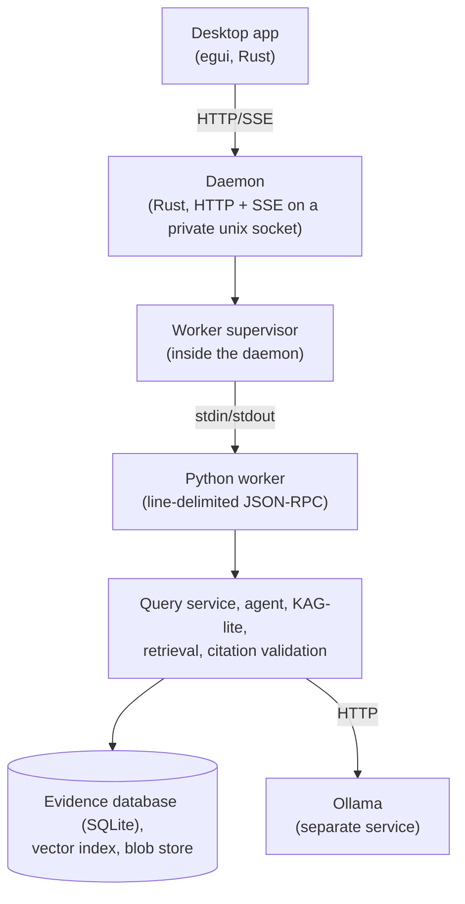
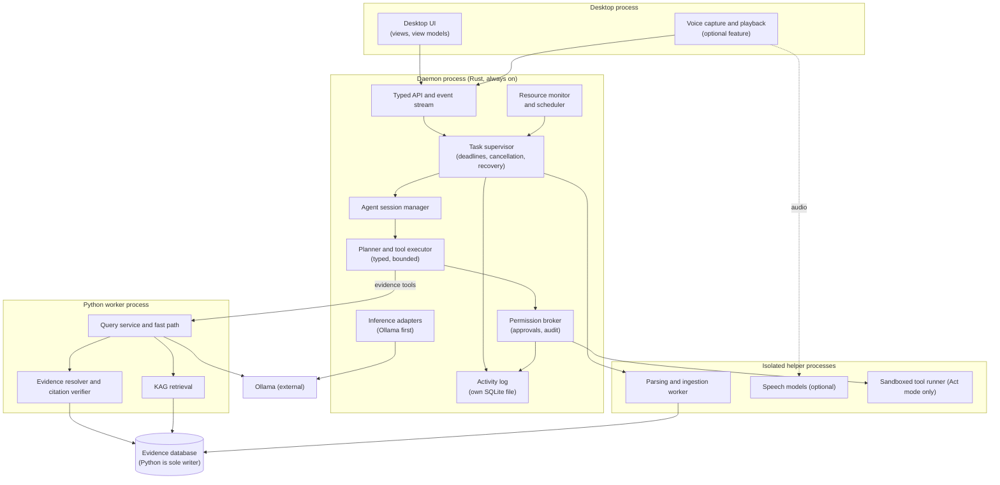
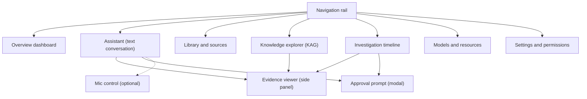
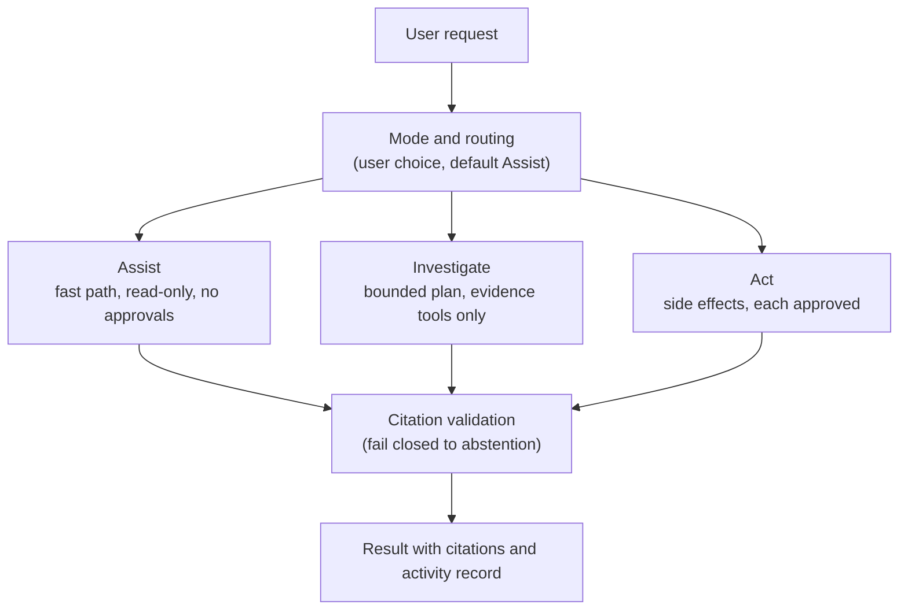
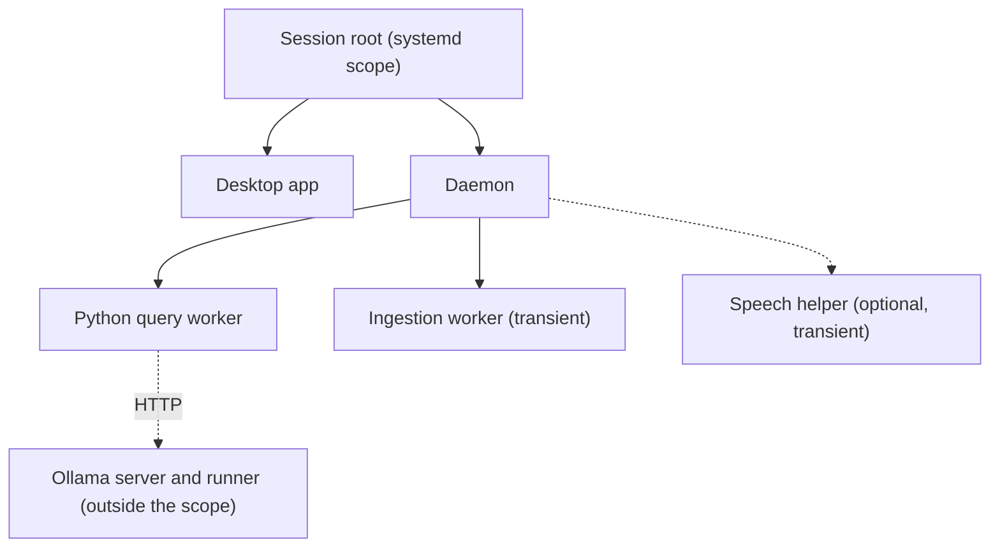
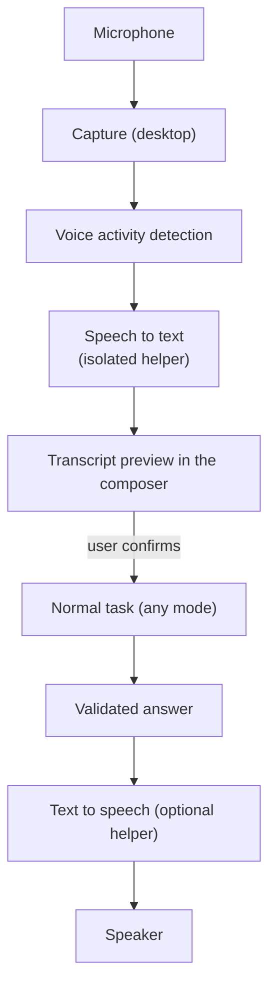

# Docket Rust Platform Architecture

Status: planning only (2026-11-17). Uncommitted. No application code, dependency, database or model change was made while writing this.
Scope: how Docket grows from "Rust daemon + egui app + Python evidence engine" into a Rust-native, local-first, multimodal personal AI workspace (interactive desktop plus bounded assistant backend, voice optional).

Conventions
- Repository evidence paths are relative to the `rust-app` worktree `/home/pc/Desktop/Rajdeep_Dev/Local_Agent-rust` (HEAD `8e02434`, "Merge M0 phase 1"). Line numbers are from that checkout.
- "Web-derived" marks a fact fetched from the web on 2026-11-17 (OpenJarvis GitHub page, docs page, GitHub API). "General knowledge" marks facts from my background knowledge that were not re-verified here and must be checked before they drive a decision.
- "Not established from repository evidence." means exactly that. No benchmark number appears in this document unless it comes from a cited repo document.
- Light read-only checks only: `ps`, `free`, file reads. Observed at write time: no `docketd`, `docket-app` or Python worker running; `ollama serve` idle at about 38 MB RSS (no model resident); 31 GB RAM total, about 8 GB used by other desktop applications.

---

## 1. Current versus target runtime

### 1.1 What exists (verified)

The desktop is not a throwaway prototype and Python does not do everything. There is a working three-crate Rust workspace (about 5.3k lines including tests) that already owns process supervision, the local API, the socket security rules and the whole UI. Python owns retrieval, evidence, KAG-lite, generation orchestration and ingestion.



| Capability | Status | Evidence |
| --- | --- | --- |
| Daemon serving `GET /v1/status`, `GET /v1/sources`, `POST /v1/ask` on a unix socket only | Exists, tested | `app/docketd/src/api.rs:59-67`; no TCP listener, `app/docketd/src/lib.rs:1-2` |
| Socket security: private dir 0700, socket 0600, symlink and owner checks, stale-socket cleanup, second-daemon refusal | Exists, tested | `app/docketd/src/socket.rs:17-91`, tests `:97-131`, `app/docketd/tests/api.rs` (`socket_and_directory_permissions`, `second_daemon_refused_and_stale_socket_replaced`) |
| SSE event stream for one question: `phase`, `delta`, `result`, `error` | Exists, tested | `app/docketd/src/api.rs:246-314`; decoder `app/docket-proto/src/api.rs:156-189` |
| Streaming answer with explicit "unvalidated until result" semantics | Exists | `app/docket-proto/src/api.rs:13-15,160-163`; worker `backend/src/docket/interfaces/worker.py:14-19` |
| Forward-compatible decoding (unknown event names and malformed data skipped, unknown JSON fields ignored) | Exists, tested | `app/docket-proto/src/api.rs:167-168,221-225` |
| Worker supervision: single owner task, restart with exponential backoff (500 ms base, 10 s cap), idle ping every 10 s, startup timeout 120 s, per-call timeouts (ask 300 s, other 15 s), crash and hang detection, kill on failure, EOF-then-kill shutdown | Exists, tested | `app/docketd/src/worker.rs:130-148,150-162,175-181,275-333`; `app/docketd/src/config.rs:192-197`; tests `crash_is_reported_and_worker_restarts`, `hung_worker_times_out_is_killed_and_replaced`, `clean_shutdown_removes_socket_and_kills_worker` |
| Worker stdout hygiene (fd 1 redirected to stderr, protocol on a duplicate fd; non-protocol lines ignored and never logged) | Exists, tested | `backend/src/docket/interfaces/worker.py:266-272`; `app/docket-proto/src/rpc.rs:72-103`; `app/docketd/src/worker.rs:383-388` |
| One question at a time (semaphore of 1, HTTP 429 `busy`) | Exists, tested | `app/docketd/src/api.rs:47,216-223`; test `only_one_question_in_flight` |
| Request ids, structured logs without bodies | Exists | `app/docketd/src/api.rs:71-85,98-134` |
| One chokepoint for every worker call, written as the future policy/approval hook | Exists (design hook only) | `app/docketd/src/worker.rs:6-7` |
| egui desktop: library panel with source scope, chat with streamed answer shown as unverified, citation chips and evidence excerpts, status line, daemon auto-launch and clean stop | Exists | `app/docket-app/src/ui.rs` (433 lines), `backend.rs:94-258`, `model.rs` (citation layout, unit-tested); eframe 0.37 with glow, x11 and wayland features `app/docket-app/Cargo.toml` |
| UI/backend separation (toolkit swappable without touching protocol or daemon) | Exists by design | `app/docket-app/src/main.rs:1-9` |
| Python agent: bounded LangGraph loop (`max_agent_iterations=8`, `max_agent_tool_calls=14`), fail-closed policy gateway, four tools (`search_knowledge`, `read_evidence`, `read_range`, `calculate`), per-run scope and boundary context | Exists, opt-in by routing, weak | `backend/src/docket/services/agent/graph.py`, `policy_gateway.py:55-84`, `tools.py`, `run_context.py`; `backend/src/docket/core/config.py:242-243`; routing `services/query/service.py:426-428` |
| Read-only MCP stdio server (`docket_search`, `docket_read`, `docket_list_sources`, read-only annotations) | Exists | `backend/src/docket/interfaces/mcp.py:41-63,210` |
| Inference port: `InferenceGateway` protocol, `StreamingInferenceGateway`, Ollama implementation, deterministic fake | Exists | `backend/src/docket/infra/inference/gateway.py:121,149,253,380` |
| Single advisory library writer (flock) | Exists | `backend/src/docket/core/writer_lock.py:1-24` |

### 1.2 What is partial or missing

| Capability | Status | Evidence |
| --- | --- | --- |
| Cancellation | Missing end to end. The daemon cannot interrupt a question: the permit is held "even if the client goes away: the worker cannot be interrupted mid-question". The worker loop is a synchronous `for line in rfile` handling one request at a time, with no cancel method. The UI has no stop button. The only relief is the 300 s ask timeout, which kills and restarts the worker. | `app/docketd/src/api.rs:248-250`; `backend/src/docket/interfaces/worker.py:130-131`; `app/docketd/src/worker.rs:313-318`; roadmap M7 already lists "worker cancel on daemon 504" (`docs/NEXT_PHASE_ROADMAP.md:21`) |
| Inference timeouts and bounded retry | Missing in the Python gateway (no timeout handling found in `gateway.py`); planned as M7 | `docs/NEXT_PHASE_ROADMAP.md:21` |
| Typed event stream beyond one question | Missing. Events exist only for `POST /v1/ask`; there is no task id, no sequence number, no replay, no events for ingestion, indexing, model state or tools | `app/docket-proto/src/api.rs:156-165` |
| Task registry / recovery after daemon restart | Missing. State is in memory (`Arc<Mutex<WorkerInfo>>`, an atomic counter); nothing persists | `app/docketd/src/worker.rs:41-45`, `api.rs:28-37` |
| Tool events, approval flow, permission model in Rust | Missing. The policy gateway is Python-only and covers the four read tools; the Rust hook is a comment | `app/docketd/src/worker.rs:6-7` |
| Worker methods beyond `ping`, `status`, `sources.list`, `query.ask` (no source add/remove/reindex, no document or chunk viewer, no KAG browse, no history) | Missing. The worker is read-only by convention (not enforced; M1) and "performs no ingestion and takes no writer lock" | `backend/src/docket/interfaces/worker.py:10,21-23` |
| Evidence viewer beyond a 400-char excerpt; page rendering | Missing | `worker.py:41,190-196` |
| KAG explorer | Missing. KAG-lite tables exist (`kag_entities`, `kag_entity_variants`, `kag_document_entities`, `kag_document_clauses`, `backend/src/docket/core/db/models.py:602-640`) but no read API crosses the worker boundary | models.py as cited |
| Activity log / session memory persisted by the daemon | Missing. The planned audit record is M4 and lives on the Python side | `docs/NEXT_PHASE_ROADMAP.md:19` |
| Multi-turn conversation in the desktop | Not established from repository evidence for the worker path: `query.ask` takes only `question` and `scope` (`worker.py:198-214`); `QueryService.ask` accepts history (`service.py:366-373`, `trim_history` at `:416`) | |
| Resource monitor (VRAM, model residency, RSS of the process tree) | Missing in the app. M0 added a GPU metrics recorder for evaluation only (commit `de94b8d` "GPU metrics recorder") | git log |
| Voice | Missing; no audio or speech dependency in `backend/pyproject.toml` or the Rust workspace (one hit for "audio" in `infra/parsing/pptx_wrapper.py` is slide media) | grep |
| Packaging | Missing; `app/dev.sh` only (`docs/research/upgrade/09-runtime-resources-and-deployment.md:61`) | |

### 1.3 Reusable as is

The framing (JSON-RPC lines worker side, HTTP+SSE client side), the supervisor, the socket rules, the forward-compatible decoders, the UI/backend/model split, the fake-worker test harness (`app/docketd/tests/fixtures/fake_worker.py`) and the stdout hygiene all carry forward unchanged. The target architecture is an extension of these, not a replacement.

### 1.4 Current versus target in one table

| Concern | Current | Target |
| --- | --- | --- |
| UI | egui, one chat plus library panel | egui, multi-view workspace (section 4) |
| Daemon | Proxy plus supervisor for one worker, one question at a time | Task supervisor, session manager, event bus, permission broker, activity log |
| Python | The whole evidence and query engine, worker (read-only by convention, not enforced; M1) | Stays the evidence/KAG/retrieval authority until a piece is replaced with no accuracy loss (decision R7, `docs/research/upgrade/00-requirements-and-open-questions.md:19`) |
| Events | Per-question SSE | Versioned typed event stream with task ids and sequence numbers |
| Cancellation | None | Cooperative (worker) with hard-kill fallback (daemon) |
| Agents | Python LangGraph, weak | Deterministic fast path stays baseline; typed Assist/Investigate/Act modes; tools always via evidence tools |
| Inference | Python calls Ollama | Same, behind the existing port; Rust adapter only when Rust code needs generation (section 3.5) |
| Voice | None | Optional feature flag, push-to-talk first |

---

## 2. OpenJarvis as a reference

### 2.1 Facts

Web-derived (GitHub page, project docs site, GitHub API, fetched 2026-11-17):
- "A framework for local-first personal AI"; Apache-2.0; created 2026-02-15; last push 2026-11-17; about 16.3k stars; 1,370 commits on `main`; 87 open issues per the API.
- Languages by bytes: Python about 11.6 MB, Rust about 1.0 MB, TypeScript about 0.9 MB. So it is predominantly a Python framework with a Rust extension and a Tauri-style desktop folder (`desktop/src-tauri` per the page).
- Five pillars on the docs site: Intelligence (model catalog, hardware-fit selection), Engine (inference runtime layer; Ollama, vLLM, SGLang, llama.cpp, MLX, Exo, LiteLLM and cloud providers behind one `InferenceEngine` interface), Agents (eight built-in agent types, multi-step tool use), Tools and Memory (web search, calculator, file I/O, code interpreter, retrieval, persistent local state, external MCP servers), Learning (interaction traces drive improvements to weights, prompts and agent behaviour).
- Install pulls uv, a Python venv, Ollama and a starter model; Node.js 22 or newer for its GUI; DSPy is used for skill optimisation; Python 3.11 or newer.
- Not established from the sources I read: the names of the eight agents (partially listed on the GitHub page: `deep_research`, `orchestrator`, `simple`), memory storage backends, the exact MCP client implementation, release cadence, and any sandbox or approval model.

Repository evidence: no OpenJarvis code or reference exists in Docket (`docs/PRODUCT_KNOWLEDGE_REPORT.md:128,493`). The earlier assessment (`docs/NEXT_PHASE_ARCHITECTURE.md:199-212`) deferred it; this section supersedes its "Not established" parts with the web facts above.

### 2.2 Four ways to use a reference

(a) Adopt a concept: copy the idea, write Docket's own code. No dependency, no trust boundary.
(b) Use a library: import code into a Docket process. Adds code to the evidence path's address space; Python-only in practice.
(c) Run the framework as a subprocess: a separate runtime talks to Docket over a protocol.
(d) Consume MCP tools: Docket (or a Docket-side agent) calls tools exposed by an external MCP server, or an external agent calls Docket's MCP server.

### 2.3 Per abstraction

| OpenJarvis pillar | Useful concept for Docket | Docket equivalent today | Method and recommendation |
| --- | --- | --- | --- |
| Intelligence (model catalog, hardware-fit selection) | A declared model profile (role, context size, VRAM class, capabilities) chosen against detected hardware | `Settings.gen_model`, `embed_model` and the locked `qwen3:14b` decision; health check `infra/inference/health.py` | (a) Adopt. A small `ModelProfile` and role table in the daemon (section 3.5). Do not import a catalog; model choice here is evidence-driven and locked by measurement |
| Engine (single `InferenceEngine` interface over many backends) | One narrow inference port with interchangeable adapters | `InferenceGateway` and `StreamingInferenceGateway` protocols (`gateway.py:121,149`) | (a) Adopt, already done in Python. Mirror it as a Rust trait only when Rust needs generation. Do not use its engine library (Python, pulls other backends Docket does not need) |
| Agents (eight types, orchestration) | Named agent roles, orchestrator pattern, per-agent tool allow-lists | Bounded LangGraph agent plus policy gateway | (a) Adopt the vocabulary for Assist/Investigate/Act modes. Not (b) or (c): the measured failure was tool under-use (section 5), which a different loop does not fix by itself |
| Tools and Memory | Tool registry with typed schemas; persistent local state; MCP as the tool transport | Four typed tools, fail-closed allow-list, read-only MCP server, `interfaces/mcp.py` | (a) for the registry shape; (d) as a later, optional experiment: an external MCP client may call Docket's read-only server. Docket never consumes an external MCP server in Investigate mode (prompt-injection and provenance surface). In Act mode external MCP tools could be offered, each behind the permission broker |
| Learning (traces improve weights, prompts, behaviour) | Trace capture is useful; automatic self-modification is not | Eval harness, `RunRecord`s | (a) for trace capture only, as the audit record (M4). Explicitly reject automatic prompt or weight updates: they would invalidate the measured baselines the roadmap depends on |

### 2.4 Verdicts

- Do not integrate the full runtime by default. Reasons: Python-centred (conflicts with the Rust-first priority), pulls Node.js, DSPy, its own installers and Ollama management (Docket already manages Ollama as an external service), introduces a second path to evidence that would have to be re-proved against the forged-tool-call and prompt-injection tests, and its Learning loop conflicts with a frozen, measured baseline.
- Concepts (a) are adopted: engine port, model profile, tool registry, named modes.
- Library (b): none recommended.
- Subprocess (c): not recommended. Revisit only if a labelled multi-document gold set shows it beats the fast path under a paired test (the adoption criteria at `docs/NEXT_PHASE_ARCHITECTURE.md:199-212` still stand).
- MCP (d): the one realistic bridge. A trial of an external MCP client against `interfaces/mcp.py` is cheap and keeps the evidence model as the only data path (`docs/NEXT_PHASE_ROADMAP.md:91`). Unknown: whether OpenJarvis's MCP client works as needed. Not established.
- License: Apache-2.0, same as the Rust workspace (`app/Cargo.toml` `license = "Apache-2.0"`), so reading and borrowing ideas carries no licensing obstacle; copying code would need attribution and notice.
- Maintenance: very active (push on the day of research) and young (created February 2026). High churn is a risk for any hard dependency.

---

## 3. Target Rust architecture

### 3.1 Principles

1. The authoritative SQLite evidence model and source lifecycle stay as they are, owned by Python (migrations, lifecycle, purge, versioning). Rust never writes to the evidence database.
2. Any path that yields an answer shown as trusted goes through the evidence tools and citation validation. Rust-side agent or voice code calls them; it never reads documents directly.
3. Additive protocol evolution. Existing `/v1` routes, SSE event names and JSON fields stay valid; new things are new routes, new event names, new optional fields.
4. Processes, not threads, for anything heavy, native or untrusted (parsers, STT, sandboxed tools). Rust components that are cheap and trusted run in the daemon process.
5. Every long action is a task: it has an id, a state, a deadline, a cancel token and an event stream.

### 3.2 Component map



### 3.3 Placement: in-process versus isolated

| Component | Where | Why |
| --- | --- | --- |
| Desktop UI, view models | Desktop process | Latency; crash isolation from the daemon (a UI crash must not kill a running task) |
| Voice capture and playback (audio device, VAD) | Desktop process, behind a cargo feature | Needs the user session's audio device; small footprint |
| Speech models (STT/TTS) | Isolated helper process, started on demand, killed when idle | Memory residency is large and optional; must be evictable |
| Typed API, event bus, task supervisor, session manager, permission broker, resource monitor, activity log | Daemon process, in-process modules | All cheap, trusted, share one deadline and cancellation model; one language and one process keeps idle memory low |
| Planner and typed tool executor | Daemon process (logic), tools execute in the Python worker or sandbox | The executor is a state machine plus validators; the heavy parts are the tools |
| Inference adapters (Ollama) | Daemon in-process, HTTP client | Needed for planner/reasoning calls initiated from Rust; Python keeps its own adapter for the fast path |
| Query service, KAG retrieval, evidence resolver, citation verifier | Python worker | Authoritative, measured; replacing requires "no accuracy loss on the gold sets" (R7) |
| Parsing and ingestion (Docling, LibreOffice, OCR) | Separate Python worker process (writer), spawned per ingest job | Parsing peaks are the largest transient memory (measurement plan, section 6); isolating them lets the daemon bound, cancel and kill them without touching the read worker |
| Sandboxed tool runner | Separate process under Landlock/seccomp (section 9) | Untrusted by construction |

### 3.4 Write ownership (single-writer rules)

| Data | Sole writer | Readers | Mechanism |
| --- | --- | --- | --- |
| Evidence SQLite (sources, versions, chunks, KAG tables, jobs) | Python ingestion/lifecycle worker holding the library writer flock | Python query worker (read-only by convention, not enforced; M1), MCP server (read-only engine), UI via API only | Existing `core/writer_lock.py` (flock; one writer per data dir). The daemon launches the writer worker but never opens the evidence file for writing |
| Vector index (LanceDB), blob store | Same writer | Query worker | As above |
| Activity log (sessions, tasks, tool calls, approvals) | Daemon | UI via API, export tool | Separate SQLite file `activity.sqlite3` in the data dir, WAL mode, owned and migrated by the daemon. Deliberately not in the evidence database, so Alembic and the evidence model are untouched |
| M4 investigation/audit record (retrieval ops, citations, verification) | Python (same transaction scope as evidence) | Daemon reads it by id | Planned in M4; cascade-deleted with its source |
| Settings and permissions | Daemon | UI | A daemon-owned file with 0600 mode |
| Ollama model state | Ollama | Daemon (read, `/api/ps`, `/api/tags`) | External service |

Rule: the daemon's activity log stores identifiers and metadata only (section 8). Content that derives from documents lives only in the evidence database, where source deletion already purges it.

### 3.5 Typed API and event schema

Versioning: the API stays under `/v1`. Additions are optional and discoverable: `GET /v1/status` gains an optional `capabilities` array (older clients ignore unknown fields, as `StatusResponse` does not reject them, `app/docket-proto/src/api.rs:134-141`) such as `"tasks.v1"`, `"events.v1"`. New clients check capabilities and fall back to the existing `POST /v1/ask` SSE route. The old route is kept as a thin adapter over a task. A breaking change would be `/v2`, not planned.

Proposed Rust types (sketch, in `docket-proto`):

```rust
/// Stable identifiers.
pub struct TaskId(pub String);      // "t-<boot>-<n>", same scheme as request ids
pub struct SessionId(pub String);
pub struct ToolCallId(pub String);

#[derive(Serialize, Deserialize)]
#[serde(rename_all = "snake_case")]
pub enum TaskKind { Ask, Investigate, Act, Ingest, Reindex, Transcribe }

#[derive(Serialize, Deserialize)]
#[serde(rename_all = "snake_case")]
pub enum TaskState { Queued, Running, AwaitingApproval, Cancelling, Succeeded, Failed, Cancelled, TimedOut }

#[derive(Serialize, Deserialize)]
#[serde(rename_all = "snake_case")]
pub enum Mode { Assist, Investigate, Act }

/// One event on a task's stream. `seq` is monotonic per task so a client can resume.
#[derive(Serialize, Deserialize)]
pub struct Event {
    pub task_id: TaskId,
    pub seq: u64,
    pub at_ms: u64,
    #[serde(flatten)]
    pub body: EventBody,
}

#[derive(Serialize, Deserialize)]
#[serde(tag = "type", rename_all = "snake_case")]
pub enum EventBody {
    // Existing vocabulary, same names and meanings:
    Phase { phase: Phase },
    Delta { text: String },              // unvalidated
    Result { result: AskResult },        // authoritative
    Error { code: String, message: String },
    // New:
    State { state: TaskState },
    PlanStep { index: u32, description: String },           // a step, not hidden reasoning
    ToolRequested { call: ToolCallId, tool: String, args_summary: String, needs_approval: bool },
    ToolStarted   { call: ToolCallId },
    ToolFinished  { call: ToolCallId, ok: bool, ms: u64, result_ref: Option<String> },
    ApprovalNeeded { call: ToolCallId, risk: Risk, summary: String, expires_ms: u64 },
    EvidenceRead  { chunk_id: String },                     // provenance trail
    Budget { tool_calls_used: u32, tool_calls_max: u32, deadline_ms: u64 },
    ResourceSample { rss_mb_tree: u64, vram_used_mb: Option<u64>, model_loaded: Option<String> },
    Cancelled { by: CancelSource },      // User | Timeout | Shutdown | ClientGone
}

/// Tools are data, validated before dispatch.
pub trait Tool: Send + Sync {
    fn name(&self) -> &'static str;
    fn schema(&self) -> &serde_json::Value;          // JSON Schema of args
    fn risk(&self) -> Risk;                          // ReadEvidence | ReadLocal | WriteLocal | Network | Exec
    fn allowed_in(&self, mode: Mode) -> bool;
    fn invoke(&self, args: serde_json::Value, cx: ToolCx) -> BoxFuture<'_, ToolOutcome>;
}
// ToolCx carries: cancel token, deadline, session id, evidence boundary (scope ids).

pub trait InferenceAdapter: Send + Sync {
    fn profile(&self) -> &ModelProfile;                         // role, context, capabilities
    fn generate(&self, req: GenerateRequest, cancel: CancelToken) -> BoxStream<'_, Result<Token, InferenceError>>;
    fn embed(&self, texts: &[String]) -> BoxFuture<'_, Result<Vec<Vec<f32>>, InferenceError>>;
    fn residency(&self) -> BoxFuture<'_, Result<Vec<ResidentModel>, InferenceError>>;  // Ollama /api/ps
}
```

New routes (all additive):

| Route | Purpose |
| --- | --- |
| `POST /v1/tasks` body `{kind, mode, question, scope, stream}` returns `{task_id}` | Start any task; `POST /v1/ask` remains and internally creates an `Ask` task |
| `GET /v1/tasks/{id}/events` (SSE; `Last-Event-ID` resumes from `seq`) | Event stream with replay of the retained tail |
| `POST /v1/tasks/{id}/cancel` | Cooperative then forced cancellation |
| `POST /v1/approvals/{call}` body `{decision: allow_once|deny|allow_session}` | Approval answers |
| `GET /v1/tasks`, `GET /v1/sessions/{id}` | Listing and history from the activity log |
| `GET /v1/resources` | Resource snapshot |

SSE event names for old clients are unchanged (`phase`, `delta`, `result`, `error`); new event types use new names, which old decoders already skip (`parse_ask_event` returns `None` for unknown events, `app/docket-proto/src/api.rs:167-168`).

Worker protocol (JSON-RPC): stays line-delimited. Additions: a `cancel` notification (no id) carrying the target request id; new read methods (`source.documents`, `evidence.get`, `kag.entities`, `kag.neighbors`, `history.list`) each returning typed results; `PROTOCOL_VERSION` (currently 1, `worker.py:40`, returned by `ping`) bumps to 2 when `cancel` exists, and the daemon reads it at start (`ping` already returns it) and enables features by capability. Backward compatibility: a v2 daemon with a v1 worker falls back to hard-kill cancellation; a v1 daemon with a v2 worker never sends `cancel`.

Contract tests: the fake worker (`app/docketd/tests/fixtures/fake_worker.py`) becomes a recorded conformance fixture; golden JSON files for each method are checked on both sides (Rust deserialises them, a Python test produces them). See section 10.

---

## 4. UX

### 4.1 Views



| View | Content | Backing API | State today |
| --- | --- | --- | --- |
| Overview dashboard | Service and worker state, model, chunk count, indexing progress, running and recent tasks, resource tiles | `/v1/status` (already carries `indexing` from the worker only in worker `status`, not forwarded: `worker.py:159-163` vs `WorkerStatus` fields `api.rs:106-114`), `/v1/resources`, `/v1/tasks` | Status line only |
| Text assistant | Conversation, streamed answer marked unverified until the validated result replaces it, citation chips, abstention styling, stop button, mode selector | tasks and events | Exists minus stop, mode, multi-turn |
| Library and source management | Sources, status, file counts, add/remove/pause, indexing and tier status | worker read methods now; writer worker later | Read-only list exists |
| Citation and evidence viewer | Verbatim passage, document, location, heading, original-text notes, page image for PDFs, "why this was cited" | `evidence.get` | 400-char excerpt only |
| KAG knowledge explorer | Entities, variants, documents, clause types; every edge shows its source chunk | `kag.*` read methods | Missing |
| Investigation timeline | Plan steps, tool calls with arguments summary, evidence read, budget, elapsed, cancel | events | Missing |
| Tool approval UI | Plain-language summary, risk class, exact arguments, allow once / deny / allow for this session | `ApprovalNeeded` | Missing |
| Model and resource monitor | Loaded models, VRAM, CPU offload ratio, process-tree RSS, queue depth | `/v1/resources` | Missing |
| Settings and permissions | Model roles, timeouts, tool permissions per mode, retention, data directory, voice toggle | settings API | Missing |
| Mic controls (optional) | Push-to-talk button, level meter, transcript preview before send | voice feature | Missing |

### 4.2 UI framework evaluation

Facts about the incumbent come from the repository; facts about alternatives are general knowledge (not re-verified in this session) and should be re-checked before any switch.

| Criterion | egui/eframe (current) | Tauri 2 plus web view | iced | Slint | Dioxus (desktop) |
| --- | --- | --- | --- | --- | --- |
| Idle memory | Small Rust-only process; no web engine. Not measured here | Adds system web view process(es); the web engine is the dominant cost (general knowledge). Not measured | Small, Rust-only | Small, Rust-only (software or GPU renderers) | Web view based on the system engine by default |
| Responsiveness | Immediate mode redraws on demand; `ctx.request_repaint()` already used (`backend.rs:35-39`) | Good for DOM UI | Retained, good | Retained, good | Good |
| Rich text and markdown | Weak. Layout is label-based; the app already hand-builds citation segments (`model.rs:1-62`). Tables, code, markdown need egui_commonmark-style crates | Best: HTML rendering of markdown, tables, code | Limited rich text | Limited rich text | Best (HTML) |
| Accessibility | AccessKit integration exists in egui (general knowledge); coverage of custom widgets is partial | Inherits browser accessibility | Weak (general knowledge) | Improving | Inherits web view |
| IME and international input | Historically weakest area on Linux/Wayland (general knowledge) | Native browser input | Mixed | Reasonable | Native browser input |
| PDF and page rendering | No built-in. Render pages to images in a helper (pdfium or mupdf, general knowledge) and show textures. Highlight overlays are easy (immediate-mode painting) | PDF.js in the web view | Same image approach | Same image approach | PDF.js possible |
| Packaging (Linux first) | Single binary; builds with no extra system toolkit (`main.rs:3-5`); AppImage or deb straightforward | Needs web view libraries; mature bundler | Single binary | Single binary | Needs web view libs |
| Maturity | Widely used; eframe 0.37 in repo | Mature | Maturing | Mature, commercial-backed | Younger |
| Cross-platform | Windows, macOS, Linux | All, plus mobile | All | All, embedded | All |
| License | MIT/Apache (general knowledge); repo comment: "permissively licensed" (`main.rs:6`) | MIT/Apache | MIT | GPLv3, royalty-free, or commercial (general knowledge; the repo comment states "GPL/commercial", `main.rs:8`) | MIT/Apache |
| Fit to prior decision | Chosen; R7 says "Rust (no Tauri)" | Excluded by R7 and the paused Tauri app (`docs/research/upgrade/13-terminal-ui-screen-a-design.md:47`) | Alternative | Licence concern | Alternative |

Recommendation: continue with egui/eframe. The evidence requirement that would justify a change is specific: if the evidence viewer needs rendered rich text with selectable, annotated, wrapped content and tables at quality that crate-level markdown does not give, or if accessibility and IME become hard requirements that egui cannot meet on the target Linux desktops. Neither is established. Mitigations, in order:
1. Keep the existing seam: UI only talks to `backend.rs` and `model.rs` (`main.rs:1-9`). Put all new protocol handling in `docket-proto` and a view-model layer so a toolkit swap touches only views.
2. Build the evidence viewer with explicit text-layout code (monospace passage with highlighted span) rather than general markdown.
3. Render PDF pages as images in a helper process, texture-upload them; overlay highlights from stored locations.
4. Add an IME and screen-reader smoke test to the acceptance of the first view milestone and record results; that evidence decides whether to revisit.
Risks: rich text, accessibility, IME, PDF viewing (each listed above). iced would not fix any of them; a web-view toolkit would fix rich text and IME at the cost of the Rust-only, low-idle-memory profile and the R7 decision.

---

## 5. Agent execution model

### 5.1 Evidence from the repository

The only agent that exists scored 26/55 (47.3%) at 36 s against the fast path's 45/55 (81.8%) at 14 s, one run each on one 55-question set (`docs/research/upgrade/06-reasoning-and-agent-orchestration.md:57-58`; `docs/PRODUCT_KNOWLEDGE_REPORT.md:30`). The diagnosed cause: a free ReAct loop searched once, read the top hit, made 67 searches and 69 reads overall, 2 `read_range` and 0 `calculate` calls (`docs/research/upgrade/05-query-understanding-and-retrieval.md:132`, per `docs/NEXT_PHASE_ARCHITECTURE.md:104`). The diagnosis is systematic tool under-use, not evidence that tools are wrong. Consequently: no generic agent framework is assumed to improve accuracy, and the deterministic fast path (`service.py:529` `_ask_fast`) remains the reliability baseline and default.

### 5.2 Modes



| Mode | Purpose | Allowed tools (risk) | Approval | Limits | Starting point |
| --- | --- | --- | --- | --- | --- |
| Assist | Answer a question from the library | None dispatched by the model; the deterministic pipeline runs retrieval, reading, generation and validation | None | Existing ask timeout (300 s default) | Exists (`_ask_fast`) |
| Investigate | Multi-step cross-checking | `search_knowledge`, `read_evidence`, `read_range`, `calculate` (all ReadEvidence); later claim verifier and KAG navigation tools | None for ReadEvidence; the plan is shown live | Max tool calls (14 today, `config.py:243`), max iterations (8), wall deadline, per-tool timeout; a forced plan with required read and compute steps (roadmap M5/M6) | Python agent exists, weak; keep opt-in until it wins a paired test |
| Act | Actions with side effects (export a report, write a note, open a file, later: send, move) | Per-tool risk classes WriteLocal, Network, Exec | Every call, with exact arguments shown; "allow for session" only for WriteLocal inside a designated folder | Same budgets plus sandbox | Not built; no tool of this kind exists today |

### 5.3 Rules (all modes)

1. Typed and bounded: every tool has a JSON schema validated in Rust before dispatch; unknown or malformed calls are rejected and reported to the model, never executed. This generalises the existing fail-closed behaviour proven by the forged-call test (`policy_gateway.py:1-22`, `spike/RESULTS.md` Case 3).
2. Evidence authority: an answer's citations come only from `read_evidence` or `read_range` results, validated by the Python citation validator. No Rust tool and no external tool can mint a citation. External tool output (web, MCP, file) is labelled "untrusted, not citable" in the prompt and in the UI.
3. Cancellation: user cancel, deadline, client disconnect and daemon shutdown all go through the task's cancel token (section 12 for the mechanism).
4. Limits: tool-call budget, iteration limit, wall deadline, per-call timeout, bounded result size; exhaustion yields a structured partial result ("stopped: budget"), not a silent answer.
5. Retries: only for idempotent read tools and transient inference errors, with a fixed small cap and jittered backoff; never for Act tools.
6. Structured results: a task ends in `Succeeded` with `AskResult` plus a trace of tool calls, or a typed failure. Abstention is a success state, not an error.
7. Approvals: Act-mode calls block in `AwaitingApproval` with an expiry; no approval means no execution; denial is returned to the model as a refusal.
8. Fast path is never replaced by the agent unless a paired test on a labelled multi-document gold set says so.

---

## 6. Memory and performance

### 6.1 Stance

No number below is measured by this document. Moving components to Rust reduces the overhead of those components only. It does not reduce total memory in these cases:
- The dominant consumers are model weights and KV cache in Ollama (VRAM, plus system RAM on CPU offload), Docling and parser peaks, and the Python interpreter plus its libraries. None are changed by moving the daemon, the UI or the supervisor to Rust.
- If the Python worker must stay resident to keep retrieval latency (it holds the index handles and the embedding path), total resident memory is the Python worker's plus the Rust processes'. Rust adds a process, it does not remove one, until a Python piece is retired.
- Adding in-process Rust inference (for example a Rust STT or embedding runtime) adds memory unless it replaces an Ollama-resident model.
- A web-view toolkit would add memory; egui avoids that.
Where a Rust migration could reduce memory: stopping the Python worker when idle and starting it on demand (the supervisor already restarts workers; trade-off is startup latency measured by the plan below), and running ingestion parsers in short-lived processes so peaks are released to the OS.

### 6.2 Process tree to measure



### 6.3 Measurement plan

Rules: scratch data directory (`DOCKET_DATA_DIR` pointing to a new temp directory, never the real library; see the 2026-10-03 incident rule), synthetic or public corpora from `backend/eval-public`, no real documents, GPU runs only in the GPU lane after M0 evaluation is idle, three or more repeats, report medians and ranges, record lane (CPU-only or GPU) and hardware in the M0 baseline manifest format (commit `de94b8d`).

| Metric | How to collect | Tool |
| --- | --- | --- |
| RSS and PSS per process (app, daemon, worker, ingestion worker, Ollama server and runner) | Sample every 1 s: `/proc/<pid>/status` VmRSS, `/proc/<pid>/smaps_rollup` Pss; enumerate children with `pgrep -P` recursively | shell loop or `smem -P` (if installed), CSV output |
| Peak memory of a bounded run | Run the scenario inside `systemd-run --user --scope -p MemoryMax=...` and read `memory.peak` from the scope's cgroup after exit | systemd cgroup v2 |
| Parsing peak per format and page count | Ingest 20-file sets (the `pdf20_noimg`, `pdf20_img`, `xlsx`, `pdfmix` scale sets already exist, recent commits `033d5c5`, `e3d5f45`, `eb00abc`) under the scope above; record `memory.peak` and wall time | systemd scope, `/usr/bin/time -v` |
| Model VRAM residency and CPU/GPU split | `ollama ps` and `GET /api/ps` (size and size_vram), `rocm-smi --showmeminfo vram` or `amd-smi`; sample at 1 s | Ollama API, ROCm tools |
| GPU utilisation | `rocm-smi --showuse` at 1 s during generation; the M0 GPU metrics recorder if reusable | ROCm tools |
| CPU use | `pidstat -u -p <pids> 1` or `/proc/<pid>/stat` deltas; idle and per-phase | sysstat |
| Retrieval latency | Existing per-phase timings (`timings.by_phase` in `AskResult`, `api.rs:72-88`), p50 and p95 over a fixed question set, cold and warm | harness output |
| First-token and total latency | Delta events timestamps on the SSE stream versus request start (Rust test client) | app or test client |
| Agent overhead | Same question set in Assist versus Investigate: wall time, tool calls, tokens, plus accuracy through the existing eval harness with paired statistics (M0 `eval/stats`) | eval harness |
| Daemon startup to ready, Python worker start to first `ping`, first question after start | Timestamps in daemon logs (`docketd::worker` "worker launched" and first ping), repeated 10 times; `hyperfine` for process start | logs, hyperfine |
| Shutdown time and orphan check | Time from SIGTERM to exit; `pgrep` afterwards for stray workers or runners (test exists for worker kill, `clean_shutdown_removes_socket_and_kills_worker`) | shell |
| Idle | 10 minutes after startup with no question: RSS of every process, wakeups per second (`perf stat` or powertop) with the 2 s status poll and 10 s ping in place (`backend.rs:155`, `config.rs:195`) | `perf stat` |
| Speech model memory (if voice enabled) | RSS and VRAM with the helper loaded, idle and during transcription | as above |
| Context size effect | VRAM and speed at `num_ctx` 8192 (current, `config.py`) versus alternatives | `ollama ps`, harness |

Execution modes to compare, each reported separately:

| Mode | Definition |
| --- | --- |
| CPU-only | Ollama with GPU disabled (for example `CUDA_VISIBLE_DEVICES`/`HIP_VISIBLE_DEVICES` empty for the Ollama service; exact switch for ROCm: verify) and smaller models; the same mode as the mandatory CPU CI lane (`-m 'not gpu'`, `backend/pyproject.toml`) |
| GPU (target) | RX 9070 XT 16 GB via ROCm, `qwen3:14b` and `qwen3-embedding:0.6b`; record whether any layers offload to CPU (the `ollama ps` split) |
| GPU plus speech | As GPU, with STT on CPU versus on GPU, to see eviction effects on the generation model |

Output: one table per mode with per-process RSS/PSS, peak, VRAM, latencies and the hardware manifest. A claim of improvement from any Rust milestone requires before/after tables from this plan.

---

## 7. Voice integration

Voice is optional, behind a cargo feature (`voice`) and a runtime toggle; everything is reachable without it.



| Aspect | Design |
| --- | --- |
| First version | Push-to-talk only. Always-listening or wake word later, if ever, and never on by default |
| Capture and playback | A Rust audio crate (`cpal` is the usual choice; general knowledge) in the desktop process |
| VAD | Small model or energy-based endpointing; candidates Silero VAD via ONNX runtime, or WebRTC VAD (general knowledge) |
| STT candidates | whisper.cpp (Rust bindings exist), faster-whisper (Python), Vosk. Whisper-class models are the likely accuracy choice; size options span tens of MB to a few GB (general knowledge, not measured here) |
| TTS candidates | Piper, Kokoro, platform speech (general knowledge) |
| Memory cost | Not established from repository evidence. Measure with section 6 metrics. Key risk: STT/TTS on the GPU competes for the 16 GB with `qwen3:14b`; default STT to CPU, load on key-down, unload after an idle timeout |
| Safety | The transcript is shown and editable before it becomes a request; voice cannot approve Act-mode calls (approvals require a click); only validated answers are spoken, never streamed unvalidated deltas |
| Privacy | Audio is never persisted by default; only the confirmed transcript text enters the session, subject to retention rules (section 8) |
| Isolation | Speech models run in a helper process the supervisor can start, memory-cap and kill, same pattern as the Python worker |

---

## 8. Session memory and event persistence

Logged by default (metadata): session id, task id, mode, timestamps, state transitions, tool name and risk class, argument summary after redaction, approval decisions and who made them, result status, duration, budget usage, cancellation source, evidence ids (chunk ids) read, model name, error codes. Not logged by default: raw question or answer text, document excerpts, prompts, model reasoning ("hidden reasoning" such as think blocks is never persisted; the gateway already strips it for answers, `gateway.py:29-87`), audio, tool outputs beyond a size and hash.
Opt-in (settings): store conversation text locally for history and resume, with a retention period (default short), purge on source delete for any record that references a chunk of that source, and a "forget this session" action. Redaction reuses the existing privacy helpers (`docket.core.privacy`, imported at `worker.py:74,267`); the daemon mirrors the same rule: log lines carry codes, not content (`api.rs:98-100`).
Relation to M4: M4 (investigation and audit record, metadata-only by default, cascade on source delete, `docs/NEXT_PHASE_ROADMAP.md:19`) is the evidence-side record kept by Python. The daemon activity log is the control-plane record (tasks, approvals, tool calls, UI-visible events). They join on `task_id`/`session_id`. M4 stays authoritative for "reproduce an answer"; the daemon log is authoritative for "what did the assistant do and who approved it".

Table sketch (`activity.sqlite3`, daemon-owned, migrations by the daemon, WAL, 0600):

```sql
CREATE TABLE sessions (
  id TEXT PRIMARY KEY, started_ms INTEGER NOT NULL, ended_ms INTEGER,
  mode TEXT NOT NULL, title TEXT, retained_text INTEGER NOT NULL DEFAULT 0);
CREATE TABLE tasks (
  id TEXT PRIMARY KEY, session_id TEXT REFERENCES sessions(id) ON DELETE CASCADE,
  kind TEXT NOT NULL, state TEXT NOT NULL, created_ms INTEGER NOT NULL,
  finished_ms INTEGER, deadline_ms INTEGER, cancel_source TEXT, error_code TEXT,
  protocol_version INTEGER NOT NULL);
CREATE TABLE task_events (
  task_id TEXT REFERENCES tasks(id) ON DELETE CASCADE, seq INTEGER NOT NULL,
  at_ms INTEGER NOT NULL, type TEXT NOT NULL, body_json TEXT NOT NULL,   -- metadata only
  PRIMARY KEY (task_id, seq));
CREATE TABLE tool_calls (
  id TEXT PRIMARY KEY, task_id TEXT REFERENCES tasks(id) ON DELETE CASCADE,
  tool TEXT NOT NULL, risk TEXT NOT NULL, args_summary TEXT, args_hash TEXT,
  started_ms INTEGER, finished_ms INTEGER, ok INTEGER, result_hash TEXT);
CREATE TABLE tool_evidence (            -- provenance trail, ids only
  call_id TEXT REFERENCES tool_calls(id) ON DELETE CASCADE, chunk_id TEXT NOT NULL,
  evidence_version_id TEXT, source_id TEXT);
CREATE INDEX tool_evidence_source ON tool_evidence(source_id);   -- purge by source
CREATE TABLE approvals (
  call_id TEXT PRIMARY KEY REFERENCES tool_calls(id) ON DELETE CASCADE,
  requested_ms INTEGER NOT NULL, decided_ms INTEGER, decision TEXT, scope TEXT);
CREATE TABLE messages (                  -- only when retained_text = 1
  session_id TEXT REFERENCES sessions(id) ON DELETE CASCADE, idx INTEGER,
  role TEXT NOT NULL, text TEXT NOT NULL, PRIMARY KEY (session_id, idx));
```

Retention job: daemon-run, deletes sessions older than the configured period, and on a `source.purged` notification deletes `tool_evidence` rows (and any retained messages citing them) for that source.
Recovery: on start, tasks left `Running` are marked `Failed(daemon_restart)`; a task is never silently resumed, because a worker restart loses model context. Resume for Investigate is a restart from the recorded plan only if the plan is stored (opt-in).

---

## 9. Security boundaries

| Boundary | Current | Target |
| --- | --- | --- |
| Socket | Unix socket only, directory 0700, socket 0600, symlink and ownership checks, stale-socket and double-daemon protection (`socket.rs:17-91`); no TCP | Same. Add peer-credential check (`SO_PEERCRED`) as defence in depth; no network listener ever, including for voice or the UI |
| Request limits | 64 KB body, 8000-char question (`api.rs:25-26`) | Same; per-route limits; approvals require a nonce bound to a task |
| Worker isolation | Plain child process, kill on drop and EOF-then-kill, stderr captured, stdout noise ignored (`worker.rs:198,323-333`) | Add resource limits (cgroup scope or `RLIMIT_AS`), process group kill so Ollama client calls and subprocesses (LibreOffice) die with the worker, environment allow-list |
| Read-only evidence guarantee | Worker reuses `SourceManager`/`QueryService` but "takes no writer lock" and does no ingestion (`worker.py:21-23`); MCP opens SQLite query-only (`mcp.py:39-47`, read-only engine with `query_only`) | SECURITY GAP, deferred to M1: the worker is NOT read-only enforced today (normal read-write engine; start-up runs migrations). R2a health probes use their own `mode=ro` + `query_only` connection and are tested, but the query worker itself is unchanged. Make it enforced, not conventional: open the query worker's SQLite connection read-only (`mode=ro` URI or `PRAGMA query_only`) and test that a write attempt fails; keep the single writer rule (section 3.4) |
| Untrusted-document prompt injection | Fenced untrusted-context block with injection tests is planned as M1 (`docs/NEXT_PHASE_ROADMAP.md:18`) | Retrieved text is data only: fenced, never in the system role; tool arguments derived from retrieved text are validated against schemas and scope; an injected instruction cannot raise a mode, add a tool, or widen a scope (the boundary ids are set by the daemon, not the model, `run_context.py`); Act-mode calls always need a human approval regardless of model output |
| Tool permissions | Python allow-list, fail-closed, budget (`policy_gateway.py`) | Rust permission broker: per-mode allow-lists, risk classes, per-tool and per-path policies, deny by default, decisions logged. Evaluate the Rust broker with the same forged-call tests as the Python gateway before it is trusted |
| Sandbox for Act tools (Linux) | None | See options below |
| Credentials | Gmail IMAP connector exists on an unmerged branch; Microsoft 365 is blocked (`docs/NEXT_PHASE_ROADMAP.md:91`) | Not established from repository evidence for the current storage mechanism. Target: OS keyring (Secret Service) behind a trait; never in the activity log, never in prompts, never passed to tools unless the tool declares it; redacted in logs |
| Data at rest | `ENCRYPTION_ENABLED = False` (`docs/PRODUCT_KNOWLEDGE_REPORT.md:28`); M1 requires an encrypted volume and 0600/0700 audits | Daemon-owned files follow the same rules; the activity log inherits M1 |

Sandbox options on Linux (general knowledge; confirm on the target Ubuntu 24.04 kernel 6.8, `uname` shows 6.8.0-146):

| Option | Gives | Trade-offs |
| --- | --- | --- |
| Landlock (kernel 5.13 or newer; crates exist) | Unprivileged filesystem (and newer: network) access restriction applied in the child before exec | No root, small, in-process; coarse (no syscall filtering, network control only on newer ABI); must be applied after fork before exec |
| seccomp-bpf (crates `seccompiler`, `libseccomp`) | Syscall allow-list | Fine-grained but needs per-tool profile maintenance; breakage risk with Python and native libs |
| bubblewrap (`bwrap`) | Mount, PID, network namespaces, read-only binds | External binary; unprivileged user namespaces may be restricted by AppArmor on Ubuntu 24.04 (verify); strongest isolation of the three for shell-like tools |
| systemd transient scopes | CPU/memory/pids limits, process-tree kill | Resource control, not confinement; useful for workers and tests |

Recommendation: Landlock plus cgroup scopes for the Python workers and helper processes (cheap, no namespaces); Landlock plus seccomp for any Act tool; bubblewrap only for a general "run a command" tool if one is ever added. The OS sandbox decision stays inside M1 design notes (`docs/NEXT_PHASE_ROADMAP.md:91`); the Rust platform consumes that decision.

---

## 10. Incremental migration roadmap

### 10.1 Shape

Strangler pattern. Rust grows around the evidence engine; Python pieces are replaced only where a measurement says no accuracy loss and a memory or reliability gain.

| Piece | Disposition |
| --- | --- |
| Evidence database, lifecycle, ingestion, parsing (Docling, openpyxl, LibreOffice) | Stays Python. Parsing libraries have no Rust equivalent of equal coverage (Not established; general knowledge). Migration later, if ever |
| Query service, fast path, KAG-lite, citation validator, retrieval (SQLite FTS5 + LanceDB) | Stays Python through M0-M9; they are the measured system (93.1% at 200 contracts, original gold 31/33, `docs/NEXT_PHASE_ROADMAP.md:7`). Reassess after M5/M6 |
| Daemon, supervisor, protocol, UI | Rust, extended |
| Task supervision, cancellation, events, permission broker, activity log, resource monitor, session manager | New Rust |
| Agent loop (planner and tool executor) | Python graph stays until a typed Rust executor beats it on a paired test; the Rust side first provides the permission broker and tool event stream around it |
| Inference | Ollama stays external. Python keeps its gateway; Rust gets an adapter only for Rust-initiated calls (planner, summarisation, health, residency) |
| Voice | New, optional, isolated |
| MCP server | Stays Python (read-only). A Rust MCP client/server is optional later |

### 10.2 Keeping the existing tests and evaluations valid

- The Python worker's protocol is the seam. Every Rust milestone leaves the Python code paths that produce answers untouched, so the 1,940 `def test_` functions in `backend/tests` (the user-cited 2,300 or more counts parametrised cases; neither figure was re-run here) and the KAG evaluations stay valid by construction.
- Golden protocol tests: a directory of recorded request/response/notification JSON per worker method, validated by Rust (deserialise into `docket-proto` types) and by a Python test (the worker emits exactly this shape for a fixture library). A schema drift in either language fails CI.
- Contract tests: the fake worker (`app/docketd/tests/fixtures/fake_worker.py`) is generalised into a conformance fixture; the same scenarios run against the real worker with the fake inference gateway (`gateway.py:380`) in the CPU lane.
- Accuracy gates: any milestone that changes what reaches the answer must reproduce original gold at least 31/33 with 0 wrongful abstention (`docs/NEXT_PHASE_ROADMAP.md:80`).
- Rollback per milestone: every new route, event and worker method is additive and capability-gated; disabling the capability (config flag) returns the system to the previous behaviour. The old `/v1/ask` path is preserved until two releases after its replacement.

### 10.3 Milestones

Dependencies refer to the M0-M9 roadmap. The Rust milestones (R) slot in without reordering M0-M9 and run beside them.

| Milestone | Objective | Dependencies | Modules | Risk | Acceptance |
| --- | --- | --- | --- | --- | --- |
| R1 Task supervisor, cancellation, typed events | Tasks with id, state, deadline, cancel; event stream with sequence numbers; Cancel button | None (this is the Rust half of M7) | `docket-proto`, `docketd`, `docket-app` (stop button) | Low | Section 12 |
| R2 Worker protocol v2 and read methods | Cooperative `cancel`, `evidence.get`, `kag.entities`, `history`, `source.documents` plus golden tests; read-only SQLite enforcement (the enforcement item is deferred to M1). First slice R2a (see the backlog): its `status` must report GENUINE health and indexing state, including zero-result and partial-processing states, never a constant "ok" | R1; M0 done (baseline) | worker, proto, tests | Low-Medium | Golden tests pass both sides; worker write attempt fails; M7 inference timeouts present |
| R3 Activity log and resource monitor | `activity.sqlite3`, retention, `/v1/resources`, resource tiles | R1; M1 redaction rules | `docketd`, UI overview | Low-Medium | Section 8 tables, metadata-only verified by a test that greps the DB for question text; resource sample matches `ollama ps` |
| R4 Workspace UI views | Overview, evidence viewer, library, settings, timeline skeleton, accessibility and IME smoke tests | R2, R3 | `docket-app` | Medium | Each view works against fake and real worker; screen-reader and IME smoke results recorded |
| R5 Permission broker and tool event stream | Rust broker around the existing Python tools, approval UI, forged-call tests in Rust | R1; M1 (injection fence), M2 (verifier) | `docketd`, proto, UI | Medium | Forged and out-of-scope calls rejected; approval blocks execution; denied call returns refusal |
| R6 Investigate mode integration | Typed plan, budgets, timeline, KAG navigation tools | R5; M5, and M6 for relations/contradictions | worker agent, planner | High | Beats fast path on a labelled multi-document gold set with a paired test, else stays opt-in |
| R7 Ingestion worker and writer role | Daemon launches and supervises the writer worker; source add/remove/pause from the UI | R2; M3 (graph lifecycle consistency) | daemon, worker | Medium | Single-writer test: two concurrent attempts, one waits or fails cleanly; parsing peak bounded by the scope |
| R8 Voice (optional feature) | Push-to-talk, STT helper, transcript preview, optional TTS | R4; measurement baseline for memory | new `voice` feature, helper | Medium | Feature off: binary and memory unchanged; on: transcript to task; VRAM effect measured |
| R9 Act mode and sandbox | Sandboxed tool runner, approvals, Landlock/seccomp | R5, M1 sandbox decision | helper, broker | High | Escape tests (path traversal, network, fork bomb) contained |
| R10 Packaging | AppImage or deb with daemon and worker; auto-update later | R4; `docs/research/upgrade/09` | packaging | Medium | Clean-VM install runs without a checkout |
| R11 Rust replacement candidates (Python pieces) | Only after measurement | M5/M6, measured memory data | per piece | High | No accuracy loss on the gold sets plus a measured resource gain |

Reconciliation with the roadmap: M0 stays first. R1 needs no M-prerequisite and is the daemon half of M7 (the roadmap already lists "worker cancel on daemon 504"); schedule it as the first Rust work beside the M0 tail. R2 follows M0 so that golden tests are anchored to the trusted baseline. R3 follows M1's redaction rules. R5 requires M1 (fenced untrusted context) and benefits from M2 (claim verifier). R6 requires M5 and, for contradiction tools, M6, matching the roadmap's rule that constrained planning precedes autonomous investigation (`docs/NEXT_PHASE_ROADMAP.md:56`). R7 follows M3. M4's audit record is consumed by R3. Nothing here moves KAG or evaluation work earlier or later.

---

## 11. Risks and trade-offs

| Risk | Detail | Mitigation |
| --- | --- | --- |
| Two sources of truth | Activity log and M4 audit record diverge | Join on ids; define ownership (3.4); M4 authoritative for reproduction |
| Rust agent re-implementing a weak agent | Accuracy is not improved by moving the loop | Broker and events first; loop replacement only with a paired win |
| Cancellation by killing the worker | Loses warm state (index handles, Python start-up cost); in-flight Ollama generation may continue until its HTTP connection closes (Ollama behaviour on disconnect: verify) | Cooperative cancel in R2; measure restart cost in the plan; verify Ollama stops on client disconnect |
| egui limits | Rich text, accessibility, IME, PDF | Keep UI seam; smoke tests; revisit with evidence |
| Protocol creep | Many methods and events | Additive versioning, golden tests, capabilities |
| Memory regression | Extra processes (helpers, speech) | Measurement plan; helpers are on-demand and evictable |
| VRAM contention | Speech or vision models evict the generation model | STT on CPU by default; resource monitor and scheduler serialise model loads |
| Sandbox gaps | Landlock and userns availability vary | Probe at start, refuse Act mode when unsupported |
| Prompt injection via documents or tool output | Could drive tool calls | Fence, schemas, scope set by daemon, approvals |
| Framework churn (OpenJarvis) | Young, fast-moving | Concepts only, no dependency |
| Single-question daemon limits concurrency | Queueing for multi-task UI | Queue with priorities in R1; concurrency stays 1 for the model |
| Test coverage drift between languages | Rust and Python protocol types diverge | Golden tests in CI |
| Scope creep before M0 | Rust work crowding the baseline | R1 is small and independent; R2+ wait for M0 |

---

## 12. Exact next Rust-platform milestone: R1

### 12.1 Justification

Evidence: the daemon cannot cancel (`app/docketd/src/api.rs:248-250`), the worker cannot be interrupted (`worker.py:130-131`), the UI has no stop button, the only exit from a bad question is the 300 s timeout (`config.rs:192`), the daemon blocks further questions meanwhile (`api.rs:216-223`), and a client disconnect does not release the worker. This is also the foundation for every later item (tool events, approvals, timeline, voice), uses no new dependencies beyond what `docketd` already has (tokio, axum, serde), does not touch the Python evidence path or the evidence database, and is the Rust half of roadmap M7. It is the smallest change that adds a reliability property users can feel.

### 12.2 Scope

1. Task registry in `docketd`: `TaskId`, `TaskState`, in-memory map, bounded retained event tail per task (for example the last N events; N a config value).
2. `POST /v1/tasks` (kind `ask` only), `GET /v1/tasks/{id}/events` (SSE with `seq` as the SSE `id`, `Last-Event-ID` replay from the tail), `POST /v1/tasks/{id}/cancel`, `GET /v1/tasks`. `GET /v1/status` gains optional `capabilities: ["tasks.v1"]`.
3. `POST /v1/ask` stays byte-compatible; internally implemented as create task plus attach stream.
4. Cancellation in the supervisor: a cancel token per call. `WorkerHandle::call` takes the token; `exchange` selects on it alongside the deadline. On cancel: state `Cancelling`, stop reading, terminate the worker's process group (SIGTERM, then SIGKILL after a short grace, default 750 ms, `DOCKET_CANCEL_GRACE_MS`; the worker runs in its own process group so children are not leaked), restart the worker immediately WITHOUT backoff penalty (a user cancel is not a failure; the failure counter and backoff must not increase), release the ask permit. Client disconnect on an `/v1/ask` stream triggers cancel with `ClientGone`; daemon shutdown cancels with `Shutdown` and does not restart the worker. No Python change: hard-kill only.
   Every worker exchange is tagged with the task id and a worker generation number. A terminal state closes the task's event channel under the same lock that appends its last events; late lines from an old process or a late `result` are dropped and never enter the retained tail. Phase and delta events are accepted only while the task is `running`.
5. Deadline: `ask_timeout` becomes the task deadline (a `POST /v1/tasks` may lower it with `deadline_ms`, never raise it) and reports `TimedOut`, not `Failed`. A timeout is a worker failure and keeps the existing restart backoff.
6. UI: a Stop button during an active question; the UI marks the partial text as cancelled and discarded.
7. Protocol: add `Task*` and `Event` types and `Cancelled`/`State` events to `docket-proto`, with serde round-trip tests. No worker protocol change (hard-kill only; the cooperative cancel is R2).

Out of scope: tools, approvals, activity log, persistence, Python changes, new worker methods, concurrency above one running task (one more task may wait in a bounded queue on `POST /v1/tasks`; `/v1/ask` still answers 429 when busy).

### 12.2b Cancellation semantics (approved; wording must be identical in events, docs and UI)

Three distinct facts, never merged, each its own event:

| Event | Meaning | Guarantee | Does NOT mean |
| --- | --- | --- | --- |
| `cancel_requested` (`by`: user, timeout, shutdown, client_gone) | The daemon accepted the request; state is `cancelling` | Nothing else | That anything has stopped |
| `worker_terminated` (`how`: exited, killed, already_dead) | The worker process (and its process group) was confirmed gone | No further output from that process can reach the task | That the model engine stopped generating |
| `inference_stopped` (`status`) | Whether the model engine stopped generating | In R1 `status` is ALWAYS `unverified` | Any claim of cooperative or confirmed Ollama cancellation |

Why `unverified`: the daemon cannot observe Ollama. Killing the Python worker closes its HTTP client, but what Ollama does when a client disconnects mid-generation is NOT established (appendix). `worker_terminated` and `inference_stopped` appear only when the worker had received the request; a task cancelled while `queued` never touches the worker. If the answer completes at the same moment as the cancel, the cancel wins: the answer is discarded and not published. The UI says the partial text was discarded and that the model's own stop cannot be confirmed.

Event schema (`docket-proto/src/task.rs`): `{task_id, seq, at_ms, type, ...}` with `type` one of `state`, `phase`, `delta`, `result`, `error`, `cancel_requested`, `worker_terminated`, `inference_stopped`. SSE `id` is `seq`; `phase`/`delta`/`result`/`error` keep their old names. A failed task carries an `error` whose `code` is a closed set (`worker_unavailable`, `worker_crashed`, `worker_error`, `bad_worker_response`, `no_content`, `bad_request`); a timeout carries `code: timeout` and state `timed_out`.

Implementation status (2026-11-17): implemented on branch `r1-tasks` (worktree `Local_Agent-r1`), not merged. `DOCKET_TASKS=off` removes the `/v1/tasks...` routes (404) and the `tasks.v1` capability; `/v1/ask` and its disconnect handling still run through the internal task adapter (the previous separate code path was not kept), so off is a surface switch, not a full revert.

### 12.3 Files

- `app/docket-proto/src/api.rs` (new types and event parser), possibly new `app/docket-proto/src/task.rs`
- `app/docketd/src/worker.rs` (cancel token in `Call`, `exchange`, no-penalty restart)
- `app/docketd/src/api.rs` (routes, task registry, disconnect handling)
- new `app/docketd/src/tasks.rs`
- `app/docketd/tests/api.rs` and `app/docketd/tests/fixtures/fake_worker.py` (new scenarios: slow question, never-ending question)
- `app/docket-app/src/backend.rs`, `ui.rs` (stop button, `Cancelled` event); `model.rs` (state reduction)

### 12.4 Interfaces

As in section 3.5, restricted to `TaskKind::Ask`, the events `State`, `Phase`, `Delta`, `Result`, `Error`, `Cancelled`, and `CancelSource::{User, Timeout, Shutdown, ClientGone}`.

### 12.5 Tests

- Cancel a running fake question: the response returns within a small bound (for example under 3 s), worker process is gone (pid check as in existing tests), a new worker serves the next question, backoff unaffected (tested with a 30 s backoff configured; the `restarts` counter does count the restart).
- Stale events: a fake worker that, after SIGTERM, sleeps and then prints a delta and a `result` must leave neither in the live stream nor in the replayed tail.
- Cancel a queued or finished task: idempotent, correct status codes.
- Client disconnect mid-stream releases the permit (a second question is accepted without waiting for the timeout).
- Deadline expiry yields `TimedOut`, not `Failed`.
- Shutdown during a task emits `Cancelled{Shutdown}` and leaves no orphan.
- `Last-Event-ID` replay delivers missed events in order without duplicates.
- Compatibility: all existing tests in `app/docketd/tests/api.rs` pass unchanged; an old-client fixture that only knows `phase/delta/result/error` still works; unknown event names are skipped (`parse_ask_event`).
- Round-trip and golden tests for the new types in `docket-proto`.
- `cargo test`, `cargo clippy` under the workspace lints (`app/Cargo.toml`); no GPU, no real library, no network; fake worker only.

### 12.6 Acceptance criteria

1. Cancel works end to end from the UI and the API, bounded time, no orphan processes, next question succeeds.
2. Existing `/v1/ask` behaviour and tests unchanged.
3. Event stream carries monotonic `seq` and can resume.
4. No Python file changed; backend test suite unaffected (not re-run needed; confirm by diff).
5. The measurement plan's startup and shutdown rows can be collected from the new logs (task and worker restart timestamps).

### 12.6b Smallest useful slice if R1 must shrink

Only items 4, 5 and 6 of 12.2: cancel token plus Stop button plus disconnect release, with no new routes (a `DELETE`-style cancel on the existing request via the stream drop plus one `POST /v1/ask/cancel`). This still removes the blocked-for-300-seconds failure.

### 12.7 Rollback

Everything is additive. Rollback: set `DOCKET_TASKS=off` (config flag defaulting to on after acceptance) to hide the new routes and the capability and keep `/v1/ask` on the previous code path; the Stop button is hidden when the capability is absent. A git revert of the Rust crates restores the prior state; no data, schema or Python change needs undoing.

---

## Appendix: open facts

- Ollama behaviour when a client disconnects mid-generation: Not established from repository evidence. R1 reports `inference_stopped: unverified` and is tested with the fake worker only. To verify (after the M0 GPU benchmark ends, real Ollama): start a long generation, kill the worker, then poll `/api/ps` and GPU utilisation (`nvidia-smi`) at 0.5 s steps and record time until the runner is idle and whether tokens keep being produced; repeat for hard kill versus graceful client close, streaming and non-streaming, and with the model already loaded versus loading.
- OpenJarvis MCP client behaviour, agent list, memory backends, sandbox model: Not established.
- Memory footprint of daemon, UI, worker and speech models: Not established; the measurement plan in section 6 produces them.
- Whether egui meets the screen-reader and IME needs on the intended desktops: Not established; R4 acceptance records it.
- Credential storage for the Gmail connector: Not established from repository evidence.
