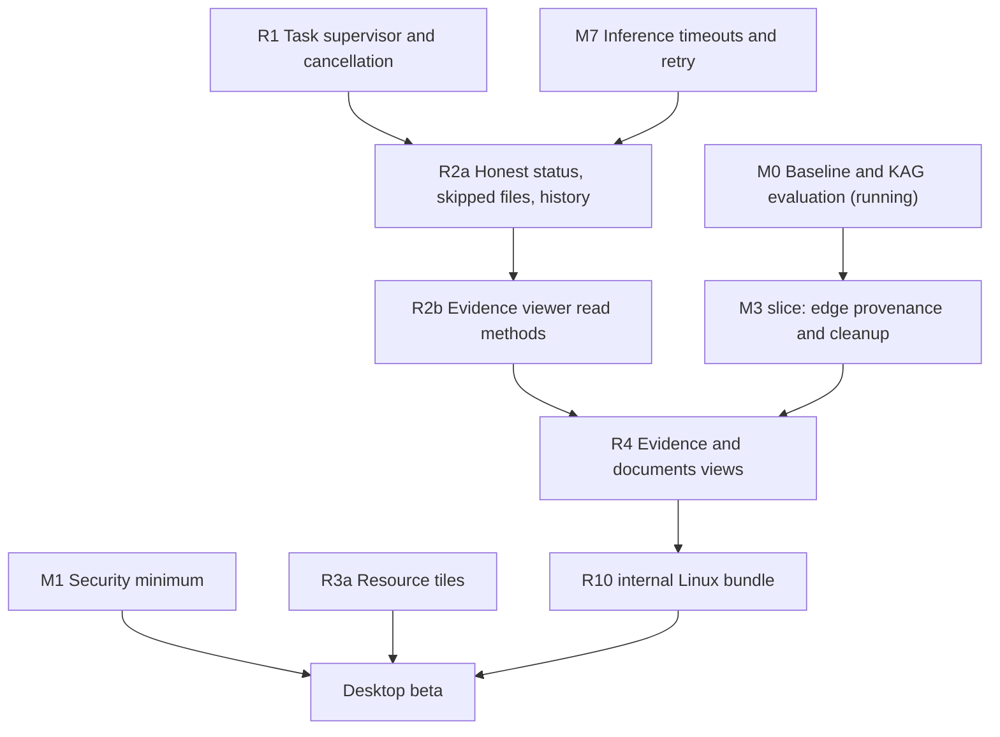

# Docket Product Backlog and Desktop Beta Scope

Status: planning, 2026-11-17. R1 is implemented on branch `r1-tasks` (not merged; scope and cancellation semantics in `RUST_PLATFORM_ARCHITECTURE.md` sections 12.2 and 12.2b); everything else here is not started. M0 (including the running GPU evaluation) is not interrupted by this plan.
Inputs: `docs/PRODUCT_GAP_ANALYSIS.md` (gap ids G01-G20, verified against `rust-app` HEAD `8da99a5`), `docs/COMPETITOR_PAIN_POINTS.md` (complaint ids `C-xx`), `docs/NEXT_PHASE_ROADMAP.md` (M0-M9), `docs/RUST_PLATFORM_ARCHITECTURE.md` (R1-R11).

Preserved without change: SQLite as authoritative store; FTS5 and LanceDB (never removed); KAG-first processing; source versioning and lifecycle; Docling; Rust desktop plus daemon; existing worker protocol compatibility (every protocol change below is additive, optional and `serde(default)`); read-only MCP; fail-closed citation validation; the deterministic fast path; the current M0 evaluation work.

Thresholds written as numbers below (latency, counts, percentages, trial counts) are PROPOSED acceptance thresholds, not measurements; they are to be calibrated on the first measured run and only then fixed.

## 1. Requirements

Priority: P0 = required for the first desktop beta; P1 = needed soon after or for a credible beta; P2 = later. Complexity: S (days), M (about a week), L (multi-week). "Action" is what changes in the existing milestone: retained unchanged, expanded, reprioritized, split, deferred.

| Id | Title | Pri | Cx | Gap | Milestone mapping and action | Depends on | Regression test (arrange / assert) | Acceptance criteria |
| --- | --- | --- | --- | --- | --- | --- | --- | --- |
| B01 | Cancel a running question, release the worker | P0 | M | G01 | R1, retained unchanged (scope per `RUST_PLATFORM_ARCHITECTURE.md` section 12). Fallback: the 12.6b slice | none | Fake worker never answers; cancel via UI/API. Assert response under 3 s, worker pid gone, next question works, restart counter and backoff unchanged; client disconnect frees the permit; deadline gives `TimedOut` | Stop button works 20 of 20 repeats; zero orphan processes; existing `/v1/ask` tests pass unchanged |
| B02 | Answer reads while a question runs | P1 | S | G17 | R1, expanded (fold in; reuse the task registry) | B01 | Fake worker 5 s question; request sources at t+1 s; assert reply under 1 s flagged stale | Library refresh never blocks on a running question |
| B03 | Inference timeouts and bounded retry | P0 | S-M | G02 | M7, retained unchanged; land after the current M0 evaluation batch so long judge runs are not affected (defaults generous, per-gap read timeout rather than a total cap, UNMEASURED for slow CPUs) | none | Fake HTTP server that accepts and never replies: assert typed error within timeout plus 1 s; fail-once-then-ok server returns after one retry; a stalled stream raises | No unbounded wait in embed, generate, stream; configured via setting |
| B04 | Capability-aware health | P0 | S-M | G11 | R2, split: new first slice "R2a" (read-only additive fields, no cooperative cancel). Does not need new milestone. Approved addition: R2a must expose GENUINE health and indexing status, including zero-result and partial-processing states (for example indexed with zero chunks, files parsed but empty, some files processed and some failed), never a constant "ok" | B03 helpful | Refusing-connection Ollama endpoint: status shows `inference_reachable=false` within 2 s; missing model flagged; raising advisory counted | UI never shows a green model state when generation would fail; advisory errors visible, not swallowed |
| B05 | Indexing progress in the desktop | P0 | S-M | G03 | R2a | none | Proto golden test with and without `indexing`; Python `status` returns counts from a scratch queue; UI model: pending files are not labelled "Ready" | Counts equal the queue table at every poll in tests; ETA labelled as estimate; keyword-only vs fully-indexed distinguishable |
| B06 | Skipped and failed files view | P0 | M | G04, G19 | R2a (method) + R4 (view); engine: report "parsed but zero text" as a reason | none | Scratch folder: valid file, password PDF, unsupported ext, corrupt PDF, image-only PDF, 10-byte file; assert every non-indexed file has a reason row and totals reconcile with files discovered | 100% of discovered files are either indexed or listed with a plain reason or counted under a named "not listed" bucket |
| B07 | Follow-up questions (history) | P0 | S-M | G05 | R2a (optional `history` field) | none | Two-turn scripted pair with a fake gateway; second retrieval uses the first's subject; old client without `history` byte-identical; history never appears as a citation | Scripted 10 pairs resolve to the same document in at least 9; original gold unchanged (31 of 33 or better, 0 wrongful abstention) |
| B08 | Abstention reason and warnings in the result | P1 | S | G12 | R2a; related M2 later (do not wait) | none | Scoped-empty source, no-evidence, citation-failure stubs return distinct reasons; old client ignores new fields | UI explains why an answer abstained and offers the next step |
| B09 | Citation location and note passed through | P1 | S | G06 | M7 (already lists the Rust `note` field), retained unchanged; location added | none | Citation for a PDF chunk carries page/section; note round-trips through the proto | Every citation shows location where the parser recorded one |
| B10 | Evidence viewer (full chunk, neighbours, page, original path) | P0 | M | G06 | R2 "evidence.get" (R2b) + R4 evidence view, split: viewer before the rest of R4 | B09 | Chunk outside library or revoked source returns an error, never text; deleted source shows "no longer available" | Every citation opens its chunk; zero cross-boundary reads in tests |
| B11 | KAG edge provenance (located span, source of name) | P0 if KAG is shown, otherwise P1 | M | G07 | M3, expanded (per-edge chunk where the name occurs, char span, name source, extractor version; migration 0019) | M0 KAG gold | Contract with party in chunk 3: edge chunk contains the normalised name and the span slices it; filename-only entity labelled; property test over all edges: `name in chunk_text` or edge marked unlocated | 100% of displayed edges are located or labelled unlocated; M0 KAG metrics not worse (paired) |
| B12 | Purge and supersede remove unreferenced entities; graph doctor | P1 | S-M | G08 | M3, retained; approved addition: M3 must also test that source deletion, revocation, reindexing and interrupted graph updates leave no ELIGIBLE orphan KAG relationships (the strict xfail test remains an acceptance test) | M3 start | Remove the xfail on `test_purge_leaves_no_orphan_entities`; shared-entity case keeps the entity | Strict xfail passes; `docket doctor --graph` reports zero orphans |
| B13 | Filename/party entity resolution, role vs party | P1 | M | G09 | M3/M5 extraction, expanded and gated by the M0 KAG gold (false-merge rate reported) | M0, B11 | "Acme_MSA.pdf" with party "Acme Corporation Ltd." yields one entity; "Acme" vs "Acme Holdings" stay separate | Pairwise precision/recall and false-merge rate published with CIs |
| B14 | KAG relationship explorer (read-only) | P1 | M | G10 | R2b `kag.entities/edges` + R4; deferred until B11 is done | B11, R2 | Every displayed edge opens a chunk containing the name; revoked versions show none | No unlocated edge displayed as fact |
| B15 | Resource tiles (RSS, CPU, loaded model, VRAM, disk) | P0 | M | G14 | R3, split: "R3a" live tiles without persistence (needs no M1 rules) now; "R3b" activity log after M1 | none | Fake sampler returns known values; tiles match; no question text in samples; manual: model residency matches `ollama ps` | Tile RSS within 10% of `ps` for the process tree; warns on a configurable memory threshold; sampler overhead recorded (UNMEASURED) |
| B16 | Security minimum for confidential libraries | P0 before confidential use | L | G15 | M1, retained and reprioritized to precede the beta; per-object encryption stays design-only | none | Data dir created 0700 under umask 022; doctor fails on unencrypted store when policy on; encrypted backup round trip; hostile-chunk gold no regression; eval/feedback outputs 0600 | See section 3 |
| B17 | Linux install bundle (daemon, worker, UI) | P0 for any non-developer beta | L | G16 | R10, split: internal Linux bundle first; signing and auto-update deferred | B01, B04 | Clean VM install without a checkout; uninstall and kill leave no process; upgrade with a running daemon stops it cleanly | Install, ask, quit, no orphan, within one session |
| B18 | Desktop source management (add/remove/pause/reindex) | P1 (beta+1) | L | G13 | R7, retained; deferred past the first beta | M3, R2 | Two concurrent adds: one waits or fails cleanly; removal purges chunks, vectors, graph | Single-writer test and lifecycle tests pass |
| B19 | Persisted desktop history and audit record | P2 | M | G18 | M4 then R3b; deferred | M2, M1 | Restart restores questions; source delete cascades | Metadata-only by default |
| B20 | Multi-select and folder scope in UI | P2 | S | G20 | R4 | B06 | Two selected sources: evidence only from them | Empty scope shows typed reason |
| B21 | Beta release gate suite | P0 | M | all | No new milestone: the checklist in section 3 is the R4/R10 acceptance, run by CI where possible | B01 to B17 | See section 4 | All rows in section 4 pass |

No new milestone is proposed. Every item fits an existing M or R milestone; the only structural changes are SPLITS (R2 into R2a/R2b, R3 into R3a/R3b, R10 into an internal bundle plus later signing/updates) so that reliability and transparency ship before the larger pieces. A "beta release gate" is a checklist, not a milestone.

## 2. Milestone impact summary

| Milestone | Action | Why |
| --- | --- | --- |
| M0 | Retained unchanged; first. No item here edits `eval/` or reruns anything | Baseline is the anchor for B07, B11, B13 acceptance |
| M1 | Retained, reprioritized before any confidential library and before beta | G15; items beyond the minimum stay deferred |
| M2 | Retained; not on the beta path (B08 does not wait for it) | Claim-level verification is independent of the beta |
| M3 | Expanded: per-edge provenance with located span and name source, entity reference counting, filename/party resolution | G07, G08, G09; measured by M0 (about 37% name-in-first-chunk) |
| M4 | Retained, deferred | Persisted history is P2 |
| M5/M6 | Retained, deferred | Planner and relations do not unblock beta; agent stays opt-in |
| M7 | Retained unchanged; Python gateway timeouts land after the current M0 evaluation batch; citation note/location | G02, G06 |
| M8 | Retained; add the resource tiles as its measuring instrument once R3a exists | G14 |
| M9 | Retained; the real-document pilot also checks scan/OCR outcomes (G19) | Not verified today |
| R1 | Retained unchanged; confirmed as the next Rust milestone (section 5); expanded by B02 | G01, G17 |
| R2 | Split: R2a (status capabilities, indexing, skipped report, history, abstention reason, citation note; all additive) and R2b (cooperative cancel, `evidence.get`, `kag.*`, read-only DB enforcement) | G03, G04, G05, G11, G12 are plumbing and ship first |
| R3 | Split: R3a live tiles (no persistence) and R3b activity log (after M1) | G14 |
| R4 | Reprioritized: evidence viewer and documents view first; other views later | G04, G06 |
| R5/R6 | Deferred (tools are read-only; no approval UI needed yet) | No competitor-parity need |
| R7 | Deferred past first beta (CLI ingest stays) | G13; depends on M3 |
| R8 | Deferred (voice) | Not a priority frustration |
| R9 | Deferred (act mode, sandbox) | Not needed |
| R10 | Split: internal Linux bundle for the beta; signing and auto-update later | G16 |
| R11 | Retained, deferred until measured | |

## 3. Smallest useful desktop beta

Goal: beat the competitors on a few frustrations that recur in their issue trackers, not on feature count. Each mandatory feature names the pattern it answers (from `COMPETITOR_PAIN_POINTS.md`).

### 3.1 Mandatory features

1. Reliable interaction (P2 stalls, P9): Stop button and cancel (B01), bounded inference timeouts (B03), reads that do not block (B02), clear error states, worker restart that does not penalise a cancel.
2. Transparent document processing (P1, P3, P4): live indexing progress with keyword-only vs fully-indexed state (B05), capability-aware health (B04), skipped and failed files view with plain reasons and reconciling totals (B06). Ingestion itself stays on the CLI for the first beta (B18 deferred); the desktop shows what the CLI is doing. This is a deliberate tradeoff: it avoids the silent-failure surface that competitors' UI uploaders produce (C-A3, C-L7, C-R4), at the cost of a CLI step.
3. Inspectable evidence and citations (P11): follow-up continuity (B07), abstention reasons (B08), citation location (B09), evidence viewer with full chunk, neighbours and page (B10), fail-closed validation unchanged.
4. KAG relationship provenance (P12, P6): either B11 and B12 are done and the read-only "why this document" panel shows only located edges, or KAG stays flag-off and is not advertised. Do not show unlocated edges as facts.
5. Predictable resource use (P7, P8): resource tiles (B15) with a configurable warning; no capacity claims.
6. Safe and recoverable execution: read-only worker, private socket (existing), security minimum for confidential use (B16), internal Linux bundle with clean stop (B17).

### 3.2 Explicitly deferred

Voice (R8); autonomous investigation, plan timeline, tool approval UI (R5, R6, M5, M6); act mode and sandbox (R9); desktop ingestion and source management (R7); persisted history and audit record (M4, R3b); claim-level verifier (M2); LLM-built graphs; reranker; multi-user access control; Microsoft 365 connector; per-object encryption implementation; auto-update and code signing; Windows and macOS builds; theming and cosmetic work; KAG graph visualisation; capacity claims.

### 3.3 Measurable acceptance criteria (proposed thresholds)

| Area | Criterion |
| --- | --- |
| Cancel | Stop returns the UI to idle within 3 s in 20 of 20 trials on a fake worker and on a real 14b model; zero orphan processes; next question succeeds |
| Stall | A dead Ollama is reported in the status line within one poll (about 5 s) and a stalled generation raises a typed error within the configured timeout plus 2 s |
| Indexing | Desktop counts equal the queue and version tables in 100% of test polls; every discovered file in a 50-file mixed scratch folder is indexed or listed with a reason |
| Continuity | 9 of 10 scripted two-turn pairs retrieve the same document as the stand-alone question |
| Evidence | 100% of citations open a chunk inside the library; 0 reads of revoked, deleted or out-of-scope text; invalid-citation answers still abstain |
| KAG | 100% of displayed edges have a chunk containing the name or are labelled unlocated; orphan-entity test passes |
| Quality guard | Original gold at least 31 of 33 with 0 wrongful abstention after all plumbing changes (the roadmap's regression gate) |
| Resources | Tile RSS within 10% of `ps` for the process tree; idle daemon, UI and worker RSS recorded and published as measured numbers only |
| Install | Clean VM install without a checkout, ask a question, quit, no process left |

### 3.4 Security requirements before confidential documents (M1)

- Encrypted volume requirement for the data directory, checked by `docket doctor` (the store itself is plaintext: `infra/evidence/store.py:40`).
- Data directory created 0700 (today `core/config.py:296` uses the default umask); feedback, backup and eval outputs 0600 (feedback, backup and eval manifest already do).
- Encrypted backups (backup code has no encryption today).
- Fenced untrusted-context block with injection tests; the hostile gold must show no regression (today only an instruction in the system prompt, `prompts/query.py:54,106`).
- Redaction rules before any activity log (R3b) or audit record (M4) stores text.
- Worker is read-only BY CONVENTION ONLY (not enforced): its engine is read-write and start-up may run migrations. Security gap, deferred to M1 (not R2b): enforce at the database level and add a test that a write attempt fails. Until then no code, field name, UI string or doc may describe the worker as read-only enforced. The R2a health probes are read-only by construction (separate `mode=ro` + `query_only` connection) and are tested.
- Keep: no TCP listener, no telemetry code, read-only MCP.
- Until these hold, the beta is for non-confidential or synthetic libraries only.

### 3.4a R2a data-plane semantics (branch r2a-status)

- Health (`health` worker method, `status.v2` daemon capability): sections `process`, `database`, `models`, `indexing`, each with `state` ok|degraded|unavailable|unknown, a closed `code`, the producer's `checked_at_ms`, and daemon-computed `age_ms` and `stale`. Cached data is never shown as current: a section is stale when older than `DOCKET_HEALTH_STALE_MS` (default 3x `DOCKET_HEALTH_INTERVAL_MS`, 15 s) or when its worker process is gone or replaced. `GET /v1/status` never calls the worker; a refresh runs only while no question runs. The daemon's own `worker_process` section (state, restarts, crashes, last error code, responsiveness) is always fresh; `busy` is reported as busy, not as unresponsive.
- Probes are read-only by construction: dedicated `mode=ro` SQLite connection with `query_only`, non-blocking flock probe, and GET-only local Ollama (`/api/tags`, `/api/ps`; no load, no inference). Models: `installed`, `reachable`, `resident` are separate yes/no/unknown facts for the answer and embedding model.
- Accounting units (never mixed, never reconciled across blocks): `versions` = current non-superseded evidence version per file of an ACTIVE source in one read snapshot (`ready` = READY with chunks; `keyword_only`; `empty_ready` = READY/TEXT_READY with zero chunks, anomalous and NOT usable; `pending`; `failed`); `queue` = ingest queue rows (dead-letter COUNT only); `job` = file-result rows of ONE named whole-source job; `history` = superseded versions, kept out of the active equation. `reconciles: true` only when categories are complete, exclusive and read in the same snapshot. Revoked/tombstoned sources get readiness `unavailable` and no `versions` block.
- Unknown is never zero: skipped counts exist only for whole-source jobs. Tiered runs and path-level jobs leave no job or file-result rows, so their skipped history is reported as unknown (`known: false`, reason `no_whole_source_job`). No ingestion records were added.
- A RUNNING job whose writer lock is free is reported `interrupted` (unknown when the lock probe fails). A zero-result indexing source (discovered, nothing usable yet) is `indexing`, never `ready`.
- Privacy: status data carries closed codes and counts only; no paths, document text, failure text, dead-letter text or scope labels.
- Abstention reasons are passed through exactly as the engine records them (scope abstentions only today); where the engine records none the field is absent and the UI shows "not recorded". QueryService and retrieval are unchanged.

### 3.5 Release tests

1. Rust: `cargo test` and `cargo clippy` for all three crates, including cancel, disconnect, deadline, shutdown, replay, golden proto tests (old-client fixture still decodes).
2. Python: unit tests for the gateway timeout, status capabilities, skipped-report method, history plumbing, citation location, KAG edge provenance property test, orphan-entity test (xfail removed).
3. Protocol compatibility: an old daemon binary with the new worker and a new daemon with the old worker both pass `ping`, `status`, `sources.list`, `query.ask`.
4. Scratch-library end-to-end (never a real library, per the standing rule): ingest 50 mixed files, ask, cancel, kill Ollama, kill the worker, restart the daemon; assert recovery and honest state at each step.
5. Evaluation gates: original gold and the M0 KAG gold unchanged within paired CIs.
6. Security checks from 3.4 as automated tests where possible.
7. Manual: screen-reader and IME smoke on the target Linux desktops (egui adequacy is Not established from repository evidence), 8-hour soak with memory samples.
8. Clean-VM install and uninstall.

### 3.6 Dependencies

M0 (baseline and KAG gold) for B07, B11, B13 acceptance; M1 for B16 and R3b; M3 slice for B11 and B12; M7 for B03 and B09; R1 for B01, B02, B17; R2a and R2b for B04 to B10; R3a for B15; R4 slice for B06 and B10; R10 slice for B17. Not required: M2, M4, M5, M6, M8, M9 (M9 is still the real-document confidence check before wider release), R5 to R9, R11.

## 4. Recommended sequence (does not interrupt M0)

| Step | Work | Notes |
| --- | --- | --- |
| 0 (now) | M0 continues; this planning only | No file in `eval/` changes |
| 1 | R1 (B01, B02) | Rust only, fake worker, no GPU; can start beside the M0 tail |
| 2 | B03 gateway timeouts (M7) | After the current M0 evaluation batch finishes so evaluation runs are not affected |
| 3 | R2a (B04 to B09) | Additive protocol fields; touches `interfaces/worker.py`, not `eval/` |
| 4 | M1 minimum (B16) in parallel with step 3 | Required before real documents |
| 5 | M3 slice (B11, B12) after M0 KAG gold is available | Gate on paired KAG metrics |
| 6 | R3a tiles (B15), R2b evidence read (B10) | |
| 7 | R4 evidence and documents views | |
| 8 | R10 internal bundle (B17) then beta gate (B21) | |
| 9 | After beta: R7 (B18), M2, M4, B13/B14, M9 pilot, then M5 and later | M5/M6 stay gated by measurement |

## 5. Single next Rust-platform milestone: R1 (confirmed)

Decision: R1 (task supervisor, cancellation, typed events) remains the next Rust-platform milestone, unchanged in scope, with B02 folded in. Approved and implemented on `r1-tasks` (fake worker only; no GPU, Ollama or model used). B02 (reads while a question runs) is NOT delivered by R1 and stays open.

Evidence for confirming (VERIFIED): the daemon cannot interrupt a question (`app/docketd/src/api.rs:248-250`); the worker is synchronous (`backend/src/docket/interfaces/worker.py:130-131`); the only exit is the 300 s deadline (`app/docketd/src/config.rs:60`) which kills the worker; a second question is rejected meanwhile (`api.rs:216-223`); the design uses no new dependencies, no Python change and no schema change. Competitor evidence points at stalls and forced restarts as a top frustration (C-A6, C-A5, C-O2, C-R4, C-R7), though no competitor complaint was about cancel specifically.

Alternative considered: R2a delivers more visible transparency per day (G03, G04, G11), needs no R1, and could go first. It is rejected as "next" for two reasons: (1) it is Python-plus-proto plumbing across several features and is best run once the event model from R1 exists so that progress and status share one stream (INFERENCE); (2) R1 is the only item that removes a state where the user is stuck. R2a follows immediately. If R1 must shrink, use the 12.6b slice.

## 6. Unmeasured assumptions to resolve

| Assumption | How to resolve |
| --- | --- |
| Ollama stops generating when the client disconnects | NOT established; R1 reports `inference_stopped: unverified`. Measure with real Ollama after the M0 GPU benchmark (procedure in `RUST_PLATFORM_ARCHITECTURE.md` appendix) |
| Proposed timeouts suit CPU-only users | Measure first-token and token-gap on target hardware before fixing defaults |
| Tile sampling overhead and idle footprints | R3a measurement; publish only measured numbers |
| History improves follow-up retrieval on real contracts | B07 scripted pairs, then M9 |
| Docling OCR returns usable text for image-only PDFs | B06 scratch test, then M9 |
| Whether KAG graph helps on non-CUAD documents | M0 paired test, M9 |
| Test suites pass at HEAD | Run them when the GPU evaluation is done (not run in this planning pass) |
