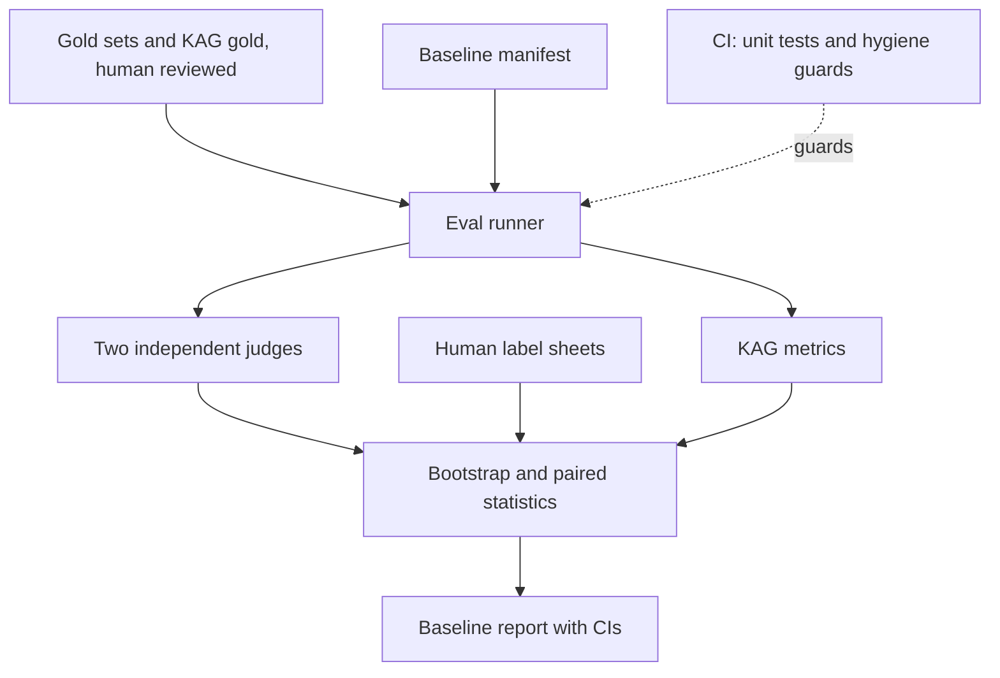

# Docket M0 Implementation Plan: Trustworthy Baseline and KAG Evaluation

Status: planning only (2026-11-17); no implementation started, nothing committed. Scope is M0 only (see `docs/NEXT_PHASE_ROADMAP.md`). Source: `/home/pc/.claude/plans/ok-so-hear-me-functional-hamming.md` ("REVISION 2026-11-17", "M0 detail"). Paths are in the worktree `/home/pc/Desktop/Rajdeep_Dev/Local_Agent-rust` (branch `rust-app`), under `backend/` unless noted.

Safety rules for every M0 test and script: use scratch directories only; never point anything at `~/.local/share/docket` or `~/docket-backup-2026-10-03` (a prior test migrated the live DB). Note `eval/cli.py:24-27` `_eval_dir()` resolves to `Settings().data_dir / "eval"`, which is the real data dir by default; M0 tests must set `data_dir` to a temp path.

## 1. Problem statement

All reported measurements used `qwen3:14b` as both answering model and judge, so every result is self-judged; judge-versus-human agreement (Cohen's kappa, target 0.7) was never measured because no human labels exist; intervals are Wilson only (about +/-12 points on 29 questions) with no bootstrap or question-clustered paired comparison across repeats; there is no CI; and there is no KAG-specific evaluation, so the KAG-lite claim (89.7/93.1/93.1) rests on end-to-end accuracy alone. M0 builds a reproducible, independent, human-anchored baseline so every later claim (KAG, verifier, planner) is measured honestly. M0 changes no retrieval or answer behaviour.

## 2. Existing implementation (verified)

| Area | What exists | Gap for M0 |
| --- | --- | --- |
| `eval/stats.py` (66 lines) | `wilson_interval` L9, `cohen_kappa` L24, `mcnemar_exact` L39, `paired_flips` L51, `pass_majority`, `pass_all` | no bootstrap; no clustering across repeats; no kappa CI |
| `eval/report.py` (402 lines) | `Rate.of` (Wilson) L45; `build_report` L178; `format_report` L364; milestone block requires `population == real_user_documents`, 3 repeats, reviewed questions | no paired section, no judge identity, no run manifest, no KAG metrics |
| `eval/compare.py` | `compare_outcomes` L74 (per-question pass/fail, McNemar), `Comparison.regressed` | per-question majority only; no CI on the difference; no cluster handling |
| `eval/calibration.py` | `sample_runs` L40 stratified; `export_labels` L58; `score_labels` L135; `KAPPA_TARGET = 0.7` L30; `meets_target` requires judge kappa and 2 label classes | strata ignore seeded mutations; labels cover answers only, not KAG items; exports default 30 items (`eval/cli.py:259-269`) |
| `eval/judge.py` | defaults `qwen3:30b` + `gemma3:12b` cross-check (L30-31); `JudgedRun.judge_models` L150; `claims_for` L61; `judge_runs` L209 | judge identity not surfaced in the report; no check that judge is not the answering model |
| `eval/runner.py` | `RunRecord.configuration` set at L346- with models and prompt knobs | lacks doc-layer/KAG flags, code commit, judge, corpus hashes |
| `eval/schema.py` | `RunRecord` L248-294 (full `prompt`, `system`, `retrieved`, `agent_trace`), `fingerprint` L322, `validate_run_keys`; `Question.reviewed` flag L119 | no manifest field; `doc_layer` L292 is a free dict |
| `eval/scoring.py` | deterministic `ContainsCheck`, `CitationCheck`, `EnumerationCheck`, abstention detection L110-112 | no KAG scorers |
| `eval/benchmark.py` | `freeze_benchmark` L34, `verify_benchmark` L60, `corpus_hashes` L22 | freezes gold and corpus only; no flags/model/judge |
| `eval/cli.py` | commands `run` L50, `judge` L100, `report` L146, `compare` L181, `draft` L206, `review` L244, `calibrate export/score` L259/L284, `freeze` L300 | no `manifest`, no KAG commands |
| Gold files | `backend/eval-public/gold*.yaml` (12 sets, 29-55 questions), `gold-cuad-scale.yaml` generated by `eval-public/scale/make_scale_corpora.py` | no `eval-public/kag/` |
| Scale drivers | `eval-public/scale/cuad_scale_curve.py`, `cuad_query_clean.py`, `make_scale_corpora.py`; both curve drivers import `docket` directly and carry an assert against the real data dir (`cuad_scale_curve.py:25`) | the two earlier artifacts (no `python -I` with editable install; one source per document) are recorded in project notes, not enforced by any test: Not established from repository evidence as test-covered |
| Eval tests | `tests/unit/eval/test_eval_{stats,report,calibration,judge,runner,schema,scoring,cli,benchmark,review,draft}.py`, `test_private_eval_kit.py` | no manifest, bootstrap, KAG or lifecycle tests |
| CI | none: no `.github/` directory | add |
| Output handling | `calibrate export` and `RunRecord` JSONL are written with the default umask (`eval/judge.py:287`, `eval/runner.py:458`, `eval/calibration.py:98`); contents include full prompts and retrieved text | 0600 and redaction |
| Private kit | `eval-private/` emits aggregate numbers only | M9, out of M0 scope |

## 3. Proposed design

Tooling only; one new package area under `eval/`, one gold directory, one CI workflow.



Decisions:
- Judge independence: the answering model is never the sole judge; the second local judge is `gemma3:12b` (fits 16 GB); `qwen3:30b` stays excluded on constrained hardware. Reports print judge model names and a self-judging warning when the judge equals `configuration["gen_model"]`.
- Statistics: percentile bootstrap resampling questions (clusters), with repeats nested; paired difference CI over the same question ids.
- KAG evaluation runs against the graph tables directly (no model calls for extraction/resolution/relations/lifecycle metrics), so it is cheap and deterministic.
- All new outputs 0600, directories 0700, and no document text in aggregate reports.

## 4. Data structures and interfaces

All new, Pydantic with `extra="forbid"` like `eval/benchmark.py:13`.

### 4.1 Baseline manifest (`eval/manifest.py`, new)

```python
class BaselineManifest(BaseModel):
    version: int = 1
    code_commit: str            # git rev-parse HEAD, "dirty" suffix if tree dirty
    flags: dict[str, str]       # DOCKET_DOC_ROUTING, DOCKET_FIELD_LOOKUP, DOCKET_FAMILY_LATEST, DOCKET_KAG_SCOPING
    models: dict[str, str]      # gen, embed, rewrite, vision
    judges: list[str]           # primary and cross-check judge model names
    self_judged: bool           # any judge == gen_model
    gold_fingerprint: str       # eval.schema.fingerprint(gold)
    corpus_hashes: dict[str, str]  # eval.benchmark.corpus_hashes
    library_size: int | None
    created_at: str

def build_manifest(settings, gold, corpus, judges) -> BaselineManifest: ...
def write_manifest(m, path) -> None            # O_EXCL, 0600, like freeze
def verify_manifest(m, gold, corpus) -> str    # reuses verify_benchmark logic
```
Integration: `EvalRunner` stores `manifest_fingerprint` inside `RunRecord.configuration` (additive dict key, no schema break); `format_report` prints the manifest header.

### 4.2 Statistics (`eval/stats.py`, extend)

```python
def bootstrap_ci(values: Sequence[float], *, stat=mean, n_boot=10000, alpha=0.05, seed=0) -> tuple[float, float]
def cluster_bootstrap_ci(outcomes_by_question: Mapping[str, Sequence[bool]], *, n_boot=10000, alpha=0.05, seed=0) -> tuple[float, float]
def paired_bootstrap_diff(a: Mapping[str, Sequence[bool]], b: Mapping[str, Sequence[bool]], *, n_boot=10000, alpha=0.05, seed=0) -> tuple[float, tuple[float, float]]
def kappa_ci(a: Sequence[Hashable], b: Sequence[Hashable], *, n_boot=5000, seed=0) -> tuple[float, tuple[float, float]]
def improvement_supported(diff_ci: tuple[float, float], mcnemar_p: float, alpha=0.05) -> bool  # both must agree
```
Seeded for reproducibility; stdlib `random` only (the module is stdlib-only, `eval/stats.py:1`).

### 4.3 Report and compare

- `Report` gains `judge_models: list[str]`, `self_judged: bool`, `manifest: BaselineManifest | None`, per-metric `ci` using `cluster_bootstrap_ci`.
- `compare.Comparison` gains `diff`, `diff_ci`; `format_comparison` prints "improvement" only when `improvement_supported(...)` is true, else "no supported difference".

### 4.4 KAG gold schemas (`backend/eval-public/kag/*.yaml`, loader `eval/kag_gold.py`, new)

Every item carries `reviewed_by: <label>` and `review_status: pending|reviewed`; items with `pending` are excluded from metrics. Labels are human-provided.

```yaml
# entities.yaml  (entity extraction)
- document: contracts/<file>        # corpus-relative path
  entities:
    - {text: "Acme Corp.", kind: party, role: party | mention}
  reviewed_by: <label>
# resolution_pairs.yaml
- {a: "Acme Corporation", b: "ACME Corp", same: true,  type: variant|subsidiary|abbreviation|different}
# relationships.yaml  (document->entity role, amends/supersedes)
- {document: ..., entity: "...", role: party|mention}
- {document: ..., relation: amends|supersedes, target: <document>}
# clauses.yaml  (clause recall and absence)
- {document: ..., clause_type: governing_law, present: true, gold_chunk_spans: ["start text..."]}
- {document: ..., clause_type: non_compete, present: false}
# provenance.yaml  (derived conclusion -> expected evidence)
- {conclusion: "party:Acme Corp@<document>", expected_chunk_span: "..."}
# lifecycle.yaml  (test scenarios, scripted, no labels needed)
- {scenario: modify|supersede|revoke|delete, document: ..., expect: no_stale_graph_rows}
```

### 4.5 KAG metrics (`eval/kag_metrics.py`, new)

```python
def entity_extraction_pr(graph_conn, gold) -> dict   # precision, recall, F1 per document and micro, with cluster bootstrap CI
def resolution_pairwise(graph_conn, gold) -> dict    # pair P/R, false-merge rate
def relationship_correctness(graph_conn, gold) -> dict
def clause_recall_at_k(runner, gold, k, scoping: bool) -> dict   # scoping on vs off, same questions
def clause_absence_pr(graph_conn, gold) -> dict
def provenance_coverage(graph_conn) -> dict          # % graph edges whose chunk resolves to a READY evidence version and whose text contains the entity/clause evidence; reports span-less edges explicitly
def lifecycle_consistency(scratch_runner, gold) -> dict  # scripted events, then asserts no kag_* row points at non-READY/revoked evidence and eligibility excludes it
```
Provenance coverage will report the known limit: entity edges store the document's first chunk (`services/documents/kag.py:235,250`), so "chunk contains entity text" is expected to fail for entities named later than chunk 0; this is a measurement of today's KAG-lite, not a bug introduced by M0.

## 5. Implementation steps (in order)

| # | Step | Files | Expected change |
| --- | --- | --- | --- |
| 1 | CI | `.github/workflows/ci.yml` (new) | jobs: `pytest backend/tests/unit` (no live Ollama; `integration` marker excluded, markers at `backend/pyproject.toml:44`) and `cargo test --workspace` in `app/` (`app/Cargo.toml` workspace). Local equivalent `backend/scripts/ci_local.sh` if Actions are not used. No GPU jobs |
| 2 | Hygiene guards | `tests/unit/eval/test_eval_hygiene.py` (new) | (a) scale drivers contain no `-I` invocation and import `docket` from the installed editable package; (b) scale corpora builder yields one source per document (test on a 3-file tmp corpus via `make_scale_corpora.py` logic); (c) every judged report states judge models; (d) gold and benchmark fingerprints verified before report. Keep these file-content/logic checks; none launches a model |
| 3 | Stats | `eval/stats.py`, `tests/unit/eval/test_eval_stats.py` | add 4.2 functions; tests: known-answer bootstrap on constant data gives a degenerate interval, seed reproducibility, paired diff with identical runs gives 0 and CI containing 0, coverage sanity on simulated binomials |
| 4 | Manifest | `eval/manifest.py` (new), `eval/runner.py` (L346 configuration dict), `eval/cli.py` (new `manifest` command) | 4.1; tests for deterministic fingerprint and refusal to overwrite |
| 5 | Report and compare | `eval/report.py` (`Report`, `format_report`), `eval/compare.py` | 4.3; self-judged warning; "no supported difference" text; update `test_eval_report.py` |
| 6 | Judge independence | `eval/judge.py`, `eval/cli.py` `judge_cmd` (L100) | default to `gemma3:12b` as second judge via `--cross-model`; refuse a judge list equal to the answering model alone unless `--allow-self-judge` (default off); recorded in manifest. Tests with a fake gateway |
| 7 | Calibration upgrade | `eval/calibration.py` | add seeded mutation strata (wrong number, wrong entity, produced from saved answers and clearly marked `synthetic: true`); report `kappa_ci`; label export written 0600 |
| 8 | Output hygiene | `eval/runner.py:458`, `eval/judge.py:287`, `eval/calibration.py:98`, `eval/cli.py:24-27` | open files with 0600, mkdir 0700; add `--redact` for report/label outputs that strips `prompt`, `system`, `retrieved` text, `agent_trace`; aggregate reports contain no document text. Tests check modes in a tmp dir |
| 9 | KAG gold loader | `eval/kag_gold.py` (new) | Pydantic loaders for 4.4, `review_status` filtering, duplicate and corpus-path checks |
| 10 | KAG metrics | `eval/kag_metrics.py` (new), `eval/cli.py` new `kag` command group (`kag eval`, `kag labels export`) | 4.5 against a scratch SQLite built by ingesting a small fixture corpus with KAG on |
| 11 | KAG label-sheet exporter | `eval/kag_gold.py` | see section 7 |
| 12 | Lifecycle tests | `tests/unit/eval/test_kag_lifecycle.py` (new) | scripted modify/supersede/revoke/delete on a scratch corpus; assert no `kag_*` row refers to a removed or non-READY document and retrieval excludes revoked evidence with KAG scoping on. These tests document the current behaviour; if one fails it is recorded as an M3 finding, not fixed in M0 |
| 13 | Re-baseline | `docs/` baseline report (later; not part of this planning step) | run original gold, G6, cuad, cuad-scale, KAG-lite with two judges and human sample, with CIs; this step is the GPU run and happens only after approval |
| 14 | Next-milestone decision | section 10 | pick from the weakest measured metric |

Steps 1-12 are CPU-only unit-level work. Step 13 needs the local model and explicit approval.

## 6. Tests and evaluation cases

| Test | Type | Passes when |
| --- | --- | --- |
| Bootstrap/paired functions | unit | known-answer and seed-stable |
| Report refuses improvement text without paired support | unit | uses `improvement_supported` |
| Manifest records flags incl. `DOCKET_KAG_SCOPING` and judge | unit | fingerprint changes when a flag changes |
| Self-judge guard | unit | refuses by default |
| Output modes | unit | files 0600, dirs 0700 in tmp dir; `--redact` removes `prompt`/`retrieved` |
| Hygiene guards (4 items in step 2) | unit | all pass |
| KAG gold loader | unit | rejects pending items from metrics, bad paths |
| Entity P/R, resolution pairs, relationship, clause recall and absence, provenance coverage | unit on a fixture graph with hand-built gold | exact expected numbers |
| Lifecycle consistency | integration-style on scratch dir (no Ollama; fake embeddings via existing test fakes) | no stale rows or documented failure |
| Cargo tests | CI | `cargo test --workspace` green |

## 7. What needs human labels and how sheets are produced

I cannot invent labels. The user or colleagues must supply them.

| Label set | Size target | Produced by | Human task |
| --- | --- | --- | --- |
| Answer correctness calibration | about 60-100 items stratified (pass, fail, abstain, seeded mutations) | `docket eval calibrate export --n 80` (existing, extended in step 7) | fill `correct: true/false` blind; the sheet omits automatic verdicts (`eval/calibration.py` module docstring) |
| Entity extraction | per-document list for about 30 CUAD + 15 non-CUAD documents | step 11 exports each document's first-page text excerpt plus the system's proposed entities as a pre-filled YAML (`review_status: pending`) | confirm, delete, or add entities; set `reviewed_by` |
| Resolution pairs | about 100 pairs sampled from the graph's near-duplicate entity candidates plus negatives | step 11 | mark `same: true/false` and type |
| Relationship roles and amends/supersedes | about 60 edges | step 11 | mark role correct or not |
| Clause presence and gold spans | about 14 clause types x 20 documents | step 11, seeded from CUAD annotations where licensed (CUAD v1 CC BY 4.0, per `eval-public/gold-cuad-scale.yaml` origin lines) | confirm spans |
| Provenance | about 40 conclusions | step 11 | mark evidence span as supporting or not |

Independence: label by someone other than the person who set the gold item, where possible; record `reviewed_by`. Label sheets contain document text: written 0600 in a scratch directory, never committed. The non-CUAD set (SEC filings or synthetic contracts with different naming) must be chosen by the user; which documents: Not established from repository evidence.

## 8. Performance and security

| Concern | Handling |
| --- | --- |
| Bootstrap cost | 10000 resamples over at most a few hundred questions is milliseconds to seconds in pure Python; cap `n_boot` via flag |
| KAG metrics cost | SQLite queries only; clause recall with scoping on/off needs runs through `QueryService` (GPU-free retrieval only; answering is not required for recall@k) |
| Judge runs | the 14b and `gemma3:12b` judges fit 16 GB class machines one at a time; judging is step 13 only |
| Eval outputs contain full text | `RunRecord` holds `prompt`, `system`, `retrieved`, `agent_trace` (`eval/schema.py:248-290`): 0600/0700, `--redact` for sharing, aggregate-only reports for anything leaving the machine |
| Real data dir | tests and tools refuse the default `~/.local/share/docket` unless explicitly overridden, mirroring the assert at `eval-public/scale/cuad_scale_curve.py:25` |
| No secrets | no connector or token code is touched; CI uses no secrets |

## 9. Rollback and definition of done

Rollback: tooling-only, no migration, no change to `services/` or `core/`. Revert the new files and the small additive edits in `eval/` (or `git revert` the M0 commits, once the user commits them); delete `.github/workflows/ci.yml`. Existing RunRecord and judged JSONL stay readable because new fields are optional.

Definition of done:
1. CI (Actions or local script) runs `pytest` unit suite and `cargo test --workspace` green.
2. Hygiene guard tests present and passing.
3. Bootstrap, cluster-bootstrap, paired-bootstrap and kappa CI functions implemented and tested; every report prints n and CI and refuses "improvement" without paired support.
4. Baseline manifest written for every run; judge identity and self-judging status in every report.
5. Independent judge option works (default second judge `gemma3:12b`); human-labelled calibration sample scored; kappa reported with CI; target 0.7 either met or reported as not met (kappa needs human labels, a user dependency).
6. KAG gold schemas, loaders, label sheets and metrics implemented and unit-tested; KAG metrics (entity P/R, resolution P/R and false-merge rate, relationship correctness, clause recall scoping on/off, clause-absent P/R, provenance coverage, lifecycle consistency) published with CIs on at least CUAD plus one non-CUAD set at 12/50/200/510 where time allows.
7. Current numbers (original gold, G6, cuad, cuad-scale, KAG-lite) re-run with two judges and the human sample, published in a baseline report with CIs.
8. No application behaviour changed (diff limited to `eval/`, tests, gold, CI, scripts); nothing written to the real data directory.

## 10. Feeding the next-milestone choice

| Weakest measured metric | Next milestone |
| --- | --- |
| Unsupported or ungrounded claims, citation grounding, judge-vs-human disagreement on support | M2 claim verifier |
| Provenance coverage low (for example the first-chunk entity edge limit), or lifecycle consistency failures | M3 provenance and incremental consistency |
| Clause recall@k with scoping on not above off, entity extraction poor on non-CUAD, or scoping errors | M5 planner (or extraction work first) |
| Several tied within CI | choose the cheapest, flag-isolated one; do not assume more graph complexity helps |
Security (M1) and inference reliability (M7) run in parallel regardless.
