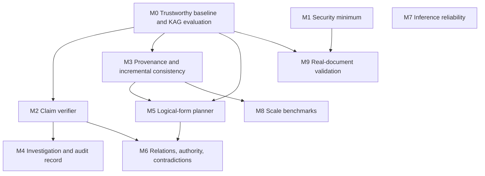

# Docket Next Phase: Roadmap M0-M9

Status: planning only (2026-11-17). Source: `/home/pc/.claude/plans/ok-so-hear-me-functional-hamming.md` ("REVISION 2026-11-17" supersedes the earlier roadmap). Architecture reasoning is in `docs/NEXT_PHASE_ARCHITECTURE.md`; the detailed M0 engineering plan is `docs/NEXT_IMPLEMENTATION_PLAN.md`. Module paths are under `backend/src/docket/` on branch `rust-app` unless stated.

Direction: Docket is KAG-first. KAG-lite (built, flag off) is the foundation, not the final architecture. A-E infrastructure (Docling, SQLite authority, FTS5, LanceDB, versioning, lifecycle, hybrid retrieval, Rust/Python runtime) is preserved; FTS5, LanceDB and hybrid retrieval are never removed. Deterministic reasoning is the baseline; no unrestricted agent framework and no LLM graph extraction until measurements justify them. No capacity claims without benchmarks.

Reference measurements (qwen3:14b answer and judge; 29-question sets, about +/-12 point intervals): clean libraries flags off 72.4 flat, doc layer 86.2/86.2/82.8, KAG-lite 89.7/93.1/93.1 at 12/50/200 contracts; cited-absence rescoring 93.1/96.6/93.1; original gold 31/33 with 0 wrongful abstention; G6 27/29 (control 26/29).

## 1. Milestones

| # | Objective | Dependencies | Files / Modules | Risk | Acceptance criteria |
| --- | --- | --- | --- | --- | --- |
| **M0 (FIRST)** | Trustworthy baseline including KAG-specific evaluation: CI, harness hygiene, bootstrap and paired CIs, independent judge option, human-labelled calibration, KAG gold and metrics, re-baseline with two judges | none | `eval/{stats,report,calibration,schema,runner}.py`, new `backend/eval-public/kag/` gold and label sheets, `.github/workflows` | Low | CI green; independent judge + kappa >= 0.7 measured (human labels required); KAG metrics published with CIs; harness hygiene tests pass |
| M1 | Security minimum before real or sensitive libraries: encrypted-volume requirement and `docket doctor` check, encrypted backups, 0600/0700 audit of data dir, feedback and eval outputs, fenced untrusted-context block with injection tests, redaction rules, per-object encryption design only | none (parallel to M0 tail) | `infra/evidence/store.py`, `services/backup.py`, `prompts/query.py`, `services/query/citations.py`, `services/doctor.py` | Medium | hostile gold no regression; encrypted-backup round trip; doctor flags unencrypted store; no plaintext eval output unless opted in |
| M2 | Claim-level verifier for text claims AND graph-derived conclusions; shadow then enforce; flag `DOCKET_CLAIM_VERIFY`; graph conclusions verified by resolving edge to evidence span to support check | M0 labels | `services/query/claims.py` (new), `services/query/trust.py`, `services/query/service.py` `_finalize_answer` (L1002-1066), `services/documents/kag.py` provenance accessor | Medium | shadow numbers vs human labels; at least 80% of seeded unsupported claims caught; enforce wrongful abstention <= baseline + 2 points |
| M3 | KAG provenance and incremental consistency: per-fact provenance (evidence_version_id, char span, extractor version), graph invalidation on modify/supersede/revoke/delete, consistency checker (`docket doctor --graph`), property tests | M0 | `core/db/models.py` + migration 0019, `services/documents/kag.py`, `services/documents/builder.py`, `services/sources/purge.py`, `services/documents/family.py` | Medium | after any lifecycle event no graph row points to non-READY or revoked evidence; rebuild equals incremental result on test corpora |
| M4 | Investigation and audit record (query sessions, retrieval ops, plan, tool calls, verification, citations); metadata-only by default; retention, redaction, cascade on source delete | M2 | `core/db` + migration, `services/query/service.py`, agent trace callback | Low-Medium | an answer is reproducible from its record; source deletion purges its records |
| M5 | Constrained logical-form planner over KAG (typed schema, validator, deterministic executor, hybrid fallback); only after measurements show where plain scoping fails | M0, M3 | `services/query/planner/` (new), `services/documents/kag.py` executor | High | beats the current scoped path on KAG gold (paired test); otherwise stays flag-off |
| M6 | Relations, authority, contradictions: amends/supersedes/references relations, authority/status (approved, proposed, superseded), cross-document comparison over normalised fields, `AnswerStatus.CONFLICT`; port `multistep.py` (only on branch `acc-step3`) only if measured useful | M5, M2 | `services/documents/`, `services/query/trust.py` | High | labelled contradiction set with precision and recall reported |
| M7 | Inference reliability (parallel, any time): `ollama.Client` timeouts, bounded retry, cancellation, worker cancel on daemon 504; Rust `Citation` `note` field; CI smoke | none | `infra/inference/gateway.py`, `services/agent/graph.py`, worker, `app/docket-proto/src/api.rs` | Low | hang test returns a typed error within N seconds; no orphan generations |
| M8 | Scale: graph build, update and query benchmarks on growing synthetic and real libraries (510-contract CUAD, mixed formats); incremental vs full rebuild cost; ANN eligibility; publish measured limits only | M3 | `backend/eval-public/scale/` drivers | Medium | measured curves; no capacity claims beyond the data |
| M9 | Real-document validation via the private eval kit (2 or more colleagues, aggregate scores only); decide default flags for doc layer and KAG | M0, M1 | `backend/eval-private/` | User dependency | aggregate results returned |

Agent fix: the bounded LangGraph agent underperformed the fast path (26/55 vs 45/55, one run each on one 55-question set; cause diagnosed in `docs/research/upgrade/05-query-understanding-and-retrieval.md` line 132). It is addressed systematically under M5/M6: force plan then `read_range` steps, measure on a multi-document gold set with a paired test, keep opt-in until it wins.

## 2. Dependency graph

M1 and M7 have no upstream dependency and can run beside M0. After M0, the next of M2, M3 or M5 is chosen from the weakest measured metric.

## 3. Development sequence and rationale

| Step | Why here |
| --- | --- |
| M0 first | every later claim (verifier precision, graph gains, planner wins) needs a baseline that is independent of the answering model, human-anchored and statistically honest. Today all reported runs used the 14b model as its own judge, kappa was never measured (no human labels), and there is no CI config |
| M1 beside M0 | security and access boundaries must exist before sensitive libraries are tested (M9); RunRecords hold full prompts and retrieved text |
| Then choose from measured weakness | if claim support or citation grounding is weakest, M2; if provenance coverage or lifecycle consistency is weakest, M3; if clause retrieval on scoping-on is weakest or scoping fails on non-CUAD naming, M5. More graph complexity is not assumed to help |
| M4 after M2 | the audit record consumes the verifier's structured result |
| M5 before M6 and before any autonomous investigation | constrained logical-form planning is introduced before complex autonomous investigation |
| M8 after M3 | scale numbers are meaningless before incremental consistency is established |
| M7 any time | independent, low risk, removes hang risk for long evaluations |

## 4. Risks

| Risk | Mitigation |
| --- | --- |
| 29-question sets give about +/-12 point intervals; apparent gains may be noise | M0 adds more questions or repeats, bootstrap and paired tests; refuse "improvement" text without paired support |
| Human labels are a user dependency (I cannot invent labels) | M0 prepares label sheets; labelling by the user or colleagues is a named blocker for kappa |
| Hardware: independent judge must fit 16 GB class machines | gemma3:12b as second judge; 30b excluded |
| KAG-lite is contract-shaped; may not generalise | non-CUAD gold in M0; real documents in M9 |
| Graph staleness after lifecycle events | M0 lifecycle tests, M3 consistency checker |
| Planner and agent complexity without gain | gated on paired tests; stay flag-off or opt-in |
| Security work deferred too long | M1 is parallel to M0 and a prerequisite to M9 |

## 5. Evaluation strategy

| Element | Plan |
| --- | --- |
| Independent judge | second local judge that is not the answering model; judge identity recorded in every report; self-judging flagged |
| Human labels | about 60-100 stratified items (pass, fail, abstain, seeded wrong-number and wrong-entity mutations) plus KAG label sheets; Cohen's kappa target 0.7 (`eval/calibration.py:30`) |
| Paired statistics | per-question, clustered across repeats; exact McNemar plus bootstrap CI; report n and CI always |
| Scale curves | same metrics at 12/50/200/510 clean libraries (one source per contract), flags off vs doc layer vs KAG-lite |
| KAG metrics | entity extraction precision/recall, entity-resolution pairwise precision/recall and false-merge rate, relationship role correctness, clause recall@k scoping on vs off, clause-absent precision/recall, provenance coverage, lifecycle consistency |
| Regression gates | original gold at least 31/33 with 0 wrongful abstention; G6 at least 28/29 per the plan's default-adoption gate (current G6 is 27/29, control 26/29, so G6 stays a gate to reach, not a current pass) |

## 6. Explicitly deferred

OpenJarvis (a possible later MCP-client trial over the read-only MCP server `interfaces/mcp.py`), DeepAgents (both assessed in `docs/NEXT_PHASE_ARCHITECTURE.md` section 9; neither replaces the evidence model), LlamaIndex, replacing LangGraph, reranker (revisit after the M0 baseline), LLM-built graphs, Microsoft 365 connector (blocked on tenant admin), OS sandbox decision (design notes inside M1), per-object encryption implementation, multi-user access control.

## 7. What would change the order

| Observation | Change |
| --- | --- |
| Kappa between judges and human labels below 0.7 | repeat M0 judge work before anything else; no milestone claims accepted |
| M0 shows lifecycle test failures (stale graph rows reachable) | M3 before M2 |
| Weakest metric is clause retrieval with scoping on, or non-CUAD entity extraction | M5 (or extraction improvements) before M2 |
| Weakest metric is unsupported claims or citation grounding | M2 first |
| Real-document pilot becomes available sooner | pull M1 forward and run M9 early |
| Hangs or timeouts disrupt long evaluation runs | M7 immediately |
| A paired test shows KAG-lite no better than doc layer on non-CUAD data | stop graph growth; improve extraction and gold before M5/M6 |
