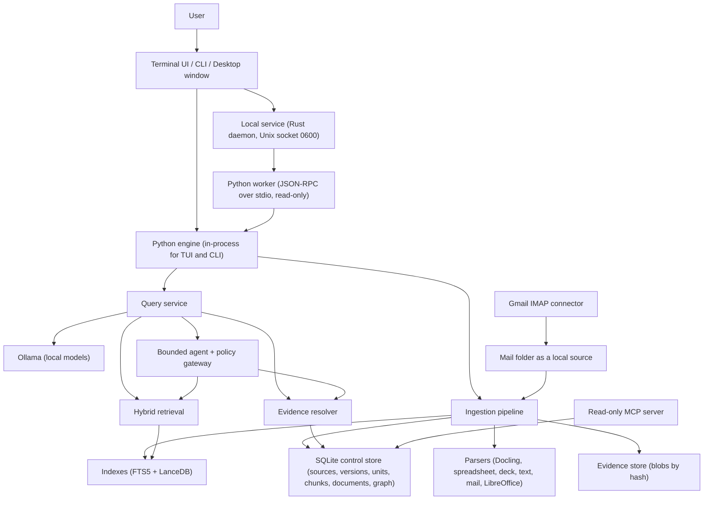
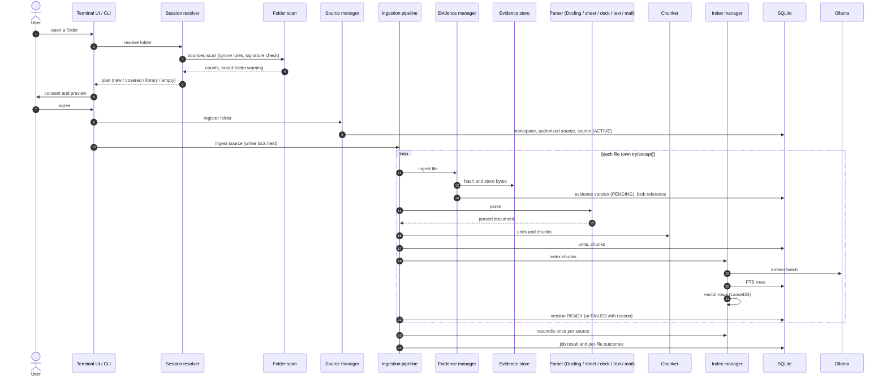
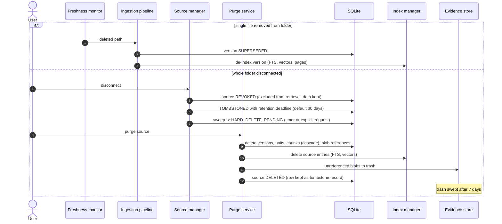
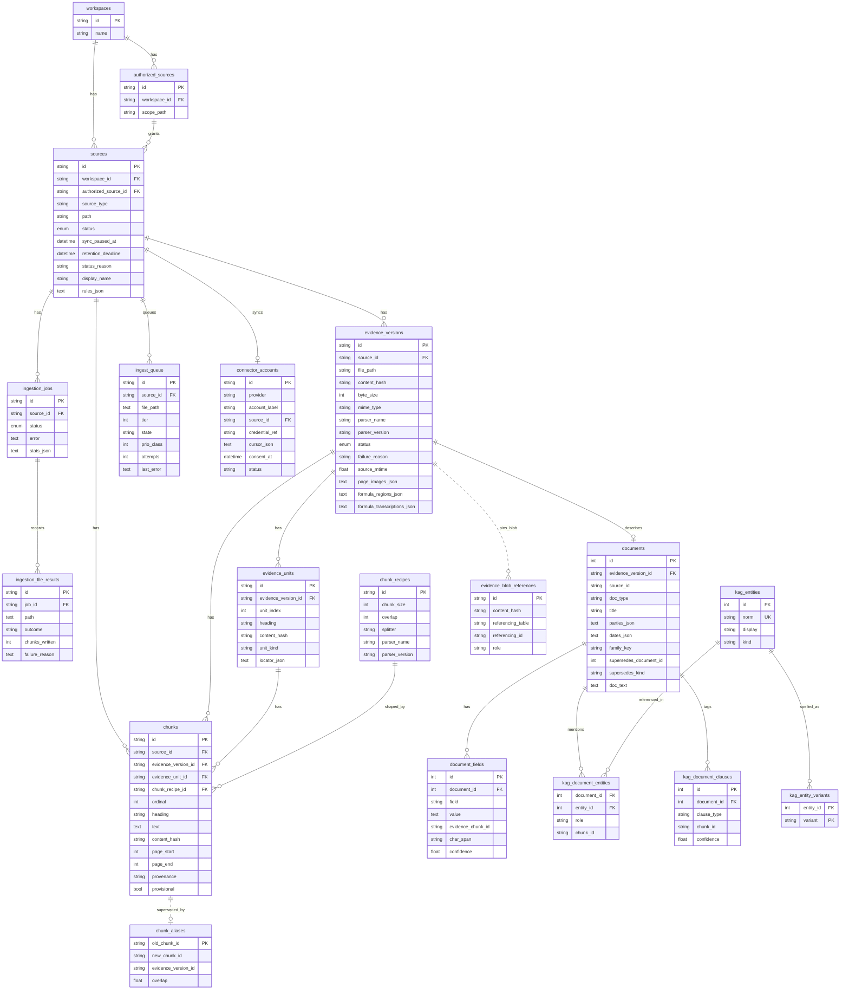
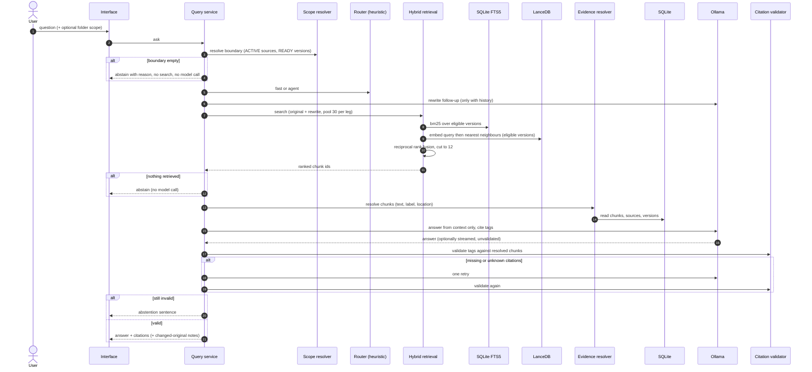
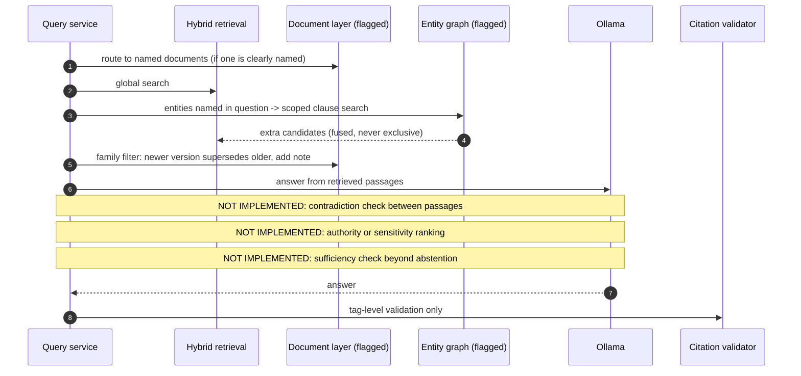

# Docket: Product Knowledge Report

Date of investigation: 2026-11-17. Mode: read-only product discovery and architecture comprehension. Not committed.

**Investigated tree:** `rust-app` branch, worktree `/home/pc/Desktop/Rajdeep_Dev/Local_Agent-rust`, HEAD `b53d5d5` (local, unpushed per project notes). Python engine `backend/src/docket`, Rust workspace `app/` (`docket-proto`, `docketd`, `docket-app`). Design docs: `/home/pc/Desktop/Rajdeep_Dev/Local_Agent/Upgrade/*.md` (docs 00-22, uncommitted). Measured results: `~/docket-eval-results-2026-11-10/`.

**Evidence labels used throughout**
- *Verified fact*: I read the code and found tests or measured result files for it (named in text).
- *Inference*: follows from code or docs but I did not observe it directly.
- *Recommendation*: my opinion, labelled as such.
- Status vocabulary: **Implemented and verified** / **Partially implemented** / **Present but unverified** / **Planned or documented only** / **Not found in the repository**.

**Limits of this investigation (be aware before relying on it)**
- I did not run the test suites. The only Python environment available (`/home/pc/Desktop/Rajdeep_Dev/Local_Agent/backend/.venv`) is an editable install pointing at the stale `main` checkout, so a read-only `pytest --collect-only` against the `rust-app` tree failed with import errors for modules that exist only on `rust-app` (for example `docket.interfaces.worker`, `docket.infra.parsing.legacy_office`). Test pass counts below are therefore *documented* (project notes: 2248 unit tests passing at `b53d5d5`), not re-observed. I counted test definitions by source search.
- I did not run any model, GPU job, or touch `~/.local/share/docket`.
- Web research on OpenJarvis was not performed; every statement about OpenJarvis in section 21 is an inference from its absence in the repository plus general knowledge, and is labelled as such.

---

## 1. Executive summary

**What Docket is.** A local-first, single-user document assistant. You point it at folders; it parses PDF, Word, Excel, PowerPoint, text/Markdown/CSV/HTML, email (`.eml`/`.mbox`) and legacy Office files, stores a copy (or a reference) of each original, builds a keyword plus vector index, and answers questions using a local Ollama model, with every claim carrying a citation that points to a stored passage. When the evidence is not there, it must say "I don't know based on the available evidence." Nothing leaves the machine except optional read-only Gmail IMAP sync.

**What is solid (verified).** Ingestion and versioning with content hashes and a version state machine; SQLite FTS5 plus LanceDB hybrid retrieval fused by reciprocal rank fusion; citation validation that fails closed to abstention; source lifecycle (active, missing, revoked, tombstoned, hard-delete, deleted) with purge and reference-counted blob trash; verified backup and restore; resumable reindex from stored SQLite chunks; a bounded LangGraph agent behind a fail-closed policy gateway; a read-only MCP server; a Rust daemon (`docketd`) supervising a Python worker over a 0600 Unix socket. Measured on the original 33-question gold set: 31/33 (93.9%, 95% interval 80.4-98.3), 0 wrongful abstentions, judge `qwen3:14b`.

**What is partial.** The "document layer" and the "KAG-lite" entity graph are built and flag-gated (default off); they fixed a measured problem on a synthetic contract library (72.4% flat with flags off, to 89.7/93.1/93.1% at 12/50/200 contracts with KAG-lite on). Tiered indexing (fast keyword-first then embeddings) is merged. Streaming answers, reference mode, legacy Office via LibreOffice are merged but only lightly measured. The Rust app (daemon plus egui client, `app/`) is the mainline on branch `rust-app` and is covered by `cargo test`; the egui client itself is thin (chat, library list, status) and not yet launched live.

**What is not there.** Encryption at rest (explicitly `ENCRYPTION_ENABLED = False`), multi-user access control, workspace isolation beyond one implicit workspace, sensitivity/authority labels, contradiction detection, sufficiency checking, claim-level verification (types exist, not connected), a reranker, persisted agent/retrieval sessions or audit log, Microsoft 365 connector (blocked on tenant admin), Docker/CI, LlamaIndex, OpenJarvis, DeepAgents, NemoClaw, OpenShell (none found anywhere in code).

**Important honest finding about the proposed architecture.** The proposal (sections A-G) describes a platform for "evidence-grounded investigation". Today Docket is a very good *cited question-answering* system. Investigation (multi-step cross-checking, contradiction detection, sufficiency checks, authority reasoning) is mostly **planned**. The one agent path that exists scored **26/55 (47%) vs 45/55 (82%) for the fast path**, one run each on one 55-question set; the cause is already diagnosed (a free ReAct loop searched once and read the top hit, with 2 `read_range` and 0 `calculate` calls; `docs/research/upgrade/05-query-understanding-and-retrieval.md` line 132, `docs/research/upgrade/06-reasoning-and-agent-orchestration.md` lines 57-58). A bounded multi-hop module, `multistep.py`, exists only on branch `acc-step3` (worktree `/home/pc/Desktop/Rajdeep_Dev/Local_Agent-acc3`), not on `rust-app`, so routing to it is deliberately conservative.

**Biggest risks to production readiness:** no encryption at rest and plaintext evidence store; the only judge is the same model family that answers (qwen3:14b judging qwen3:14b), on small sets (29-33 questions, about plus or minus 12 points); the 12-200 document curve is synthetic CUAD-derived contracts, not real user documents; semantic citation support is not checked (a valid tag does not prove the claim); no Ollama timeout/retry in the engine; single-writer, single-machine architecture.

---

## 2. Product vision and mission

*Verified from README, `docs/research/upgrade/00`, `docs/research/upgrade/11`, package description ("Local-first, evidence-backed work intelligence assistant", `backend/pyproject.toml`).* Mission: make a person's own documents answerable in plain language, locally, with every statement traceable to a passage, and with honest abstention. Brand history: "Attest" then "Docket" (2026-09-23, project notes). The user's stated direction (this task) is a "local-first document intelligence and evidence-grounded investigation platform"; that is the *target*, not the current state.

**Non-technical explanation (for a customer or investor).** Imagine a careful research assistant that lives on your own computer. You give it a folder of contracts, reports, spreadsheets and emails. It reads them once, keeps an organised copy, and then you can ask it questions in plain English. Every answer comes with footnotes pointing to the exact passage it relied on, and if the documents do not contain the answer it tells you so rather than guessing. Your documents never leave your machine, there is no subscription to a cloud AI, and when you delete a folder the assistant forgets it. Today it is best at "find and quote" questions across a library; deeper "investigate across documents and flag conflicts" is on the roadmap, not in the product yet.

**Technical explanation (for a senior architect joining).** Python 3.12 engine: SQLAlchemy 2.0 + Alembic on SQLite (control store, chunk text, FTS5), LanceDB (vectors), a sha256 content-addressed blob store on disk, Docling plus native openpyxl/python-pptx/text/email readers, Ollama for `qwen3:14b` (generation) and `qwen3-embedding:0.6b` (embeddings), LangGraph + langchain-ollama only for the bounded agent path. Query path: classify (regex heuristic) -> scope -> hybrid retrieval (FTS5 bm25 + vector, optional visual leg, RRF, k=60 default) -> resolve chunks from SQLite -> prompt -> generate -> citation validation with one repair retry -> abstain on failure. A Rust daemon exposes `/v1/status`, `/v1/sources`, `/v1/ask` (SSE) on a Unix socket and supervises a line-delimited JSON-RPC Python worker. Evaluation harness with gold sets, a local judge, Wilson intervals and paired comparison is a first-class part of the repo.

---

## 3. Problem statement

People hold decision-critical knowledge in scattered files (PDF contracts, workbooks, decks, mail) that they cannot or will not upload to a cloud service (confidentiality, compliance, cost). Generic chat over documents hallucinates, cites vaguely, goes stale when files change, and cannot prove where an answer came from. Docket's answer: keep everything local, keep originals and parsed text as the citable ground truth, make citations mechanical (a tag that resolves to a stored chunk), make abstention a first-class outcome, and measure accuracy with a repeatable harness rather than impressions.

*Verified in the repo's own gold-set design and measurements (sections 6 and 17).*

---

## 4. Target users and personas

*Inference from docs 00/01/10/17 and eval corpora; no user research artefacts found ("Not established from repository evidence" for real-user validation: the private eval kit exists so colleagues can run it, but no results from real users are in the repo).*

| Persona | Need | Fit today |
|---|---|---|
| Individual professional with a document folder (legal, finance, engineering) | Ask questions of own files, privately | Primary target; works via terminal UI or CLI |
| Small team member on a Linux workstation with a 16 GB GPU | Same, plus colleagues' documents | Single-user only; no sharing, roles or workspaces |
| Compliance/legal analyst | Find a clause, compare versions | Clause lookup works on contracts (measured); comparison and contradiction detection are not built |
| Developer / agent builder | Read-only evidence tool for another agent | Read-only MCP server exists (verified by unit tests) |
| Enterprise IT (future) | Central deployment, access control, audit | Not served: no auth, no audit log, no encryption |

---

## 5. Real-world use cases (readiness)

Measured numbers: all from `~/docket-eval-results-2026-11-10`, answer model `qwen3:14b`, judge `qwen3:14b` (invoked as `docket eval judge --model qwen3:14b`; the code default judge is `qwen3:30b` with `gemma3:12b` cross-check, `backend/src/docket/eval/judge.py:30-31`, so the reported results are with the *answer model as judge*, a self-judging caveat). 29-33 question sets give about plus or minus 12 points on 95% intervals (for example 27/29 = 93.1% has interval 78.0-98.1).

| # | Use case | Workflow | Components | Readiness today | Missing | Practical limit |
|---|---|---|---|---|---|---|
| 1 | Enterprise document QA | Add folder; ask; read cited answer | All of A-E, fast path | **Works** for single-fact and enumeration on local libraries. Original gold 31/33, 0 wrongful abstention, recall@14 100% (99/99), p50 8.0s p90 13.9s (`base-orig.r14.txt`) | Multi-user, access control, encryption | Single machine, one writer; real-document accuracy unmeasured |
| 2 | Software-architecture knowledge retrieval | Index design docs, markdown, code docs; ask where/why | Text/MD/HTML readers, hybrid retrieval, identifier follow-up | Plausible; no dedicated gold set. Identifier lookup (`BL-102`, "Clause 4.2") exists (`infra/retrieval/id_followup.py`) | Code-aware chunking, cross-reference graph | Not established from repository evidence for code repositories |
| 3 | Requirements-to-test traceability | Link requirement IDs to tests | ID follow-up retrieval, enumeration questions | Partial: enumeration questions measured 9/9 on original gold | No traceability matrix, no link model, no coverage report | Questions answered one at a time |
| 4 | Technical specification comparison | "Compare spec A and B" | Router sends "compare" wording to agent | Agent path measured weaker (47% vs 82%) | Structured comparison, per-document retrieval planning | Not reliable today |
| 5 | Contract and policy analysis | Clause lookup, who/when/governing law | Document layer, KAG-lite, field lookup (flagged) | Best-measured domain: KAG-lite 89.7/93.1/93.1% at 12/50/200 CUAD contracts vs 72.4% flat off (`scale-curves/curve-kag`, `curve-clean-off`), 29 questions | Flags default off; no risk scoring; synthetic/public contracts only | Interval wide; "contains no X clause" answers need the cited-absence scoring |
| 6 | Multi-document research | Ask across many files | Hybrid retrieval, RRF, scope narrowing | Works for questions answerable from a few passages; MuSiQue multi-hop slice builder exists (`gold-musique.yaml`, 30 questions) but I found no results file for it in the results directory | Iterative retrieval planning; synthesis checks | Unmeasured for multi-hop |
| 7 | Compliance evidence discovery | Find evidence for a control | Retrieval, citations, tombstones | Partial: find-and-cite works; no control-to-evidence mapping, no provenance/authority labels | Sensitivity/authority metadata, audit log | No audit trail of who asked what |
| 8 | Financial document investigation | Spreadsheet and report questions | Native xlsx reader, `read_range`, `calculate`, compute stage (flagged off) | Arithmetic tools exist, tested (`test_spreadsheet_tools.py`, `test_compute_stage.py`); FinQA slice exists (`gold-finqa.yaml`, 34) | Measured results for compute stage on real finance docs not found in results dir | Numeric accuracy on CUAD-derived numeric questions 70% (7/10, `cuad.r14.txt`) |
| 9 | Document version comparison | What changed v1 to v2 | Versions stored, family links (`family.py`), "latest wins" note (flagged) | Versions exist; **no diff feature**. Family-latest only prefers the newer doc | Diff and change summary | Version history kept as superseded rows, not exposed as comparison |
| 10 | Contradiction detection | Flag conflicting statements | None | **Not found in the repository.** `AnswerStatus.CONFLICT` and `AbstentionReason.UNRESOLVED_CONFLICT` types exist in `services/query/trust.py` but nothing produces them | Everything | Planned only |
| 11 | Change-impact analysis | What is affected if clause X changes | Entity graph partially | **Not found**; KAG-lite only maps parties and clause types to documents | Dependency/reference graph | Planned only |
| 12 | Autonomous investigation | Multi-step open-ended research | Bounded LangGraph agent | Present but weak: 47% vs 82% measured (doc 18 s9); no memory, no plan mode, no sufficiency check | Planner, sufficiency, cross-check, verifier | The project's own earlier note: "harness agent deliberately not started: earlier bounded agent measured worse" |

---

## 6. Existing capabilities (summary, each verified in its section)

- Folder sources with overlap rules, ignore rules, `.docketignore`, per-source include/exclude.
- Formats: `.pdf`, `.docx` (Docling); `.xlsx` (openpyxl, row chunks with sheet/period context); `.pptx` (python-pptx); `.txt/.md/.csv/.html/.htm`; `.eml/.mbox`; legacy `.doc/.xls/.ppt/.rtf` via headless LibreOffice (`infra/parsing/legacy_office.py`). `.xlsm` refused explicitly.
- Content-addressed storage with refcounted trash, reference mode (do not copy originals; flag changed/missing originals next to citations).
- Incremental ingestion, parse worker pool with timeouts, duplicate reuse, tiered indexing (keyword-ready first).
- Hybrid retrieval, per-leg pool 30 / send 12, optional follow-up rewrite, identifier follow-up, named-file scoping, folder/source query scope boundary.
- Citation-or-abstain generation, bare-citation repair, one retry, streaming (opt-in).
- Bounded agent (4 tools) behind a policy gateway.
- Spreadsheet read-range and a decimal calculator tool.
- Verified backup/restore with atomic directory exchange; resumable reindex; doctor; writer lock; feedback capture (opt-in, redacted).
- Read-only MCP server (3 tools); Gmail IMAP read-only connector.
- Terminal UI (prompt_toolkit/rich, 2,206-line `tui/app.py`), CLI (Typer, 1,260-line `main.py`), Rust daemon + egui app.
- Eval harness: 12 gold YAML files (counts in section 22), local judge, calibration, paired compare.

---

## 7. Proposed capabilities (not existing; from the user's intended direction and docs 19/20)

Planned or documented only: encrypted evidence storage; sensitivity/authority metadata; targeted authoritative-evidence reading as a distinct step; agent-driven multi-step investigation with cross-checking and contradiction detection; sufficiency checks; claim-level verifiers (doc 07, doc 19 section 8); reranker (doc 19 section 6); retrieve-check-escalate to long context (doc 19 section 5); sandboxed agent execution; approval-gated tool access; Microsoft 365 connectors (doc 01, blocked); multi-user/workspaces; OpenJarvis/DeepAgents/NemoClaw/OpenShell integration. See section 25.

---

## 8. Technology stack

| Layer | Technology | Where (verified) |
|---|---|---|
| Language/runtime | Python >= 3.12; Rust 2021 workspace | `backend/pyproject.toml`; `app/Cargo.toml` |
| Parsing | Docling (PDF, DOCX; layout, tables, OCR), openpyxl, python-pptx, stdlib email, LibreOffice headless | `infra/parsing/*` |
| Control store | SQLite via SQLAlchemy 2.0, Alembic (18 migrations), WAL-style pragmas, `busy_timeout`, `synchronous=NORMAL` | `core/db/engine.py`, `models.py` |
| Keyword index | SQLite FTS5 (`fts_chunks`, porter stemming, rowid map `fts_chunk_map`) | migrations 0003, 0011, 0015 |
| Vector index | LanceDB; IVF_PQ ANN above a row threshold; `pages` table for optional visual leg | `infra/index/vector_index.py` |
| Fusion | Reciprocal Rank Fusion, k default 60 | `infra/retrieval/hybrid.py:105` |
| Inference | Ollama (`ollama` Python client); `qwen3:14b`, `qwen3-embedding:0.6b`, optional `qwen2.5vl:7b` | `infra/inference/gateway.py`, `core/config.py` |
| Agent | LangGraph `StateGraph`, `langchain-ollama` `ChatOllama`, `langchain_core` tools | `services/agent/graph.py` |
| Watching | `watchfiles` | `services/sources/watcher.py`, `freshness.py` |
| UIs | prompt_toolkit + rich TUI; Typer CLI; egui/eframe desktop client (mainline `rust-app`, thin) | `interfaces/cli`, `app/docket-app` |
| Service | Rust: axum HTTP over Unix socket, tokio, JSON-RPC to Python | `app/docketd` |
| Tool protocol | MCP stdio (hand-written, not an SDK) | `interfaces/mcp.py` |
| Not present | LlamaIndex, OpenJarvis, DeepAgents, NemoClaw, OpenShell, Docker, CI config, reranker, SQLCipher/encryption library, keyring | searched (see section 14, 18) |

---

## 9. Repository structure

```
Local_Agent-rust/
  README.md                         install via pipx; stale on legacy formats (see section 23)
  backend/
    pyproject.toml                  deps, `docket` console script
    alembic.ini
    src/docket/
      core/        config.py (Settings, env prefix DOCKET_), db/{engine,models,identity,migrations/0001-0018}, privacy.py, writer_lock.py
      infra/       evidence/ (blob store, manager, originals, references, workbook_reader)
                   index/ (fts, vector, manager, manifest, reindex, context, tuning, visual)
                   inference/ (gateway, health)
                   parsing/ (docling_wrapper, chunker, xlsx_*, pptx_*, text_family, mail_family, legacy_office, fast_text, recipes, tokens)
                   retrieval/ (hybrid, resolver, id_followup)
      services/    ingestion/ (pipeline 1738 lines, queue, tiered, parse_pool, ignore, skips, chunk_writer)
                   query/ (service 1164 lines, classifier, citations, scope, signals, compute, trust, latex, routing)
                   agent/ (graph, policy_gateway, tools, calculator, run_context)
                   documents/ (builder, classify, fields, family, routing, lookup, layer, kag)
                   sources/ (manager, scan, session, freshness, watcher, maintenance, prune, purge, resolve, suggest, readiness)
                   connectors/ (base, gmail_imap, service)    backup.py  doctor.py  feedback.py  library_cleanup.py
      interfaces/  cli/ (main, launcher, tui/, interactive/)  worker.py  mcp.py
      eval/        runner, judge, scoring, report, compare, calibration, draft, review, stats
      prompts/     query, agent, judge, vision, draft, shared
    tests/         unit/ (103 files), integration/ (5 files), fixtures
    eval-public/   12 gold YAMLs, corpus builders, synthetic corpora, experiments
    eval-private/  private eval kit for colleagues (aggregate-only)
  app/             Cargo workspace: docket-proto, docketd, docket-app (about 3,164 lines Rust)
  desktop/, spike/ earlier experiments (spike/RESULTS.md validated fast path and policy gateway)
  Docs/            six .docx design docs (PRD, SRS, SAD, TDD, WBS, DB design) + accuracy-evaluation.md, interaction-flow.md
  Upgrade/         docs 00-17 committed; 18-22 and azure status uncommitted (in the main checkout)
```

---

## 10. System architecture



*Verified:* the Rust app never ingests; the worker is documented "read-only ... performs no ingestion and takes no writer lock" (`interfaces/worker.py:1-22`). Ingestion runs in the TUI/CLI process, guarded by an advisory file lock (`core/writer_lock.py`, flock-based, one writer per data dir).

### Proposed architecture A-G classification (summary; detail in sections 11-20)

| Proposed component | Classification | Reality vs proposal and source |
|---|---|---|
| A1 User-selected folders | **Implemented and verified** | `SourceManager.register_source` (`services/sources/manager.py:162`); tests `test_sources_manager.py`, `test_source_resolve.py`, live e2e per project notes |
| A2 Authorized roots | **Partially implemented** | `authorized_sources` table exists, but each registered folder simply creates its own `AuthorizedSource` row with `scope_path = path` (`manager.py:195-199`); it is not a separate grant layer. Broad roots (home, Desktop, Documents) trigger a preview (`services/sources/session.py:85-112`) |
| A3 Directory monitoring | **Implemented and verified** (while the app is open) | `FreshnessMonitor` and `SourceWatcher` (`freshness.py:508`, `watcher.py:32`); explicitly "only alive while the window is open (no daemon; next launch's catch_up covers the gap)". `tests/unit/ingestion/test_freshness_monitor.py`, `test_watcher.py` |
| A4 Hashing/change detection | **Implemented and verified** | streamed sha256 in `ContentAddressedStore.hash_file`; size+mtime pre-filter in `catch_up` (`freshness.py:125`); `EvidenceManager.ingest_file` |
| A5 Versioning | **Implemented and verified** | `evidence_versions` with `VersionStatus` PENDING/TEXT_READY/READY/FAILED/SUPERSEDED (`models.py:71-107`) |
| A6 Deletion/tombstones | **Implemented and verified** | `SourceStatus` machine, retention sweep, purge, blob trash (`manager.py:369-515`, `purge.py:84`, `store.py:188-220`); `test_source_purge.py` |
| B1 Docling parsing/OCR | **Implemented and verified** | `infra/parsing/docling_wrapper.py`; OCR is Docling's built-in OCR with an *experimental* flag to skip OCR when a text layer exists (default off, `core/config.py` `pdf_skip_ocr_with_text_layer`); tests `test_docling_wrapper.py`, integration `test_docling_page_markers_real_pdf.py` |
| B2 Tables/headings/pages/sections | **Implemented and verified** | heading-aware chunker, page markers, `page_start/page_end`, `unit_kind` and `locator_json` (migrations 0005, 0009); `test_chunker.py`, `test_token_cap_chunking.py` |
| B3 Normalized evidence representation | **Partially implemented** | A real, consistent representation exists (`EvidenceUnit` -> `Chunk` with locator JSON and provenance), but it is not a single typed schema for all modalities; spreadsheets/decks/mail each have bespoke chunkers and locators |
| C1 SQLite control store | **Implemented and verified** | `core/db/models.py` + 18 migrations; `test_db_models.py`, `test_db_migrations.py` |
| C2 Encrypted evidence storage | **Not found in the repository** (feature absent) | `infra/evidence/store.py:21-40`: "encryption at rest is NOT implemented"; `ENCRYPTION_ENABLED = False`. No cryptography dependency in `pyproject.toml`. LanceDB, FTS and SQLite are also plaintext |
| C3 Versions, hashes, provenance | **Implemented and verified** | `content_hash`, `parser_name/version`, `chunks.provenance` (default "extracted"), `EvidenceBlobReference` |
| C4 Authority and sensitivity | **Not found in the repository** | `models.py:1-7` docstring: "Trust/sensitivity/multi-user tables are out of scope"; no such columns |
| C5 Tombstone and index states | **Implemented and verified** | source status + version status + provisional chunk flag; `index_manifest.json` guards embedding-model mismatch (`infra/index/manifest.py`) |
| D1 LlamaIndex ingestion pipeline | **Not found in the repository** | zero references in source, tests, config or Upgrade docs (searched `llama_index`, `llamaindex`, `llama-index`). The ingestion pipeline is custom (`IngestionPipeline` class, `services/ingestion/pipeline.py:364`) |
| D2 Structure-aware chunking | **Implemented and verified** | heading-then-sliding-window with token cap 512, table-aware splitting; recipe id `heading_then_sliding_window_tokcap2` (`parsing/recipes.py`) |
| D3 Metadata propagation | **Partially implemented** | file-name/heading prefix is added to indexed text (`infra/index/context.py`); sheet/period context for workbooks; no sensitivity/authority metadata; LanceDB metadata filter limited to `source_id` and `evidence_version_id` |
| D4 Embeddings | **Implemented and verified** | `embed_texts` batch 32, Qwen3-Embedding-0.6B via Ollama, optional query instruction (default off) |
| D5 FTS5 + LanceDB | **Implemented and verified** | `index/fts_index.py`, `index/vector_index.py`; `test_index_fts.py`, `test_index_vector.py` |
| D6 Metadata filtering | **Partially implemented** | pre-filter by eligible version ids and source status; scope by folder/source/named file. No filter by date, type, author, tag |
| D7 Index consistency and rebuild | **Implemented and verified** | `reindex` rebuilds FTS5 and LanceDB from SQLite chunks into scratch tables then swaps; resumable; manifest written last (`infra/index/reindex.py:1-60`); `test_reindex.py` |
| E1 Query understanding | **Partially implemented** | regex `HeuristicQueryClassifier` (fast vs agent); follow-up rewrite by LLM; named-file/period/ambiguity signals (`query/signals.py`). A smarter router is "built and tested but not connected" (doc 18 s18) |
| E2 Source authorization filtering | **Implemented and verified** | retrieval SQL joins `sources.status = ACTIVE` and `evidence_versions.status`; `QueryScope` outer boundary; `read_evidence` refuses out-of-scope chunks (`agent/tools.py`); `test_query_scope.py`, `test_index_version_isolation.py`. Note this is *source-status and scope* filtering, not per-user permissions |
| E3 Hybrid retrieval + RRF | **Implemented and verified** | `hybrid_search` (`hybrid.py:648`); `test_hybrid_retrieval.py` |
| E4 Optional rerank | **Not found in the repository** | no reranker code (doc 19 section 6 proposes one) |
| E5 Top-K | **Implemented and verified** | `default_top_k = 12`, `retrieval_pool_k = 30` (measured E4 experiment) |
| E6 Targeted authoritative evidence reading | **Partially implemented** | agent tools `read_evidence` and `read_range` re-read stored chunk text / original workbook cells (`agent/tools.py`, `workbook_reader.py`); the fast path reads chunk text from SQLite only |
| E7 Evidence bundles with citations/provenance | **Partially implemented** | `ResolvedEvidence` + `format_location` + original-changed notes; no persisted bundle object |
| F1 Agent multi-step investigation | **Partially implemented, weak** | LangGraph agent, 8 iterations / 14 tool calls; measured 47% vs 82% fast (doc 18 s9) |
| F2 Follow-up retrieval | **Implemented and verified** (limited) | agent can re-search; fast path has id follow-up retrieval |
| F3 Cross-checking, multi-doc reasoning | **Planned or documented only** | no cross-check logic; only prompt asks to "give the answer for each" workbook/fiscal year |
| F4 Contradiction detection | **Not found in the repository** | types only (`services/query/trust.py`) |
| F5 Sufficiency checks | **Not found in the repository** | the only sufficiency proxy is "no chunks retrieved -> abstain" and the model's own abstention |
| F6 Verifiable citations | **Implemented and verified** (tag-level) | `validate_citations` (`citations.py:74`); semantic support is *not* verified by the engine (`_finalize_answer` docstring says so) but is scored by the eval judge |
| F7 Abstention | **Implemented and verified** | exact phrase; fail-closed on invalid citations; wrongful abstention 0/99 on original gold; empty-scope abstention with reason codes |
| G1 Local inference via Ollama | **Implemented and verified** | `OllamaGateway` (`gateway.py:253`); `test_inference_gateway.py`, `test_offline_audit.py` (socket audit allows only local Ollama) |
| G2 Sandboxed agent execution | **Not found in the repository** | the "sandbox" is a software allow-list, not OS isolation. The agent runs in-process with the engine's privileges |
| G3 Approved tool access | **Partially implemented** | allow-list and call budget (policy gateway); no human approval flow |
| G4 Filesystem authorization boundaries | **Partially implemented** | agent has no filesystem tool; reads go through the resolver/reader which check scope; but the process itself has full user filesystem rights |
| G5 Read-only authoritative evidence | **Partially implemented** | evidence blobs are never overwritten by queries; MCP uses SQLite `mode=ro` and `PRAGMA query_only`; but no OS-level read-only enforcement or encryption/integrity signing |
| G6 Local-first processing | **Implemented and verified** | offline audit test; only connector sync uses the network |
| G7 OpenJarvis / DeepAgents / NemoClaw / OpenShell | **Not found in the repository** | only a NemoClaw docs URL appears as UI inspiration in `docs/research/upgrade/13-terminal-ui-screen-a-design.md:559` |

---

## 11. Module-by-module explanation

**`core/`** `config.py` (`Settings`, pydantic-settings, env prefix `DOCKET_`; 302 lines) is the single configuration surface: models, context window (`num_ctx=8192`, `num_predict=4096`), flags (`documents_build`, `doc_routing`, `field_lookup`, `family_latest`, `kag_scoping`, `compute_stage_enabled`, `visual_index_enabled`, `reference_mode`, `store_page_images`), tuning (`default_top_k=12`, `retrieval_pool_k=30`, parse workers/timeouts), retention (`tombstone_retention_days=30`, `blob_trash_grace_days=7`). `db/engine.py` applies SQLite pragmas. `writer_lock.py` is a flock-based single-writer lock (nested ownership, other processes wait up to 5 s). `privacy.py` redacts emails, tokens, bearer credentials, PEM keys, URL credentials for logs and explicit exports.

**`infra/evidence/`** `store.py` `ContentAddressedStore` (objects/manifests/quarantine/trash, atomic write, `move_to_trash`, `sweep_trash`); `manager.py` `EvidenceManager.ingest_file` (hash, compare to current version, supersede, store, write blob reference); `references.py` refcounts; `originals.py` `check_original` (reference mode: is the file at the recorded path still the indexed bytes?); `workbook_reader.py` (712 lines) read-only cell/range access from the stored workbook for `read_range`/`calculate`.

**`infra/parsing/`** Docling wrapper (PDF/DOCX; formula-region coordinates retained but formula OCR text deliberately not trusted; page images only when needed); `xlsx_wrapper/xlsx_chunker/xlsx_context` (row chunks with headers, fiscal-year/units context); `pptx_*`; `text_family`; `mail_family`; `legacy_office` (headless LibreOffice with private profile, one conversion at a time, process-group kill on timeout; converted copy never becomes evidence); `fast_text` (tier-1 keyword-only path); `chunker` and `tokens` (token cap 512 using the embedding tokenizer, heuristic fallback); `filecheck` (magic-bytes vs extension).

**`infra/index/`** `IndexManager` fan-outs writes to `FtsIndexWriter` and `LanceIndexWriter`; `manifest.py` records embedding model and dimension and refuses mismatched query/write (`IndexManifestGuard`); `reindex.py`; `vector_index.py` builds an IVF_PQ ANN index once the table passes a row threshold and compacts after ingest.

**`infra/retrieval/`** `hybrid.py` (738 lines): `fts_search`, `vector_search`, `visual_search`, RRF, eligibility filtering with a legacy and a "scalable" mode that avoids giant IN lists; `resolver.py` `EvidenceResolver` turns chunk ids into `ResolvedEvidence` with the single citation-label function `_citation_label` -> `[display_name #chunk_id[:12]]`; `id_followup.py`.

**`services/ingestion/`** `IngestionPipeline` (family routing, per-file try/except, status transitions, duplicate reuse, tier-1/tier-2), `queue.py` persisted priority queue (`ingest_queue`) with backoff and dead-letter, `tiered.py`, `parse_pool.py` (process pool with idle shutdown), `ignore.py` (built-in ignores, `.docketignore`), `skips.py` (non-indexed files with reasons, `sources skipped`), `failure.py` (error condensation).

**`services/query/`** `QueryService` (`ask` at line 366 routes FAST/AGENT; `_ask_fast` 529; `_ask_agent` 1067; `_finalize_answer` 1002), `classifier.py` (regex `_AGENT_PATTERNS`), `citations.py`, `scope.py`, `signals.py` (named-file scope, period ambiguity), `compute.py` (flagged JSON-plan then `calculate`), `trust.py` (types only), `latex.py` (strip LaTeX from answers), `timing.py` (phase timing), `original_notes.py`.

**`services/agent/`** see section 14.

**`services/documents/`** the "document layer": `builder.py` writes `documents` and `document_fields` at ingest (hooked via `IngestionPipeline._document_hook`), `classify.py` (doc type, title, parties, dates), `fields.py` (regex extractors for governing law, renewal term, notice period, audit rights etc.), `family.py` (version families, explicit amendment links), `routing.py` (named-document routing through `fts_documents`), `lookup.py` (deterministic field answer when confident), `layer.py` (query-time orchestration), `kag.py` (KAG-lite entity graph; section 16).

**`services/sources/`** manager and state machine, `scan.py` bounded folder scan, `session.py` folder-first launch and one-time consent in `preferences.json`, `freshness.py`/`watcher.py`, `maintenance.py` (prune -> refresh -> rechunk -> reindex plan), `prune.py`, `purge.py`, `resolve.py`, `suggest.py`.

**`services/connectors/`** read-only mail connector protocol, Gmail IMAP provider, sync service.

**`interfaces/`** `cli/main.py` commands: `ingest`, `query`, `chat`, `status`, `sync`, `reindex`, `watch`, `doctor`, `backup`, `restore`, `mcp`, `worker`, `ui`, `launch`, `sources {add,list,skipped,prune,purge}`, `library clean`, `documents build`, `connectors {guide,add,list,sync,remove}`, `feedback {review,export}`, `formulas {export,score}`, `eval ...`. `worker.py` JSON-RPC (`ping`, `status`, `sources.list`, `query.ask`). `mcp.py` stdio MCP.

**`eval/`** gold schema, runner (ingests a scratch corpus, asks every question), deterministic scoring, LLM judge, report (Wilson intervals, "milestone" gate), paired compare, calibration, draft/review of gold from feedback.

**`app/`** `docket-proto` (API types, JSON-RPC types, UDS client), `docketd` (axum router `/v1/status`, `/v1/sources`, `/v1/ask`; `worker.rs` supervisor with restart backoff, idle ping, per-call timeout; `socket.rs` 0700 dir / 0600 socket, stale-socket cleanup, refuses second daemon), `docket-app` (egui chat, library, status line).

---

## 12. Complete data lifecycle

1. **Discovery.** Folder registered -> files walked with ignore rules and signature checks -> new/changed candidates found by path+size+mtime.
2. **Capture.** sha256 streamed; blob written to the store (or only referenced in reference mode); `evidence_versions` row (PENDING); `evidence_blob_references` row.
3. **Parse.** Per family: Docling, workbook, deck, text, mail; legacy Office converted first.
4. **Normalize and chunk.** `evidence_units` (sections/rows/slides) then `chunks` with recipe id, page span, locator, provenance.
5. **Index.** FTS5 rows, then embeddings -> LanceDB; manifest check.
6. **Publish.** Version -> READY (or TEXT_READY first under tiered indexing, upgraded atomically later). Document layer/KAG rows written by hook when flagged.
7. **Serve.** Retrieval eligible = ACTIVE source AND READY (or TEXT_READY for keyword only).
8. **Change.** New bytes -> new version, old one SUPERSEDED and de-indexed.
9. **Delete.** File gone -> version superseded and de-indexed. Folder removed -> REVOKED -> (user/timer) TOMBSTONED -> HARD_DELETE_PENDING -> purge -> DELETED; blobs to trash then swept after 7 days.
10. **Recover.** `reindex` from SQLite; `backup`/`restore`.

### Flow 1: first-time ingestion (folder selection to indexing)



*Verified in:* `services/sources/session.py` (plan kinds), `services/sources/manager.py:162` (register), `services/ingestion/pipeline.py:811` (`_ingest_one_file`; per-file exception recorded as FAILED with `condense_error`, then re-raised to be caught by the job loop), pipeline docstring (single reconcile per source at end). *Error handling:* unsupported or password-protected files are reported as skipped/failed with a reason (`services/ingestion/failure.py`, `skips.py`), parse timeouts and size caps in the parse pool, root unreachable -> source MISSING (`_check_root_reachable`). Tests: `tests/unit/ingestion/*`, `test_ingestion_job_files.py`, `test_cli_e2e.py` (integration, needs Ollama).

### Flow 2: document update

```mermaid
sequenceDiagram
    autonumber
    participant FS as Folder change
    participant Mon as Freshness monitor / catch-up
    participant Pipe as Ingestion pipeline
    participant Ev as Evidence manager
    participant DB as SQLite
    participant Idx as Index manager
    participant Doc as Document layer hook

    FS->>Mon: file event (debounced) or next-launch scan
    Mon->>Mon: filter by rules; compare size and mtime
    Mon->>Pipe: ingest changed paths
    Pipe->>Ev: ingest file
    Ev->>Ev: stream hash
    alt same bytes
        Ev->>DB: record new mtime only
        Ev-->>Pipe: existing version (no-op if READY)
    else new bytes
        Ev->>DB: old version SUPERSEDED, new version PENDING
        Pipe->>Idx: remove old version entries
        Pipe->>Pipe: parse, chunk, index as in first-time flow
        Pipe->>DB: new version READY
        Pipe->>Doc: rebuild document row and graph edges
    end
```

*Verified:* `EvidenceManager.ingest_file` (`manager.py:72-135`): unchanged bytes return the same row; changed bytes flip the old row to SUPERSEDED immediately and insert a new one. `_drop_superseded_index_entries` removes stale index rows. `ChunkAlias` records old-to-new chunk overlap so old citations can be related to new chunks. Reference mode additionally detects "changed while being ingested". Citations to an older version resolve through stored chunk rows; the CLI/worker add an "original changed or missing" note (`original_notes.py`, commit `1a150b4`).

### Flow 3: document deletion



*Verified:* `pipeline._supersede_deleted_path` (`pipeline.py:1399`), `SourceManager.deactivate_source/mark_tombstoned/request_hard_delete/sweep_expired_retentions` (`manager.py:369-515`), `SourcePurgeService.purge_source` (`purge.py:84`), `ContentAddressedStore.move_to_trash/sweep_trash`. The `DELETED` source row is retained so an old citation can still say "this evidence was deleted on <date>". Tests: `test_source_purge.py`, `test_sources_manager.py`, `test_library_cleanup.py`. Caveat (*inference*): deletion is logical for the SQLite/LanceDB data (freed on compaction/vacuum behaviour I did not verify); the original files on disk are never touched.

---

## 13. Database architecture

SQLite file `<data_dir>/docket.sqlite3`; LanceDB directory `<data_dir>/lancedb`; blob store `<data_dir>/evidence_store`; `index_manifest.json`; `preferences.json`; `feedback/`; `library-writer.lock`. Default data dir `~/.local/share/docket` (override `DOCKET_DATA_DIR`).

**Source of truth.** SQLite (`sources`, `evidence_versions`, `evidence_units`, `chunks`) plus the original bytes in the evidence store. FTS5 and LanceDB are derived and rebuildable. (*Verified:* `reindex` reads `chunks` from SQLite and re-embeds; module docstring.) Chunks themselves can be re-made from stored original bytes (`rechunk_source`, maintenance doc) except in reference mode where originals live outside the store.

**Concepts the user asked about, mapped to the real schema**
| Concept | Reality |
|---|---|
| Users | **Not found.** No users table |
| Workspaces | `workspaces` exists; one implicit "default" workspace (`SourceManager.get_or_create_default_workspace`); multi-workspace explicitly deferred |
| Sources | `sources` (+ `authorized_sources`) |
| Documents | `evidence_versions` (one per file per content); `documents` is the optional document-layer row, 1:1 with a version |
| Versions | `evidence_versions.status` + `source_mtime`, `file_path`, `content_hash` |
| Evidence units | `evidence_units` (section/row/slide with `unit_kind`, `locator_json`) |
| Chunks | `chunks` (text, heading, page span, `provenance`, `provisional`, recipe) |
| Embeddings | **Not in SQLite**: LanceDB `chunks` table (vector + `chunk_id`, `source_id`, `evidence_version_id`); `pages` table for visual leg |
| Index records | `fts_chunks` (FTS5), `fts_chunk_map` (rowid map), `fts_documents`, `index_manifest.json`; `ingest_queue` for tier work |
| Metadata | `documents.parties_json/dates_json/doc_type/family_key`, `document_fields`, `kag_*` tables |
| Permissions | **Not found** (only source status gates retrieval) |
| Agent executions / retrieval sessions | **Not found** (in-memory only; `trace_callback` hook for eval, `RunContext` per ask) |
| Citations | **Not persisted**; derived at answer time from chunk ids; `chunk_aliases` links superseded chunk ids |
| Audit records | **Not found.** `ingestion_jobs` and `ingestion_file_results` record ingestion history; optional opt-in `feedback/items.jsonl` is user feedback, not an audit log |



*The ER diagram is built from `core/db/models.py` (read in full for the class list and columns) and migration 0016-0018 docstrings. Cardinalities marked with dots are logical, not enforced foreign keys (stated in the model docstrings for `evidence_blob_references`; `chunk_aliases` has no FK). FTS virtual tables are omitted.*

**Migrations 0001-0018** (files in `core/db/migrations/versions/`): 0001 evidence core; 0002 `file_path`; 0003 FTS porter stemming; 0004 formula regions; 0005 chunk page span; 0006 page images; 0007 formula transcriptions; 0008 version status (replaced `is_current`); 0009 unit kind/locator/provenance; 0010 source lifecycle + blob references; 0011 FTS version columns; 0012 folder-first names, rules, failure reason; 0013 per-file ingestion results; 0014 connector accounts; 0015 FTS chunk map; 0016 document layer; 0017 tiered indexing (queue, provisional); 0018 entity graph. Tests: `test_db_migrations.py`, `test_db_migration_0012.py`, `test_db_models.py`.

---

## 14. AI and agent architecture

**Which frameworks are actually used (verified by `pyproject.toml` and source search)**

| Framework | Used? | Exact responsibility |
|---|---|---|
| Ollama | Yes | All inference: generation, embeddings, vision description (off by default). `OllamaGateway` (`infra/inference/gateway.py:253`) wraps the `ollama` client; health check and `docket doctor` only contact a loopback host (`services/doctor.py` `local_tags_url`) |
| LangGraph | Yes | Only the agent path: `StateGraph` with nodes `agent`, `gateway`, `force_tool_use` (`services/agent/graph.py`) |
| LangChain | Partly | Only `langchain_core` messages/tools and `langchain_ollama.ChatOllama` for the agent; not used for RAG or retrieval |
| LlamaIndex | **No** | zero references anywhere |
| OpenJarvis, DeepAgents, NemoClaw, OpenShell | **No** | zero references in code or tests |
| MCP | Yes (server only) | `interfaces/mcp.py`: hand-written stdio server exposing `docket_search`, `docket_read`, `docket_list_sources`, all annotated read-only; search is lexical only, "no model gateway"; citation ids are session-local capabilities; output is labelled "untrusted document content". Docket does not consume MCP tools |
| Other | Docling, watchfiles, Typer, prompt_toolkit, rich, SQLAlchemy, Alembic, LanceDB, pyarrow, pydantic | as in section 8 |

**Model selection.** Static, via `Settings`: `gen_model="qwen3:14b"` (locked after measurement, project notes), `embed_model="qwen3-embedding:0.6b"`, `vision_model="qwen2.5vl:7b"` (off). Optional per-purpose overrides `rewrite_model`, `compute_model` (default: generation model). There is no dynamic model router. The TUI model/thinking controls are "display only" (doc 18 s18). Answer sampling: temperature 0.6, thinking on (`answer_think=True`), measured choices documented inline in `core/config.py`.

**How requests reach inference.** `QueryService` -> `InferenceGateway.generate` (fast path) or `ChatOllama.invoke` inside the graph (agent path). Think blocks stripped by `strip_think_block`; streaming uses `ThinkStreamFilter` (`gateway.py:34`). If the server rejects `think`, the gateway retries once without it. **No explicit timeout, backoff or retry for connection failures** in the engine: errors are translated to `InferenceError`/`InferenceUnavailableError`/`ModelNotFoundError` (`gateway.py:96-120`, `_translate_error`). The Rust layer supplies the only deadline (ask timeout 300 s default, call timeout 15 s; hung worker killed and replaced, test `hung_worker_times_out_is_killed_and_replaced`).

**Deterministic vs agent-directed retrieval.** Default is deterministic: `HeuristicQueryClassifier` (`classifier.py:189`) routes to AGENT only when regex patterns match comparison, change-over-time, causal "why", impact tracing, exhaustive enumeration, or cross-document wording; everything else is FAST. The worker (`interfaces/worker.py` `query_ask`) does not pass a mode, so the heuristic decides. Retrieval inside the agent is the same `hybrid_search` stack.

**Agent tools (registered in `build_investigation_agent`, `graph.py:224`)**
1. `search_knowledge(query)` returns chunk ids and scores only (forces a deliberate read step).
2. `read_evidence(chunk_id)` returns chunk text, citation label, location; refuses chunks outside the scope boundary.
3. `read_range(chunk_id, range, sheet)` returns exact workbook cells from the stored workbook.
4. `calculate(operation, refs, round_to)` Decimal arithmetic over cells the tool itself reads; the model names cells, never supplies numbers (`agent/calculator.py`).

**Tool permission enforcement (verified).** Two layers: (a) the model is bound only to `allowed_tools.values()` so it cannot see other tools; (b) `make_policy_gateway` (`policy_gateway.py:41`) rejects any tool name not in the allow-list (returns a "POLICY DENIED" `ToolMessage`, records it in `blocked_calls`) and rejects calls past `max_agent_tool_calls=14`. Evidence: `test_agent_policy_gateway.py`, `test_agent_graph_tool_enforcement.py`, `spike/RESULTS.md` (Case 3 forges a call bypassing the model binding). Bound: `max_agent_iterations=8`, graph `recursion_limit=50`.

**Can the agent touch the filesystem or bypass authorized retrieval?** No filesystem tool exists; the four tools only call `hybrid_search`, `EvidenceResolver`, `WorkbookReader`. `read_evidence`/`read_range`/`calculate` enforce the scope boundary; `_ask_agent` additionally filters resolved citations to the boundary ("belt and braces", `service.py` near 1130). *Inference:* the agent process is not OS-sandboxed; isolation is purely by tool surface.

**Execution state.** Per-ask `RunContext` bound via `ContextVar` (`run_context.py`): follow-up rewrite, scope ids, boundary ids; cleared in `finally`. LangGraph state: messages, iteration count, tool-call count, blocked calls. **No persistent memory**; conversation history is passed in by the UI (`trim_history`), used only to resolve references, never as evidence.

**Tool-call logging.** An optional `trace_callback` receives model calls (messages, response, latency, tool schemas) and an `agent_end` event (`graph.py`, `service.py`); used by the eval harness. There is no persistent tool-call log. Worker logs never carry question/answer text (stated in `worker.py` docstring).

**Failure handling.** Tool exceptions become JSON error objects so one bad argument never crashes the loop; the "force_tool_use" node pushes the model to call `read_evidence`/`read_range` before accepting a final answer (real-data-driven fix, `graph.py` docstring); loop terminates at max iterations with whatever answer exists, which then goes through the same citation validation and abstention.

**Fast-path answer pipeline (the default).** `ask` -> `resolve_scope` -> `_ask_fast`: follow-up rewrite (LLM, thinking off, 128 tokens) -> query signals -> optional document-layer routing/field lookup -> `hybrid_search` -> optional KAG scoping -> `resolve_many` -> id follow-ups -> optional family filter -> token-budget fit (drop lowest-ranked chunks, never cite dropped ones) -> optional period-ambiguity note -> optional compute stage -> generate -> `_finalize_answer` (bare-citation repair, validate, one retry, abstain on residual warnings).

### Flow 4: user question



When the router picks AGENT, the "retrieve, resolve, answer" steps are replaced by the loop: model -> policy gateway -> tool (search/read/range/calculate) -> model ... up to 8 iterations / 14 calls, then citations are rebuilt from the tool-call trace (`_citations_from_agent_messages`, `service.py:169`) and passed through the same `_finalize_answer`.

### Flow 5: multi-document reasoning (contradictions, authority)

**What exists:** multi-document answering is retrieval across the library plus a prompt instruction ("if more than one workbook or fiscal year could match, give the answer for each", `prompts/query.py`), period-ambiguity detection for same-sheet workbooks of different fiscal years (`query/signals.py`), a flagged family-latest rule that drops *older* versions of one document family when a newer one is retrieved and adds a one-line note (`documents/family.py`), and KAG-lite scoping to the named parties. **What does not exist:** contradiction detection, authority ranking, source trust levels. The sequence below marks the real steps and the missing ones.



---

## 15. Document ingestion architecture

**Entry points.** `IngestionPipeline.run_ingestion_for_source` / `run_ingestion_for_paths` (`pipeline.py:495,501,1442,1580`), `ingest_tier1_path` / `ingest_tier2_path` for the tiered queue, `rechunk_version`/`rechunk_source`, CLI `docket ingest`, `docket sync`, TUI controller, maintenance `run`.

**Format routing (`_ingest_one_file`, `pipeline.py:811`).** mail -> `_ingest_one_mail_file`; text family -> `_ingest_one_text_file`; `.xlsx`/`.xls` -> workbook path; `.pptx`/`.ppt` -> deck path; `.pdf`/`.docx` -> Docling; `.doc/.rtf` -> LibreOffice -> DOCX -> Docling. `.xlsm` raises `UnsupportedFormatError`. Legacy conversion unavailable -> "skipped" entry, not failure.

**OCR and tables.** Docling provides layout, tables and OCR for scanned PDFs (default OCR on; optional skip when a text layer exists, off by default, "experimental"). Formula regions are stored as coordinates; VLM transcription of formulas is off by default and never promoted to citable evidence (`core/config.py` comment). Page images are generated only when a consumer (visual index, formula transcription, or the explicit flag) needs them (commit `92300cf`).

**Safety.** magic-bytes check (`filecheck.py`), file size cap 512 MB (`max_file_bytes`), per-file parse timeout 600 s and worker pool (`parse_pool.py`), page cap option, one bad file never aborts the batch, `FAILED` rows hold a condensed reason.

**Tiered indexing (merged).** Tier 1 `fast_text` makes keyword-searchable `TEXT_READY` versions with `provisional=1` chunks (no embeddings); tier 2 replaces them atomically with full chunks. Measured on a fake-inference 300-file corpus: first file searchable at 3.4 s vs 14.4 s for one-pass, total 25.0 s vs 14.4 s (about 1.7x wall for two passes) (`tiered/STEP_TIERED_RESULTS.txt`). That benchmark measures pipeline overhead only, not model cost (its own header says so).

**Idempotency.** Same bytes and READY -> no-op; PENDING/FAILED same bytes -> redriven (`Failed -> Ready`); duplicate content under another path -> parsed chunks and vectors cloned (`_try_clone_duplicate`).

**Mail.** `.eml/.mbox` readers with message evidence and exact locators; Gmail IMAP connector writes `.eml` files into `<data_dir>/connectors/<id>/mail`, which is registered as a normal local source (so the same pipeline, freshness and tombstones apply).

---

## 16. Retrieval and RAG architecture

**Hybrid search (`hybrid_search`, `hybrid.py:648`).** For the question and any extra query (follow-up rewrite): FTS5 `bm25` over `fts_chunks` (query sanitized, porter stemming, number-form expansion so "1,000" and "1000" match), LanceDB vector search over the embedded query, optional visual leg (`pages` table, off), each requesting `pool_k=30`; fused by `reciprocal_rank_fusion` (`hybrid.py:105`, score `1/(k+rank+1)`, k=60 default); cut to `top_k=12`; `flag_provisional` marks keyword-only chunks. Eligibility: ACTIVE source AND READY version for vector/visual; READY or TEXT_READY for keyword (`_FTS_SEARCH_SQL`); filtered *before* the top-k cut so revoked/superseded chunks never occupy a slot. Scoped searches pass `scope_version_ids` into every leg.

**Reranker.** Not found. (Doc 19 s6 proposes one; unmeasured.)

**Metadata filters.** Version/status/scope only. No filters by date, author, type or sensitivity.

**Document layer (flags default off).** `DOCKET_DOC_ROUTING`, `DOCKET_FIELD_LOOKUP`, `DOCKET_FAMILY_LATEST`, `documents_build`. Routing is *additive*: extra candidates from a single strongly named document are appended, never removed. Field lookup answers named-contract field questions deterministically from extracted fields only when routing is unambiguous and confidence >= `LOOKUP_MIN_CONFIDENCE`, and "never claims that something is absent" (`lookup.py` docstring).

**KAG-lite (flag `DOCKET_KAG_SCOPING`, default off).** At ingest, party/corporate names from a document's preamble become shared `kag_entities` with normalised variants; each chunk is tagged with clause types (`kag_document_clauses`); every edge keeps its source chunk id. At query time `plan()` finds entities named in the question by exact variant match, maps them to <= 3 documents and detects the clause asked about; clause-focused search inside those documents is RRF-fused with the global pool (soft scoping). A "clause absent" note cites a real excerpt and forbids the abstention sentence. It is deterministic regex/string logic; there is no LLM graph extraction, no multi-hop traversal, no graph database. It is "KAG" in name only in the sense of a small entity-to-document scoping index; I classify it as **Implemented, measured on synthetic/public contract sets only**.

**Measured accuracy (judge qwen3:14b, answer qwen3:14b, 29-33 questions; intervals are 95% Wilson from the reports)**

| Result | Accuracy | Wrongful abstention | Source file |
|---|---|---|---|
| Original gold (33 q), flags off | 31/33 = 93.9% [80.4-98.3] | 0/99 | `base-orig.r14.txt` |
| Original gold, KAG on | 31/33 = 93.9% | 0/99 | `kag/kag-orig.r14.txt` |
| Original gold, doc layer on | 30/33 = 90.9% [76.4-96.9] | 0/99 | `orig.r14.txt` |
| G6 synthetic contracts (29 q), KAG on | 27/29 = 93.1% [78.0-98.1]; abstention precision/recall 12/12 | 0/75 | `kag/kag-g6.r14.txt` |
| G6, flags off | 26/29 = 89.7% [73.6-96.4] | 0/75 | `kag/off-g6.r14.txt` |
| Clean CUAD library 12/50/200 contracts, flags off | 72.4 / 72.4 / 72.4% | 30.4 / 30.4 / 34.8% | `scale-curves/curve-clean-off` |
| same, doc layer on | 86.2 / 86.2 / 82.8% | 15.2 / 17.4 / 17.4% | `curve-clean-doc` |
| same, KAG-lite on | 89.7 / 93.1 / 93.1% | 4.3 / 4.3 / 4.3% | `curve-kag` |
| same, KAG on with duplicated sources (harness artifact) | 82.8 / 79.3 / 65.5% | 10.9 / 21.7 / 34.8% | `curve-kag-dupes` |
| CUAD 12 contracts (34 q), earlier flags-on run | 28/34 = 82.4% [66.5-91.7]; recall@18 any span 71.4% | not extracted | `cuad.r14.txt` |
| CUAD 12 contracts (34 q), baseline | 25/34 = 73.5% [56.9-85.4]; recall@18 78.6% | not extracted | `base-cuad.r14.txt` |

Caveats that matter: the 12/50/200 curve has 2 repeats at 12 and 1 repeat at 50/200; all 29-question sets carry roughly plus or minus 12 points, so KAG vs doc-layer differences (93.1 vs 82.8) are *not* statistically established (intervals overlap heavily); the earlier "decay with library size" curve (`curve`, `curve-on`) was a harness artifact (`python -I` ignored `PYTHONPATH` so the doc layer never ran, and the curve driver duplicated sources per stage), confirmed by the dupes run reproducing the decay; every report states "Milestone: NOT MET" (population not real user documents, no frozen manifest, judge calibration kappa >= 0.7 missing, no revoked-source or out-of-corpus cases in the test split).

---

## 17. Evidence and citation model

- **Unit of evidence:** a chunk. Id `chk_<sha256>` computed deterministically from content/version identity (`core/db/identity.py`); chunk text is stored in SQLite and is what the model sees and what a citation resolves to.
- **Label:** `[<display name> #<first 12 chars of chunk id>]`, built in exactly one place (`resolver._citation_label`, line 65). The model must copy it verbatim; `repair_bare_citations` re-brackets exact bare labels.
- **Location:** `format_location` composes page range, section heading, sheet/row range or slide number from stored locators; "Open original" (egui) is disabled in the desktop spike.
- **Validation (`citations.py:74`):** abstention iff exact phrase; cited = labels of the resolved chunks appearing as substrings; unknown = bracket-shaped tags matching no resolved label; uncited = non-abstention text with no cited label. `_finalize_answer` allows one regeneration, then abstains if warnings remain (including "cited evidence is no longer available").
- **What validation does not do (verified in `_finalize_answer` docstring):** prove that each claim is supported by its cited passage. Semantic support is evaluated only offline by the eval judge. Claim-level `SOURCED/DERIVED` types, `VerificationStatus` and `AnswerStatus.VERIFIED/PARTIAL/CONFLICT` exist in `trust.py` but nothing consumes them (doc 18 s18: "Types only").
- **Provenance and staleness:** `chunks.provenance` ("extracted"), parser name/version on the version, `ChunkAlias` for superseded chunk ids, reference-mode `check_original` -> "this original changed/moved/missing" note shown next to the citation (commit `1a150b4`, tests `test_reference_mode.py`, `test_original_notes.py`).
- **Authority:** no authority or sensitivity model. The only "which source wins" rule is family-latest (newer document in a family supersedes older, flagged, default off).
- **Persistence:** citations live only in the returned `QueryResult`/JSON-RPC response. The Rust `Citation` struct has `label`, `source_display_name`, `chunk_id`, `excerpt` and **no `note` field**, so changed-original notes do not reach the GUI (project notes, confirmed in `docket-proto/src/api.rs:64`).

---

## 18. Security architecture

| Area | Status | Evidence |
|---|---|---|
| Access control / users | **Missing** | no users table; single local user; `docketd` trusts anything that can open the socket |
| Workspace isolation | **Missing / planned** | one implicit workspace; multi-workspace "deferred" (`sources/manager.py` docstring) |
| Source authorization | **Implemented** (folder-level, local) | registration is explicit; broad roots need consent/preview (`session.py`); overlap rules; REVOKED/TOMBSTONED sources excluded from retrieval (SQL) |
| Query-time scope isolation | **Implemented and verified** | `QueryScope` outer boundary; empty scope never means "everything"; tools refuse out-of-scope reads; tests `test_query_scope.py`, `test_query_run_isolation.py` (per-ask `RunContext` under concurrency) |
| Filesystem permissions | **Partial** | daemon socket dir 0700 and socket 0600 (`docketd/src/socket.rs:75-91`, test `socket_and_directory_permissions`); no explicit permission hardening of the data dir observed (*not established*) |
| Encryption at rest | **Missing (verified absent)** | `ENCRYPTION_ENABLED = False` in `infra/evidence/store.py:40`; "deferred TODO ... OS keychain-backed key + AES-GCM per object" at line 38; SQLite, FTS and LanceDB plaintext; backups are plain zip-like snapshots |
| Key management | **Missing** | no key code |
| Secret handling | **Partial** | Gmail app password read from env var `DOCKET_GMAIL_APP_PASSWORD_<ACCOUNT>`; `credential_ref` stores a reference, not the secret; keyring fallback is a `TODO` (`connectors/base.py:78`); log redaction (`core/privacy.py`) is "conservative pattern redaction", explicitly not complete |
| Prompt-injection defense | **Partial; measured lightly** | system prompts declare retrieved text "content, not instructions" (`prompts/shared.py`, `prompts/query.py`); MCP output labelled untrusted; hostile gold variants (`gold-g4-hostile.yaml`, 7 q; `corpus-synthetic-g4-hostile`); live-Ollama test `tests/integration/test_prompt_injection.py` (needs Ollama; not run by me). Doc 18 says hostile variants "are additional gold data, not proof of prompt-injection immunity" |
| Agent sandboxing | **Missing** | no OS-level sandbox; tool allow-list only |
| Tool restrictions | **Implemented and verified** | policy gateway, call budget, scope checks |
| Local vs cloud data movement | **Implemented and verified** | `test_offline_audit.py` blocks any socket except local Ollama in a fake-gateway run; connector network confined to `ConnectorService.sync`; connector `ReadOnlyImap` allows only EXAMINE, SEARCH, FETCH BODY.PEEK (`gmail_imap.py`, `test_connectors.py`) |
| Audit logging | **Missing** | no security audit log; HTTP request id logging in `docketd` (method, path, status, ms; bodies never logged); ingestion job history only |
| Deletion | **Implemented and verified** | section 12 flow 3 |
| Backup/recovery | **Implemented and verified** | `services/backup.py`: snapshot with verification manifest and sha256, short writer lock, incremental reuse of unchanged originals, restore by atomic Linux directory exchange, rejects symlinks/special files and unsafe paths; `test_backup.py` |
| Feedback privacy | **Implemented** | opt-in (`feedback_enabled=False`), redacted export, reviewed drafts only |

---

## 19. Runtime and deployment architecture

- **Distribution:** `pipx install "git+https://github.com/notSylas/Docket.git@main#subdirectory=backend"` (README). First install pulls several GB (Docling/PyTorch). Requires Ollama with `qwen3:14b` and `qwen3-embedding:0.6b`. README on `main` still says legacy `.xls/.ppt` unsupported, which is stale relative to `rust-app`.
- **Docker/infra:** none (no Dockerfile, compose, systemd unit, or CI config found). Launcher creates a desktop menu entry (`docket install-launcher`).
- **Processes:** TUI/CLI process hosts the engine and is the sole writer (flock). Rust path: `docket-app` (egui) -> `docketd` (HTTP over UDS) -> `docket worker` (Python JSON-RPC, read-only) with exponential-backoff restart, idle ping every 10 s, 120 s startup timeout, one question in flight (semaphore), 64 KiB body limit, 8,000-char question cap.
- **Background work:** no resident ingestion daemon. Freshness watching exists only while a window is open; the Rust daemon performs no ingestion. Maintenance (prune/refresh/rechunk/reindex) is user-triggered with an up-front estimate.
- **Resources:** parse worker count `max(1, min(4, cpus/4))`; Ollama `num_ctx=8192`; per-question latency (original gold): p50 8.0-8.6 s, p90 13.9-14.4 s (dominated by thinking-mode generation). 16 GB GPU assumed (doc 09/19; *inference* for the hardware target).
- **Platform:** Linux-first (flock, `renameat2` directory exchange in restore, Unix socket). Windows/macOS: not established.

---

## 20. External integrations

| Integration | Status | Evidence |
|---|---|---|
| Ollama (local) | Implemented and verified | gateway, doctor, health |
| Gmail IMAP (read-only, app password, folders INBOX/Sent, last 12 months, attachments off by default) | **Implemented, unit-tested; live use partially shown** | `connectors/gmail_imap.py`, `test_connectors.py`; project notes call it "merged" on rust-app; no live-account result in repo (*not established*) |
| Gmail OAuth (`gmail.readonly`) | Planned (documented in `connectors/__init__.py` docstring only) | not found in code |
| Microsoft 365 (Graph: mail, Teams, OneDrive/SharePoint) | **Planned; blocked** | design in `docs/research/upgrade/01`; `Upgrade/azure-connector-setup-status.md`: blocked because the vedya.ai account has no Entra admin role; no MSAL or Graph code anywhere (`grep msal graph.microsoft` only hits a docstring). OneDrive/SharePoint/Teams: no code |
| MCP | Server only, implemented | section 14 |
| Hugging Face tokenizer download | Implemented, optional | `embed_tokenizer`; offline fallback heuristic |
| LibreOffice | Implemented, optional | `legacy_office.py` |

---

## 21. OpenJarvis integration feasibility

*All OpenJarvis statements here are inference; I did not browse the web, and the repository contains no OpenJarvis reference. I therefore treat OpenJarvis as "a local-first agent framework" at the level of assumptions and list what must be verified before any decision.*

**What Docket already has in the agent space:** an in-process bounded LangGraph loop, a fail-closed allow-list gateway, four read-only tools, and an MCP read-only server. It lacks: sandboxed execution, human approval, persistent memory, planning, persistent tool-call logs, multi-agent orchestration.

**Where an agent framework could complement (inference)**
1. *Consumer of the existing MCP server.* Docket's `docket mcp` is already a safe, read-only evidence tool. A framework that speaks MCP could use Docket as its document tool with no change to Docket's trust model. Lowest-risk integration. Trade-off: the MCP search is lexical-only and has no answer synthesis, so quality depends on the framework's own model.
2. *Orchestration/planning layer above the retrieval interface* (the proposed F stage): planning, task decomposition, memory and session logs, tool-call audit. Trade-off: Docket's own measurements show the agent path scoring below the fast path (47% vs 82%), so any planner must be evaluated on the existing gold harness before it is routed to.
3. *Sandbox/runtime (proposed G stage):* if the framework brings process isolation or approval policies, it could close the "no OS sandbox" gap. Trade-off: unverified; an additional runtime means extra dependency weight on a pipx-installed desktop tool.

**What it would replace:** possibly the LangGraph loop in `services/agent/graph.py` (about 284 lines) and the policy gateway if it provides equal fail-closed semantics. I would not replace the gateway until an equivalent forged-tool-call test passes (the spike's Case 3).

**What must stay custom:** source authorization and lifecycle (tombstones, purge, reference counting), the evidence store and version model, citation label construction and validation, scope boundary enforcement, the eval harness and abstention policy. These encode product guarantees no general agent framework provides.

**Redundancy risks:** two tool-registration systems; two sources of truth for session state; duplicated model configuration (Ollama settings are in `Settings` and `ChatOllama` construction); two logging paths. **Recommendation:** do not integrate before (a) an experiment demonstrating a multi-step loop that beats the fast path on a multi-document gold set, and (b) the persistent audit/session tables exist so the framework has somewhere authoritative to write.

The same applies to DeepAgents, NemoClaw and OpenShell: none is present, none is measured; they are candidates for the G stage, not current components.

---

## 22. Current development status

**Recent history (git, 234 commits since 2026-09-21).** Key architectural changes, newest first:
- 2026-11-16/17: legacy Office via LibreOffice (`b50e0a2`), skipped-files report (`c29a7ed`), changed/missing original disclosure (`1a150b4`), reference mode + SQLite pragmas + lighter backup + resumable reindex (`b2515be`, `0a82647`, `36e1f79`, `d838e36`), private eval kit (`aa4c695`), cited-absence scoring (`301d395`), KAG-lite round 1 merged (`6bdfede`, `2a4ab45`, `0ac1705`), streaming answers (`7670dbe`, `3d24b59`).
- 2026-11-09: scale step 1b (rowid-mapped FTS, append-only Lance writes, parse pool, duplicate reuse, page images on demand), tiered indexing (`6375964`), document layer merge (`4a1cf86`, `8492d63`).
- 2026-11-08: Rust workspace and egui app (`7355eef`, `17c21ee`), Python JSON-RPC worker (`56e277a`), Gmail IMAP connector (`c7bbeb3`), retrieval defaults pool 30/send 12 (`e76ac9d`), bare-citation repair (`ee68338`), eval slices CUAD/FinQA/MuSiQue.
- 2026-10-11/12: writer lock and timing, backup/restore, doctor, feedback, MCP, email readers, offline audit.
- 2026-09-21/23: Evidence Core (CP0-CP9), rebrand Attest -> Docket.

**Tests (source counts; passing counts are documented, not re-observed).** Python: 103 unit test files plus `unit/eval` and `unit/ingestion` subfolders (about 1,864 `def test_` in unit and 6 in integration by source count; project notes record 2248 unit tests passing, higher due to parametrization), 5 integration files (marked `integration`, need live Ollama with both models; auto-skipped otherwise): agent graph, CLI e2e, real-PDF page markers, prompt injection, agent routing. Rust: 36 test attributes across the workspace on `rust-app` (14 in `docketd/tests/api.rs`, 6 in `docket-app/src/model.rs`, 16 in `docketd/src` and `docket-proto/src`) (daemon API tests cover SSE ordering, streaming deltas, crash restart, hung-worker timeout, single in-flight, bad input, socket permissions, clean shutdown, second-daemon refusal, missing worker). The egui rendering itself has no automated test (only `docket-app/src/model.rs` logic tests).

**Eval gold sets in `backend/eval-public` (question counts by source search):** original 33; extended 55; G1 numeric 49; G2 Brindle 19 and Tarnwick 25; G4 adversarial 16 and hostile 7; G6 29; CUAD 34; CUAD-scale 29; FinQA 34; MuSiQue 30; routing G5 file. Public-data slices are built by scripts and not committed (`external/` contains a NOTICE and a README placeholder).

**Open items (project notes, 2026-11-17):** Rust `Citation` lacks `note`; streamed draft shows raw citation tags; GUI "Open original" disabled; egui app not launched live; real-document eval kit not yet sent to colleagues; user decision on pushing `rust-app`; absent-clause scorer decision pending; doc-01 M365 blocked.

### Implementation matrix

| Component | Status | Existing files / modules | Evidence | Missing work | Priority |
|---|---|---|---|---|---|
| Folder sources and lifecycle | Implemented and verified | `services/sources/manager.py`, `session.py`, `scan.py`, `purge.py` | `test_sources_manager.py`, `test_source_purge.py`, live e2e (notes) | Per-source permission model beyond folder | Low |
| Ignore rules / discovery | Implemented and verified | `services/ingestion/ignore.py`, `infra/parsing/filecheck.py` | `test_ignore_rules.py` | none noted | Low |
| Change detection and freshness | Implemented and verified | `freshness.py`, `watcher.py`, `evidence/manager.py` | `test_freshness*.py`, `test_watcher.py` | Resident background watcher (only while window open) | Medium |
| PDF/DOCX parsing (Docling, OCR) | Implemented and verified | `infra/parsing/docling_wrapper.py` | `test_docling_wrapper.py`, real-PDF integration test | OCR quality unmeasured on scans | Medium |
| XLSX/PPTX/text/mail readers | Implemented and verified | `xlsx_*`, `pptx_*`, `text_family`, `mail_family` | respective unit tests | Attachments, `.msg`, `.xlsm` | Low |
| Legacy Office via LibreOffice | Implemented, lightly verified | `legacy_office.py` | `test_legacy_office.py`; live e2e with .doc/.xls (notes) | none noted | Low |
| Evidence store + refcount + trash | Implemented and verified | `infra/evidence/*` | `test_evidence_store.py`, `test_evidence_manager.py` | Encryption, integrity signing | High |
| SQLite schema + migrations | Implemented and verified | `core/db/*` | `test_db_*` | Users, audit, sensitivity, authority tables | High |
| Chunking | Implemented and verified | `infra/parsing/chunker.py` etc. | `test_chunker.py`, `test_token_cap_chunking.py` | Semantic chunking not attempted | Low |
| FTS5 + LanceDB + ANN | Implemented and verified | `infra/index/*` | `test_index_*.py`, scale results | Scale beyond measured sizes unverified | Medium |
| Hybrid retrieval + RRF | Implemented and verified | `infra/retrieval/hybrid.py` | `test_hybrid_retrieval.py`; recall@14 100% on original gold | Reranker; metadata filters | Medium |
| Reindex / rebuild | Implemented and verified | `infra/index/reindex.py` | `test_reindex.py` | none noted | Low |
| Fast-path answering | Implemented and verified | `services/query/service.py` | `test_query_service.py`; 31/33 gold | Timeout/retry in gateway | High |
| Citation validation | Implemented, tag-level | `services/query/citations.py` | `test_render_citations.py`, `test_bare_citation_repair.py` | Claim-level semantic verifier | High |
| Abstention | Implemented and verified | `service.py`, `trust.py` | 0 wrongful abstention on original and G6; abstention P/R 12/12 on G6 | Reason-coded abstention connected end-to-end | Medium |
| Bounded agent + policy gateway | Present, enforcement verified, quality weak | `services/agent/*` | `test_agent_*`, spike Case 3; 47% vs 82% (doc 18) | Better planning; evaluation on multi-doc gold | High |
| Spreadsheet tools and calculator | Implemented, unit-verified | `agent/calculator.py`, `workbook_reader.py` | `test_spreadsheet_tools.py` | Measured accuracy on real finance docs | Medium |
| Compute stage (fast path) | Present, flag off | `services/query/compute.py` | `test_compute_stage.py` | Decision on enabling after measurement | Medium |
| Document layer | Implemented, flag off | `services/documents/*` | `test_document_layer.py`, `test_document_fields.py`; 82.8-86.2% clean curve | Default decision; real-document validation | Medium |
| KAG-lite | Implemented, flag off | `services/documents/kag.py`, migration 0018 | `test_kag.py`; 89.7/93.1/93.1% (29 q, wide CI) | Real-document eval; absent-clause scoring decision | High |
| Streaming answers | Implemented, opt-in | `gateway.py`, `worker.py`, `docketd` | `docketd/tests/api.rs` SSE tests | GUI shows raw tags during stream | Low |
| Tiered indexing | Implemented | `queue.py`, `tiered.py`, `fast_text.py` | `test_scale_step1a.py`; tiered benchmark (fake inference) | Real-model benchmark | Medium |
| Backup / restore | Implemented and verified | `services/backup.py` | `test_backup.py` | Encryption of backups | Medium |
| Writer lock / doctor / privacy | Implemented and verified | `core/writer_lock.py`, `services/doctor.py`, `core/privacy.py` | `test_writer_lock.py`, `test_doctor.py`, `test_privacy.py` | none noted | Low |
| MCP server | Implemented and verified | `interfaces/mcp.py` | `test_mcp.py` | Semantic search over MCP, auth | Low |
| Gmail IMAP connector | Implemented, unit-verified | `services/connectors/*` | `test_connectors.py` | Keyring secrets, OAuth | Medium |
| Microsoft 365 connector | Planned only | none (docs only) | `azure-connector-setup-status.md` | Everything; tenant admin action | Medium (blocked) |
| Rust daemon | Implemented and verified | `app/docketd`, `docket-proto` | `docketd/tests/api.rs` (14 async tests) | Auth beyond file permissions; policy layer | Medium |
| Rust desktop app | Partial (mainline `rust-app`, cargo tests) | `app/docket-app` | `docket-app/src/model.rs` (6 tests); workspace `cargo test` | Notes in citations, open original, live validation | Low |
| Eval harness | Implemented and verified | `src/docket/eval/*`, `eval-public/` | `tests/unit/eval/*` | Judge independent of answer model; calibration kappa >= 0.7; real-doc population | High |
| Encryption at rest | Not found | flag constant only | `store.py:40` | Everything | High |
| Users / access control / audit | Not found | n/a | models docstring | Everything | High (for any shared deployment) |
| Reranker | Not found | n/a | n/a | Everything | Medium |
| Contradiction detection | Not found | types only (`trust.py`) | n/a | Everything | High (for the stated vision) |
| Sufficiency checks | Not found | n/a | n/a | Everything | High |
| Sandboxed agent execution | Not found | n/a | n/a | Everything | Medium |
| LlamaIndex / OpenJarvis / DeepAgents / NemoClaw / OpenShell | Not found | n/a | source search | Decision first | n/a |

### Mocked, placeholder, dead or inconsistent items found

- `tui/fake_data.py` (464 lines) and `tui-demo` command: demo/prototype data for the UI (hidden command). `FakeInferenceGateway` is a test double (also used by the tiered benchmark).
- `trust.py`: types and enums with no producers/consumers (doc 18 confirms).
- Smarter query router: "built and tested, original rule-based classifier still routes" (doc 18 s18).
- TUI model and thinking-level controls: display only; "plan mode": unavailable.
- Visual retrieval and formula transcription: built, off by default, unmeasured.
- `ENCRYPTION_ENABLED = False` constant; keyring `TODO` in `connectors/base.py:78`.
- `chunks.provenance` always "extracted" (only value observed); `quarantine/` store dir reserved, "no active logic" (`store.py` docstring).
- `models.py` module docstring ("trimmed-down subset ... Trust/sensitivity/multi-user tables are out of scope") is stale versus the 18-migration schema; `main`-branch README stale on legacy formats; doc 18 says streaming is absent but it is merged on `rust-app`.
- Judge default model in code (`qwen3:30b`, cross-check `gemma3:12b`) differs from the model actually used in all reported runs (`qwen3:14b` via `--model`); results are reproducible only if the same flag is used.
- Environment inconsistency: the shared `.venv` is an editable install of the `main` checkout, so running tests from the `rust-app` worktree with that interpreter fails at collection.
- Two checkouts diverge: the stale `main` tree has uncommitted docs 18-22; code lives only on `rust-app`.

---

## 23. Architectural gaps (against the stated vision)

1. **No authoritative-evidence security layer:** no encryption, no integrity verification of stored blobs beyond content hashes, no sensitivity/authority attributes.
2. **No investigation layer:** no planner, cross-check, contradiction detector, sufficiency judge, or persisted investigation trail. The agent is a retrieval loop with a prompt.
3. **Citation correctness is syntactic.** A claim can be wrong while its tag is valid.
4. **No persisted sessions or audit:** retrieval sessions, agent executions, citations and tool calls are not stored.
5. **Single-user, single-process-writer design:** no workspaces, roles, or network access model.
6. **Metadata model is thin:** filters limited to status/scope; no date/type/author/tag filtering; no cross-document link model (references, supersession only for conservative amendment cases).
7. **Evaluation independence:** judge equals answer model; sets are small; population is synthetic/public; no real-user documents measured.
8. **Operational:** no CI, no Docker, no resident background service; Linux-only assumptions.
9. **Rust/Python seam:** the daemon is read-only; ingestion and freshness live in the Python TUI process; the GUI cannot ingest or manage sources.

---

## 24. Technical risks

| Risk | Basis | Severity (qualitative) |
|---|---|---|
| Plaintext evidence on disk | `ENCRYPTION_ENABLED=False` | High for sensitive or shared machines |
| Over-trust in measured accuracy | self-judged, small n, synthetic corpora, "Milestone: NOT MET" in every report | High |
| Flag-gated features (doc layer, KAG) not default | `core/config.py` defaults "off"; real-document behaviour unknown; earlier combined KAG+doc flags regressed to 72-79% in round 2 (project notes) | Medium-High |
| Prompt injection residual risk | prompt-level defense only, small hostile set | Medium |
| LLM call without timeout/retry in engine | `gateway.py` | Medium |
| Agent path quality | 47% vs 82% | Medium (mitigated by conservative routing) |
| Ollama/model drift | answer model locked to `qwen3:14b`; judge, embeddings share runtime; embedding-model change requires full reindex (manifest guard prevents mixed spaces) | Medium |
| Concurrency | advisory flock only coordinates cooperating Docket processes (backup docstring) | Medium |
| Scale | measured pipelines up to hundreds of docs/contracts; ANN, compaction and tiered indexing exist, but large-corpus latency on real hardware beyond measured scale: Not established from repository evidence | Medium |
| Dependency weight | Docling pulls PyTorch; multi-GB install | Medium (distribution) |
| Single-maintainer / documentation drift | multiple stale docs and docstrings noted in section 22 | Low-Medium |

---

## 25. Recommended roadmap (recommendations, not facts)

Principle: do not redesign before the current design is validated on real documents.

1. **Validate before extending.** Run the existing private eval kit (`backend/eval-private`) with 2-3 colleagues on real documents, flags off vs KAG on (aggregate scores only). Add an independent judge (a different model family, or the code default `qwen3:30b` with the `gemma3:12b` cross-check) and complete judge calibration (kappa >= 0.7) so the milestone gate can ever pass.
2. **Close the trust gap cheaply.** Add a per-sentence grounding verifier (doc 19 s8 candidate) behind a flag and measure on the existing gold sets; connect the `trust.py` types only after it works.
3. **Persist an audit trail.** New tables for query sessions, retrieval results (chunk ids and scores), tool calls and citations; reuse the `trace_callback` hook. This is a prerequisite for any investigation or compliance use case and for any agent framework integration.
4. **Encryption at rest.** Implement the documented plan (OS-keychain key, per-object AES-GCM) for the blob store, then decide on SQLite/LanceDB encryption or documented full-disk-encryption guidance; include encrypted backups.
5. **Decide the flag defaults** for document layer and KAG after step 1; resolve the absent-clause scoring decision.
6. **Add Ollama timeouts and bounded retry** in the gateway.
7. **Investigation features in measured steps:** (a) retrieve-check-escalate (doc 19 s5), (b) multi-document comparison with per-document retrieval, (c) contradiction detection between cited passages, only then (d) a planner/agent framework, evaluated on a new multi-document gold set against the fast path.
8. **Product surface:** make the Rust app useful (citation notes, open original, source management) or formally park it; keep CLI/TUI as primary.
9. **Reranker experiment** (doc 19 s6) as a measured, flagged step.
10. **Deployment hygiene:** CI running the unit suite on `rust-app`, packaging for the daemon, and fixing the stale README/doc statements.

---

## 26. Product differentiation

*Inference, grounded in verified behaviour.* (1) Truly local: offline audit test proves no network use outside local Ollama in query/ingest. (2) Mechanical citations with fail-closed abstention and a measured wrongful-abstention rate, not just "citations shown". (3) Real lifecycle semantics: versions, supersession, tombstones, hard-delete purge, reference-counted blobs, reference mode that discloses changed originals. (4) A genuine eval culture: gold sets, repeats, intervals, paired comparison, harness-artifact discovery and honest "not met" gates. (5) Deterministic contract-oriented layer (document fields, family-latest, entity scoping) that gave a measured lift without LLM graph extraction. (6) A read-only MCP interface that lets other agents use the evidence store safely. Not a differentiator yet: contradiction/investigation, enterprise security, connectors breadth.

---

## 27. Open technical questions

- Does KAG-lite's lift hold on real, messy, non-CUAD documents? Not established from repository evidence.
- Judge agreement: how does a different-family judge or human calibration change the reported accuracies? Not established from repository evidence.
- Why did the combined document-layer plus KAG flags regress in round 2, and is the absent-clause scorer the real cause? (Open in project notes.)
- Real-hardware latency and memory at thousands of documents with ANN + compaction: Not established from repository evidence.
- Is the 47% vs 82% agent gap due to the model (qwen3:14b tool-calling), the tools, or the question mix? Doc 18 states the numbers; I found no per-question breakdown in the results directory.
- What is the intended multi-user or team model (workspaces vs per-user data dirs)? Not established from repository evidence.
- Does deletion fully remove data from SQLite free pages and LanceDB versions (compaction/vacuum behaviour)? Not verified.
- Windows/macOS support intent. Not established from repository evidence.
- MuSiQue and FinQA slice results: builders and gold exist; I found no result files for them in `~/docket-eval-results-2026-11-10`.
- Whether OpenJarvis (or any named agent framework) offers sandboxing/approval/MCP-client features that fit; requires web research not done here.

---

## 28. Final architectural assessment

**Readiness assessment (qualitative, evidence-backed; no numeric ratings)**

- **Functional completeness:** strong for cited Q&A and library management; incomplete for the stated "investigation platform" (no contradiction, sufficiency, authority, audit).
- **Architecture quality:** clean separation (core/infra/services/interfaces), protocol-based gateways (`InferenceGateway`, `QueryClassifier`, `Connector`), additive flag-gated features, well-documented decisions in docstrings; some oversized modules (`pipeline.py` 1,738 lines, `tui/app.py` 2,206, `main.py` 1,260, `service.py` 1,164).
- **Security:** careful on scope isolation, tool restriction, read-only connectors/MCP, offline discipline; deficient on confidentiality (plaintext), identity, audit, sandboxing.
- **Reliability:** strong lifecycle and recovery design (atomic swaps, resumable reindex, verified backup, writer lock, per-file failure isolation, supervised worker restarts); gateway lacks timeouts/retries.
- **Scalability:** engineered and measured in steps (rowid-mapped FTS, append-only Lance writes, ANN, compaction, tiered indexing); measured scale is modest and mostly synthetic; single machine.
- **Performance:** typical answer 8-9 s p50, 13-19 s p90 with thinking on (measured); ingestion cost dominated by Docling; tiered mode improves time-to-first-searchable.
- **Local inference efficiency:** one 14B model plus a 0.6B embedder; thinking-on chosen by measurement; context fitting by dropping lowest-ranked chunks.
- **Retrieval accuracy:** recall@14 100% on the original gold; recall@18 71-79% on the harder CUAD slice; retrieval misses were reported as about 70% of failures (doc 19).
- **Citation correctness:** mechanical correctness strong (tags resolve, unknown tags rejected); semantic support unverified in production.
- **Observability:** phase timings, HTTP request ids, job history, doctor; no persistent query/tool trace.
- **Maintainability:** high docstring discipline and large test suite; documentation drift across branches.
- **Test coverage:** broad unit coverage (about 1,900 unit test definitions), few live-model integration tests (5 files), no automated egui rendering tests, no CI configuration found.
- **Deployment readiness:** acceptable for a technical single user on Linux via pipx; not ready for non-technical or multi-user or regulated deployment.

**Most important risks to production readiness:** (1) plaintext data and no identity/audit; (2) accuracy claims rest on small, synthetic, self-judged sets; (3) citation validity is syntactic; (4) the agent/investigation tier is unproven; (5) operational maturity (CI, packaging, timeouts, platform breadth).

**Bottom line.** Docket is a coherent, unusually well-measured local cited-QA engine with strong lifecycle and honesty properties. The proposed architecture A through E is largely real; F (investigation) and the security half of C and G are mostly proposal. The shortest credible path to the stated vision is: validate on real documents with an independent judge, add the audit trail and a grounding verifier, add encryption, and only then introduce planning or an external agent framework, with each step gated by the existing eval harness.
